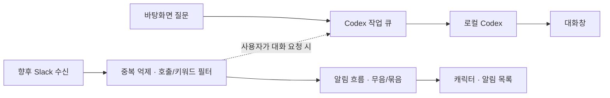

# 옹기봇 기획·구조·코드 검토

초기 분석 기준: 2026-10-06, alpha.6. 아래의 남은 이슈는 당시 상태이며 alpha.7 적용 결과는 문서 마지막에 갱신했습니다. 기존 소스와 문서, 설치 CLI 0.160.0의 실제 응답, 핵심 테스트 및 네이티브 UI 검증을 근거로 작성했습니다. 제품·라이브러리의 현재 설계는 공식 문서로 확인했으며 시장 점유율이나 유행을 추정하지 않았습니다.

## 시작한 문제와 전제

대화에서 확인한 목표는 **바탕화면에서 빠르고 편하게 질문하기**, **움직이는 나만의 캐릭터 보기**, 이후 **Slack 호출·키워드 알림 받기**입니다. 여러 클라이언트의 공용 FIFO 서버는 이후 과제입니다. 시작 계기는 앱을 전환해 질문하는 번거로움과 중요한 대화를 놓치는 불편으로 해석할 수 있습니다. 특정 업무 사고가 있었다는 근거는 없습니다.

캐릭터는 접근성을 높이고 지속 사용을 돕는 접점입니다. 실질적인 가치는 질문까지의 마찰과 필요한 소식을 확인하는 시간을 줄이는 데 있습니다. 외형을 바꾸어도 대화·모델·알림 정책이 유지되는 데이터 팩 방식은 이 목표에 맞습니다. 캐릭터마다 실행 스크립트를 허용할 필요는 없습니다.

검증해야 할 전제는 다음과 같습니다.

- 캐릭터가 사용 동기를 높이면서 업무를 방해하지 않는가? 클릭을 가로막거나 반복 안내가 떠 있으면 목표에 반합니다.
- 느린 원인은 모델뿐인가? 현재 측정은 모델 조회·큐·연결·최종 응답·화면 반영을 분리합니다. Fast가 큐나 UI 지연까지 해결하지는 않습니다.
- 로컬 앱이면 오프라인인가? 화면과 기록은 로컬이지만 모델 응답은 CLI의 계정·네트워크에 의존합니다.
- 모든 Slack 메시지를 AI로 읽어야 하는가? 호출과 명확한 키워드는 규칙으로 먼저 처리할 수 있습니다. 뉘앙스 감지는 실제 오탐 사례가 쌓인 뒤 평가해야 합니다.
- 공용 FIFO가 편리함을 높이는가? 긴 요청이 모든 사용자를 막을 수 있습니다. 현재 단일 사용자에서는 연결 재사용과 빠른 접근이 먼저입니다.

## 기획자가 먼저 확인할 사항

지금 확정된 우선순위를 다시 묻지 않고, 다음 단계 착수 시 아래 결정을 구체화합니다.

1. 질문창을 여는 데 허용할 시간, 첫 답변과 완료 답변의 목표 지연은 얼마인가? 체감 속도는 최종 시간 외에 첫 응답도 봅니다.
2. Slack에서 누가 호출할 수 있는가? 본인 멘션·봇 멘션·지정 키워드 중 무엇이며, 대상 채널은 어디인가?
3. 알림은 말풍선·배지·소리 중 무엇이고 무음 시간, 반복 묶음, 최대 빈도는 어떻게 할 것인가?
4. PC가 잠들거나 꺼졌을 때 알림을 나중에 받아야 하는가? 이 조건이 로컬 수신과 상시 서버의 분기점입니다.
5. 우선은 질문/알림만 하는가, 파일 변경·명령 실행도 필요한가? 필요한 작업별 승인 경계를 정합니다.
6. 유휴 메모리·CPU·배터리 목표가 있는가? 캐릭터 움직임과 상시 창의 비용을 실제 사용 시간에 맞춰 측정합니다.
7. FIFO 단계에서는 접수 순서·실행 시작 순서·완료 순서 중 무엇을 보장해야 하는가? 사용자별 대화, 계정, 취소, 재시도 정책도 함께 정합니다.

첫 출시 평가에는 질문창을 연 횟수, 첫 응답/전체 시간의 중앙값·p95, 알림의 유용/불필요 표시, 무음/종료 이유를 쓰는 것이 적절합니다. 수집 범위와 저장 정책을 먼저 정하고 대화 원문을 불필요하게 전송하지 않습니다. 아직 해당 사용 지표 수집은 구현하지 않았습니다.

## 현재 기술 흐름과 구조 선택

현재 Codex는 UI가 stdio JSON-RPC로 대화·턴·스트리밍·승인 등을 다룰 수 있는 App Server 인터페이스를 제공합니다. 따라서 터미널 화면을 자동 타이핑하고 긁어오는 대신, CLI 인증과 실행 체계를 재사용하는 얇은 데스크톱 UI가 적합합니다. 이는 공식 인터페이스를 근거로 한 설계 판단입니다. [Codex App Server](https://learn.chatgpt.com/docs/app-server)

현재 구조는 `캐릭터/대화창 → 제한된 IPC → 메인 프로세스 → Codex app-server`입니다. 모델 카탈로그, 질문별 모델·추론·속도 스냅샷, 대화별 소유 기록을 유지합니다. 모델 목록 갱신은 실제 CLI 응답을 사용하며 계정 실행 권한을 보장하는 목록으로 취급하지 않습니다.

Slack의 로컬 첫 단계에는 Socket Mode가 맞습니다. 공개 수신 URL 없이 WebSocket으로 이벤트를 받고 envelope를 ACK합니다. 연결 재수립과 중복 전달을 고려해야 하므로, ACK를 LLM 판단이 끝날 때까지 미뤄서는 안 됩니다. 내구성 있는 접수 후 ACK, event/envelope 식별자 기반 중복 억제, 호출/키워드 필터, 알림 표시를 분리하는 방향입니다. PC가 꺼져도 수집해야 하면 상시 실행 서버를 검토합니다. [Slack Socket Mode](https://docs.slack.dev/apis/events-api/using-socket-mode/)

알림은 긴 작업 뒤에 밀리지 않도록 작업 큐와 별도 흐름으로 둡니다. 뉘앙스 판단이 필요한 일부 이벤트만 제한된 분석 큐에 넣습니다. 외부 메시지를 접수했다는 사실이 로컬 도구 실행을 허가하지는 않습니다.

다중 클라이언트 브로커는 실제 동시 수요가 생겼을 때 도입합니다. FIFO 큐의 접수/시작 순서와 완료 순서는 다릅니다. 여러 워커가 실행하면 완료는 뒤바뀔 수 있습니다. 전체 완료 순서까지 엄격히 보장하려면 동시성 1의 비용을 감수하거나 순서대로 결과를 전달하는 별도 정책이 필요합니다. 기본 추천은 대화별 순서 유지와 사용자별 공정성입니다. BullMQ의 FIFO 문서도 동시 처리 시 완료 순서 차이를 명시합니다. [BullMQ FIFO](https://docs.bullmq.io/guide/jobs/fifo)

데스크톱 런타임에는 OS WebView와 Rust를 쓰는 Tauri 같은 선택지가 있습니다. 작은 배포·리소스 목표를 검토할 후보지만 현재 투명 창, 클릭 통과, 한국어 입력, CLI, 패키징이 검증된 Electron을 바로 교체할 근거는 부족합니다. 장시간 유휴 측정이 목표를 넘으면 동일 기능의 작은 프로토타입을 비교합니다. 구조 차이가 이 앱의 실측 성능 차이를 보장하지는 않습니다. [Tauri 구조](https://v2.tauri.app/concept/architecture/)

## 이번에 수정한 코드·문서 이슈

| 발견 사항 | 조치 | 확인 근거 |
|---|---|---|
| 설정 탭이 주요 탐색 영역을 차지 | 대화/이전 대화 두 탭과 우측 설정 톱니바퀴 | 네이티브 UI·timing smoke |
| 응답 지연의 어느 단계가 느린지 알 수 없음 | 선택형 단계 측정, 첫 응답·큐·전체 포함 | 구간 순서·합·실제 CLI·화면 ACK |
| 완료 응답에도 50ms 묶음 갱신 적용 | 완료/측정 확정은 즉시 갱신 예약, 스트리밍은 50ms 유지 | timing smoke |
| 캐릭터 창에 전체 대화/목록 전송 | 필요한 상태만 전달, 팩은 변경 때 전달 | 캐릭터·대화 UI 회귀 |
| 설정/위치 변경도 전체 대화 JSON 직렬화 | 설정 전용 저장은 대화 직렬화·파일 쓰기 생략 | 저장 경계 핵심 테스트 |
| 목록 자동 갱신이 선택 중인 옵션 DOM 교체 가능 | 선택 중 교체 보류, blur 뒤 반영, 캐시 있으면 활성 유지 | model smoke의 포커스/목록 확인 |
| 용량 초과 저장 실패 전에 큐 등록 가능 | 응답 예약 공간을 접수 전에 확인, 저장 성공 뒤 큐 등록 | 코드 검토·전송 회귀; 용량 경계 별도 자동 검증은 미실시 |
| 사용하지 않는 stderr 문자열 유지 | 문자열 버퍼 제거, stderr는 계속 drain | 프로토콜·실제 CLI 검증 |
| 패키징 앱에서도 개발 smoke 플래그 사용 가능 | 개발 플래그를 unpackaged 환경으로 제한 | 소스·패키징 확인 |
| FIFO 서버가 초기 핵심처럼 읽히는 계획 | 바탕화면/Slack 우선, 다중 클라이언트는 이후 명시 | TASKS·README 갱신 |

Electron 공식 성능 지침은 프로세스를 막는 동기 작업과 실제 프로파일링을 강조합니다. 위 개선은 불필요한 데이터 전송/직렬화를 줄입니다. 메모리나 배터리가 몇 퍼센트 개선됐다는 수치는 아직 산출하지 않았습니다. [Electron 성능](https://www.electronjs.org/docs/latest/tutorial/performance)

## 이번 지연 측정에서 확인한 범위

최종 실제 Luna/high·Standard의 짧은 질문 1회는 입력 0.80ms, CLI 전송까지 306.02ms, CLI 완료 4897.18ms, 화면 반영 13.91ms, 전체 5217.90ms였습니다. 첫 답변 수신은 CLI 전송 뒤 4833.39ms였습니다. `artifacts/real-response-timing.json`에 원시 시각을 남겼습니다. 앞선 동일 목적 왕복은 전체 약 3.25초였으므로 모델·통신 변동을 UI 변경 효과와 혼동하면 안 됩니다.

통제된 테스트 CLI에서는 최종 응답 화면 반영이 두 질문에서 약 11.55ms와 5.20ms였고, 설정 화면에 머문 경우 약 308ms였습니다. 기존 50ms 예약을 제거한 구조의 동작 확인이며 통계적 개선율/하드웨어 성능 보장이 아닙니다. 큐가 밀린 두 번째 질문은 전송까지 약 831ms였고 그중 큐 대기가 약 831ms였습니다. 측정 설정으로 어떤 단계가 체감을 바꾸는지 확인할 수 있습니다.

## 남은 이슈와 최적화 순서

**P1 — Slack 알림의 신뢰성.** 실제 연동 전 접수/ACK/재연결/중복 억제/무음 시간/알림 목록을 설계합니다. 호출과 키워드의 기대 이벤트부터 테스트하고, PC 종료 중 보존이 요구되면 서버의 필요성이 생깁니다. 현재 Slack 코드는 없습니다.

**P2 — 긴 대화의 UI와 저장.** 패널에는 아직 전체 대화를 전달하고 메시지 DOM을 순회합니다. 설정 전용 저장은 개선했지만 접수/완료 때 JSON 동기 직렬화·저장이 있습니다. 32MiB 한계까지 큰 기록에서는 메인 프로세스를 막을 수 있습니다. 먼저 긴 대화의 p95 이벤트 지연을 측정하고, 변경분 IPC·목록/메시지 페이지 읽기·DOM 가상화·직렬화 작업 분리를 검토합니다. 질문 접수 전 JSON 용량 계산 자체도 큰 기록에서는 비용이 있으므로 후속으로 누적 크기 관리가 필요합니다.

**P2 — CLI 기록 조회 크기.** 로컬 대화 한도는 32MiB이고 JSONL 버퍼 보호 한도는 8×1024×1024 문자열 단위입니다. 메시지/도구 기록이 큰 `thread/read` 응답은 한도에 도달해 CLI 연결이 종료될 수 있습니다. 로컬 기록 fallback은 있지만 한도가 일치하지 않습니다. 설치 CLI의 페이지 조회 지원을 확인하고 분할 읽기/프레임 단위 처리를 검토해야 합니다. 단순히 보호 한도를 무제한 늘리는 방향은 피합니다.

**P2 — 두 파일 저장의 일관성.** 각 파일은 tmp→rename 교체지만 대화 파일과 목록 파일을 함께 커밋하는 트랜잭션은 아닙니다. 디스크 부족·중간 종료에서 고아 기록이나 오래된 목록이 가능하며 초기 저장 실패의 메모리 등록 변경도 완전 롤백되지 않습니다. 복구 스캔/저널 또는 DB 도입의 실제 판단 지점입니다. 이번 수정은 질문의 큐 등록 순서를 개선했으며 이 문제 전체를 해결했다고 주장하지 않습니다.

**P2 — 유휴 리소스 기준.** timing smoke에 Electron 프로세스 working set 스냅샷을 기록했습니다. 이는 프로세스별 값이며 공유 페이지가 있어 합을 고유 RAM으로 해석할 수 없습니다. Codex 자식은 별도이며 한 번의 샘플·첫 CPU 조회로 유휴 CPU/배터리를 평가할 수 없습니다. 유휴 30분, 대화 100/1000개, 화면 숨김, Slack 연결 상태의 기준을 정해 비교해야 합니다. [Electron MemoryInfo](https://www.electronjs.org/docs/latest/api/structures/memory-info)

**P2 — 배포와 권한 호환성.** Apple Silicon 로컬 unsigned alpha입니다. 서명/공증/자동 업데이트/다른 OS와 다중 모니터는 후속 검증입니다. 설치 CLI가 제한 읽기 `readOnly.access`를 거부하여 현재 readOnly를 사용하며 작업 폴더 외 읽기 격리는 보장하지 않습니다. Node 통합 꺼짐, context isolation/sandbox, 제한 IPC와 정제는 유지합니다. 외부 렌더러/도구 확장이 생기면 sender 및 프레임 출처 검증을 더 엄격히 검토합니다. [Electron 보안](https://www.electronjs.org/docs/latest/tutorial/security)

## 데드코드·의존성 선택의 이유

확인한 실제 미사용 항목은 stderr 문자열 보관으로 제거했습니다. 캐릭터의 상태 fallback, 팩/아이콘 생성 스크립트, 테스트 fixture, 번들 파일은 기능·재생성·빌드에서 쓰므로 데드코드가 아닙니다. 현재 검토만으로 미사용 코드가 전혀 없다고 보장하지 않습니다. CSS 후반 덮어쓰기와 main의 개발 smoke 코드는 추후 정리 후보입니다. 행동 검증 없이 일괄 삭제/범용 헬퍼 추출을 하지 않았습니다.

| 선택 | 현재 이점 | 유지/변경 기준 |
|---|---|---|
| Electron | 투명 창·클릭 통과·tray·Node CLI 실행을 한 환경에서 구현 | 유휴 리소스 목표 미달 때 Tauri 비교 |
| Codex app-server | 로컬 인증·모델 카탈로그·대화 재개·승인 체계 재사용 | 설치 버전별 프로토콜 호환 검증 유지 |
| markdown-it | 스트리밍 텍스트의 표/목록/코드 표시 | 직접 Markdown 파서 구현보다 경계 검증 집중 |
| DOMPurify | 허용 DOM으로 한 번 더 정제 | 파서 HTML 비활성 외의 방어 경계 유지 |
| CJK 강조 플러그인 | 한국어 괄호·조사 경계의 실제 강조 문제 해결 | 코드/이스케이프 회귀 유지 |
| esbuild | renderer 의존성을 로컬 번들 하나로 묶음 | 빌드 때만 사용; CDN 런타임 불필요 |
| 대화별 JSON | 단일 설치·단일 writer에서 단순 복구/확인 | 대규모 검색·트랜잭션·다중 writer 필요 시 SQLite 등 검토 |
| 브로커 미도입 | Redis/서버 운영·계정 분리 비용 절약 | 다중 클라이언트 수요와 실패/재시도 정책 확정 후 |

배포 앱의 생산 의존성에는 renderer 번들에 이미 포함된 라이브러리 원본도 있을 수 있습니다. 지금은 재현 가능한 패키징을 우선하며 실제 main 의존성을 조사한 뒤 중복 파일 제외를 검토합니다. 앱 실행에서 쓰는 파일을 먼저 삭제하지 않습니다.

이 프로젝트를 하는 이유는 기존 Codex를 다시 만드는 데 있지 않고 **사용자가 바탕화면에서 질문하고 필요한 소식을 제때 받는 접점**을 제공하는 데 있습니다. 그 효과가 확인되기 전에 범용 에이전트 프레임워크·중앙 큐·새 DB·전체 런타임 교체를 추가할 필요는 없습니다. 다음 구현은 Slack 명시적 호출→키워드→무음/중복/알림 목록 순서가 적절합니다. 뉘앙스 분류와 공용 FIFO는 평가 자료와 실제 수요가 생긴 뒤 진행합니다.

## alpha.7 적용 결과와 변경된 우선순위

사용자 지시에 따라 Slack은 후순위로 두었습니다. C01 저장 저널/등록·전환 실패 복구, C02 프레임별 UTF-8 수신, C03 최대 100개/256KiB 단계 표시, C04 메시지 변경분 IPC/카드 Map, C05 1000개 규모·용량·저장 실패 큐 검증을 적용했습니다. 생산 앱의 중복 node_modules 원본도 제외하고 번들·라이선스 고지를 유지합니다.

위 P2의 전체 메시지 IPC·카드 전체 탐색·두 파일 중간 종료 문제를 개선했습니다. JSON 동기 저장과 전체 파일 읽기, 큰 CLI 전체 기록 조회, 완전한 DOM 가상화, 전원 장애 내구성, 장시간 리소스 측정은 아직 남습니다. 프레임 한도는 64MiB로 명시적으로 제한합니다. 구현과 측정 근거는 [LOCAL_STABILITY.md](LOCAL_STABILITY.md), 후속 우선순위는 [TASKS.md](../TASKS.md)에 있습니다.
