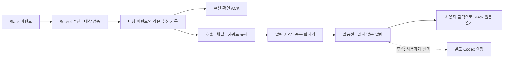

# Slack 연동 분석과 작업 계획

검토일: 2026-10-06. 대상: 0.1.0-alpha.8 / macOS 로컬 앱.

이 문서는 현재 코드와 Slack·Electron 공식 문서를 확인한 설계 제안이다. Slack 앱 생성, 권한 승인, 실제 수신, SDK 설치, Keychain 접근은 아직 수행하지 않았다. 아래 완료 기준과 수치 목표는 구현 후 검증할 항목이다. 로컬 안정화 우선, Slack 후순위, 다중 클라이언트 FIFO는 이후 과제라는 기존 순서를 유지한다.

## 1. 해결할 문제와 먼저 정할 내용

옹기봇의 Slack 기능은 다른 작업 중에도 나에게 필요한 호출·소식을 알아차리게 하는 데 가치가 있다. Slack의 메시지 전체를 캐릭터에 옮기면 알림이 늘어나는 만큼 방해도 늘어난다. 성공 기준은 연결 성공보다 필요한 알림의 발견, 적은 오탐, 대화·작업을 방해하지 않는 표시다.

기획자로서 처음 확인할 내용은 다음과 같다. 현재 확정된 것은 바탕화면 대화와 Slack 호출·키워드 알림이 주요 가치라는 점이다. 아래 세부 정책은 아직 사용자와 합의하지 않았다.

| 결정 | 확인할 내용 | 첫 구현 제안 |
|---|---|---|
| 기존 Slack 알림의 부족함 | 놓치는 호출인지, 관심 이슈 선별인지, 작업 전환 비용인지 | 명시적 호출과 지정 키워드로 먼저 가치 측정 |
| 호출 대상 | `@옹기봇`, 사용자 본인의 멘션, 글자 그대로 “옹기봇” 중 무엇인지 | 봇 멘션 우선; 본인 멘션·문자열은 별도 규칙 |
| 범위 | 워크스페이스, 공개/비공개 채널, 사람 또는 알림 봇, 스레드 포함 여부 | 한 워크스페이스·사용자가 선택한 소수 채널 |
| 동작 | 알림만, 사용자가 선택한 메시지 요약, Slack에 답장, 원격 작업 요청인지 | 로컬 알림과 원문 열기 |
| 가용성 | PC가 꺼지거나 절전 중에도 수집해야 하는지 | 실행·연결 중 수신; 연결 공백 안내 |
| 데이터 정책 | 회사의 앱 설치·로컬 저장·AI 전달 허용 범위 | 짧은 미리보기만 저장; 자동 AI 전달은 다음 단계 |
| 알림 정책 | 조용한 시간, 잠자기, 반복 이슈 묶기, 중요한 알림 봇 허용 | 무음/일시중지·중복 방지·채널별 제외 규칙 |

## 2. 권장 첫 범위와 연결 방식

첫 범위는 **한 PC·한 워크스페이스에서 봇 호출과 지정 채널의 키워드를 받아, 말풍선·읽지 않은 알림 목록으로 보여주고 Slack 원문으로 이동하는 기능**이다. 의미 판단, Slack 답장, 원격 Codex 실행, 전체 메시지 아카이브, 여러 PC 동시 배포는 별도 단계다.

로컬 앱에는 Socket Mode를 제안한다. 외부로 WebSocket 연결을 맺어 수신하므로 공개 HTTP 수신 서버를 먼저 마련할 필요가 없다. 다만 연결 갱신·재연결 처리는 필요하고, 현재 Socket Mode 앱은 공개 Slack Marketplace에 등록할 수 없다. 내부 앱과 공개 배포의 구조는 따로 계획해야 한다. [Slack Socket Mode](https://docs.slack.dev/apis/events-api/using-socket-mode/)

| 방식 | 적합한 상황 | 옹기봇의 판단 |
|---|---|---|
| 로컬 Socket Mode | 한 PC의 내부 앱, 실행 중 알림 | 첫 구현 후보 |
| 상시 서버의 Events API + 클라이언트 전달 | PC 종료 중 수집, 사용자별 전달, 여러 설치 관리 | 실제 요구가 생기면 도입 |
| 주기적 기록 조회 | 제한된 연결 공백 보완 | 실시간 수신의 보조로만 검토 |

**같은 Socket Mode 앱의 연결을 여러 PC에 열어도 이벤트가 모든 PC에 방송되는 구조는 아니다.** 한 이벤트가 어느 연결로 전달될지는 보장되지 않는다. 여러 버디에 전달하려면 중앙 수신자가 사용자별로 전달하거나 각 설치의 Slack 앱을 분리해야 한다. 이 문제는 알림 라우팅 문제이며 Codex 작업용 공용 FIFO 도입과는 별개다. [복수 Socket Mode 연결](https://docs.slack.dev/apis/events-api/using-socket-mode/#using-multiple-connections)

## 3. 준비물과 권한

### 사용자·워크스페이스에서 준비할 내용

1. 테스트 가능한 Slack 워크스페이스와 앱 설치 권한. 조직 정책에 따라 관리자 승인 필요 여부 확인.
2. Slack 앱 생성, Socket Mode 활성화, 이벤트 구독, 설치. 앱·워크스페이스 ID를 연결 대상과 대조.
3. App-level 토큰(`xapp-…`)과 Bot 토큰(`xoxb-…`). 역할이 다르므로 각각 입력·검증한다.
4. 감시할 채널 ID와 봇 초대. 개인 멘션도 감지하려면 대상 사용자의 멤버 ID.
5. 키워드/제외 키워드, 무음 시간·시간대, 표시할 미리보기와 보관 기간.
6. 조직망에서 외부 HTTPS/WebSocket 연결 가능 여부. 테스트 채널에서 호출·키워드·절전 복귀 확인.

토큰을 채팅이나 저장소에 붙여넣는 방식은 쓰지 않는다. 구현 시 전용 설정 입력에서 메인 프로세스로 한 번 전달하고, 이후 UI에는 연결 여부·필요 권한·마스킹된 상태만 보낸다.

### 기능별 최소 권한

| 기능 | 이벤트/호출 | 권한 | 범위 |
|---|---|---|---|
| Socket 연결 | `apps.connections.open` | App-level `connections:write` | Bot 읽기 권한과 별개. [권한](https://docs.slack.dev/reference/scopes/connections.write/) |
| `@옹기봇` 호출 | `app_mention` | Bot `app_mentions:read` | 봇 호출용. 본인 멘션과 봇 DM은 다른 기능. [이벤트](https://docs.slack.dev/reference/events/app_mention/) |
| 공개 채널 키워드·본인 멘션 | `message.channels` | Bot `channels:history` | 봇이 접근 가능한 채널에서 로컬 규칙 적용. [이벤트](https://docs.slack.dev/reference/events/message.channels/) |
| 비공개 채널 키워드·본인 멘션 | `message.groups` | Bot `groups:history` | 해당 비공개 채널에 봇 초대 필요. [이벤트](https://docs.slack.dev/reference/events/message.groups/) |
| 채널 선택 UI | 채널 목록·메타데이터 조회 | `channels:read`, 필요하면 `groups:read` | 채널 ID 직접 입력으로 시작하면 목록 권한은 생략 가능. [공개](https://docs.slack.dev/reference/scopes/channels.read/), [비공개](https://docs.slack.dev/reference/scopes/groups.read/) |
| 봇에게 보내는 DM — 선택 | `message.im` | `im:history` | 봇 자신의 DM 범위. 사용자의 모든 개인 DM을 읽는 기능이 아니다. [권한](https://docs.slack.dev/reference/scopes/im.history/) |
| Slack 답장 — 후속 | `chat.postMessage` | `chat:write` | 첫 알림 버전에서는 요청하지 않음. [권한](https://docs.slack.dev/reference/scopes/chat.write/) |

표의 공개/비공개 이벤트 구독 이름과 수신 payload의 `event.type`을 혼동하지 않는다. 메시지 payload는 `message`로 들어올 수 있으며 채널 유형·subtype도 확인해야 한다. [메시지 이벤트](https://docs.slack.dev/reference/events/message/)

봇 호출만 사용하는 manifest와 채널 키워드까지 사용하는 manifest를 나누어 준비한다. 추가 권한은 설치에 반영되어야 한다. 관리자·전체 검색·자동 채널 가입·사용자 토큰은 첫 범위에 필요하지 않다. 앱 권한은 설치와 참여 범위에 따른다. [Events API 권한 모델](https://docs.slack.dev/apis/events-api/#permission-model)

## 4. 수신·알림 구조

위 흐름은 제안이다. ACK는 Slack에 수신을 확인하는 응답이며 모델 답변이 아니다. 분석·UI 표시가 끝날 때까지 ACK를 미루지 않는다. Socket envelope의 ACK와 이벤트의 `event_id`를 각각 처리하고, 팀·앱·이벤트 형태를 먼저 확인한다. 로컬 감시 대상 밖 메시지는 내용 저장 없이 빠르게 제외한다. [Socket 수신 확인](https://docs.slack.dev/apis/events-api/using-socket-mode/)

처리할 이벤트는 작은 비동기 수신 기록에 반영한 뒤 ACK하고, 재시작 후 미처리 항목을 이어서 처리하는 설계를 검증한다. 기록 실패를 성공 수신으로 처리하지 않는다. SDK의 ACK 시점과 재전송 동작을 구현 시 확인해야 하며, “정확히 한 번 수신”이나 무제한 재전송은 보장하지 않는다. 이벤트 중복은 `event_id`로 제거한다. [Events API](https://docs.slack.dev/apis/events-api/)

추가로 `team_id + channel_id + message_ts`를 알림의 원문 식별자로 사용한다. 같은 글이 봇 호출·키워드 조건에 모두 걸리면 하나의 알림에 감지 이유를 합친다. Slack의 `ts`/`thread_ts`는 문자열로 유지하고 부동소수점 숫자로 변환하지 않는다.

### 첫 규칙과 UI 정책

- 호출·키워드·제외 키워드·본인 멘션은 감지 이유를 분리한다. 한글 Unicode 정규화, 영문 대소문자, 부분 일치/단어 일치 정책을 명시한다. 첫 버전은 사용자 임의 정규식을 받지 않는다.
- 자신과 옹기봇의 메시지를 기본 제외한다. 다른 봇도 기본 제외하되, 장애 알림 봇은 채널·봇별 허용할 수 있어야 한다.
- 스레드 답글, 수정·삭제 이벤트를 정규화한다. 원문이 삭제되면 미리보기 제거/원문 없음 표시 정책을 적용한다. 순서가 뒤바뀐 수정 이벤트가 최신 내용을 덮어쓰지 않도록 한다.
- Slack의 `mrkdwn`은 일반 Markdown과 규칙이 다르다. 기존 대화 렌더러에 그대로 넣지 않고 첫 버전은 안전한 일반 텍스트 미리보기와 원문 링크로 표시한다. 이미지·파일 자동 다운로드는 하지 않는다. [Slack 서식](https://docs.slack.dev/messaging/formatting-message-text/)
- 짧은 자동 숨김 말풍선 + 읽지 않은 개수 + 목록을 제안한다. 상단의 대화/이전 대화는 유지하고 종 아이콘이나 트레이에서 알림을 연다. 수신만으로 패널을 열거나 입력 포커스를 빼앗지 않는다.
- 실행 승인 요청을 Slack 미리보기로 가리지 않는다. 대화 중에도 읽지 않은 개수는 갱신하고 말풍선 표시는 미룰 수 있다. 연속 수신은 묶으며, 빈 투명 영역·긴 문구·같은 상태의 타이머 문제를 다시 만들지 않는다.
- 캐릭터 “잠자기”와 연결 끊기, PC 절전은 다른 동작이다. 잠자기는 표시만 조용히 하고 수신·목록 적재를 유지하는 안을 제안한다. OS 알림은 선택 옵션이며 시스템 알림 권한·집중 모드의 영향을 받는다.

### 저장과 연결 공백

Slack 알림은 Codex 대화 파일에 섞지 않는다. 원문 ID·짧은 미리보기·감지 이유·수신 시각·읽음 상태를 별도 저장하고, 목록은 단계 로딩한다. 로컬 알림 삭제는 Slack 메시지 삭제나 Codex `thread/delete`와 연결하지 않는다.

용량·보관 기간은 유한하게 둔다. 시작안은 미처리 수신 기록 24시간, 알림 7일/최대 500건, 중복 ID 72시간/최대 10,000건이며 실제 사용량·회사 정책에 맞춰 결정한다. 이는 확정값이 아니다. 임시 기록·진단 로그도 같은 삭제 정책을 적용하고 메시지 원문·토큰을 로그에 남기지 않는다. 로컬 미리보기는 별도 암호화를 하지 않는다면 평문 데이터임을 설정 문서에 명시한다.

PC 종료·절전·망 단절 동안의 메시지가 재연결만으로 전부 복원된다고 가정하지 않는다. 연결 공백 시각을 기록·안내한다. 기록 조회를 붙이면 마지막 조회 지점 이후를 제한적으로 보완하되 권한, 보존 기간, API 제한을 고려해야 한다. 공식 문서상 일부 비-Marketplace 상용 배포 앱의 기록 조회 제한과 내부용 앱의 제한은 다르므로 내부 앱에 일괄적으로 “분당 1회”를 적용하지 않는다. [기록 조회](https://docs.slack.dev/reference/methods/conversations.history/)

원문 이동은 `chat.getPermalink`로 얻은 HTTPS 링크를 필요할 때 조회·캐시한다. Web API의 429는 `Retry-After`에 따라 재시도하고 인증 해제·권한 부족은 사용자 조치가 필요한 오류로 표시한다. [원문 링크](https://docs.slack.dev/reference/methods/chat.getPermalink/), [호출 제한](https://docs.slack.dev/apis/web-api/rate-limits/)

## 5. 현재 코드에서 필요한 변경과 선택 이유

| 위치 | 확인한 상태 | 필요한 작업 |
|---|---|---|
| `scripts/package.cjs` | `node_modules` 전체 제외; 현재 UI 의존성은 사전 번들 | Slack 런타임 SDK·전이 의존성을 패키지에 포함. 개발 실행만 성공해도 완료로 보지 않음 |
| `scripts/build.cjs` | UI 번들·라이선스 문구 생성 | 백엔드 의존성 포함 시 고지 제목/범위·전이 라이선스 검증 |
| `src/store.cjs`, `src/main.cjs` | 설정을 JSON 저장하고 전체 settings를 UI/캐릭터에 전달 | 토큰은 별도 암호화 저장; 설정·IPC에는 비밀을 제외한 허용 필드만 전달 |
| `src/main.cjs` | Codex 큐·현재 작업·승인 상태 중심 | Slack 연결 수명과 알림 흐름 추가. 모델 큐에 수신 이벤트를 넣지 않음 |
| `src/store.cjs` | 기존 대화 저장에 동기 파일 쓰기·직렬화 사용 | 이벤트 ACK 지연 측정. 별도 큐만 만들어도 메인 스레드 동기 작업의 지연은 해결되지 않음 |
| `src/main.cjs` | OS suspend에서 현재 Codex 작업 중단 | Slack 절전/복귀·오프라인·재연결·수동 해제·종료 시 정리 추가 |
| `src/main.cjs`, `src/ui/renderer.mjs` | 단일 캐릭터 상태·동일 상태 말풍선 타이머 억제 | 알림 ID/읽지 않은 개수·표시 우선순위를 상태와 분리 |
| `src/main.cjs`의 `showPanel` | 패널을 띄우고 포커스를 가져옴 | 수신 알림에서는 자동 호출하지 않음 |
| `src/ui/index.html`, `src/preload.cjs` | 미래 기능 안내만 존재; 제한된 IPC | 연결 설정·알림 목록·읽음/삭제/원문 열기와 검증 추가 |
| UI CSP·외부 링크 처리 | 렌더러 네트워크 차단, http/https만 허용 | Slack 통신은 백엔드에서 수행. 범용 프로토콜 허용으로 바꾸지 않음 |

현재 조사 범위에 제거할 기존 Slack 구현·데드코드는 없다. 미래 기능 안내는 구현 완료 후 실제 설정 진입점으로 교체한다. 기존 대화·삭제 기능과 알림은 데이터 수명과 책임이 달라서 무리하게 재사용하지 않는다.

### SDK와 프로세스

`@slack/socket-mode`와 `@slack/web-api`를 후보로 한다. 공식 SDK로 연결·Web API 처리를 맡기고, 현재 앱의 설정·알림 규칙은 유지할 수 있다. Bolt는 명령·버튼·여러 Slack 상호작용이 늘어날 때 재평가한다. ACK를 저장 흐름과 연계하려면 SDK의 자동/수동 ACK 처리를 확인해야 한다. 버전·현재 CJS/Node/Electron 호환은 아직 설치 검증하지 않았다. [공식 Node Socket Mode SDK](https://docs.slack.dev/tools/node-slack-sdk/socket-mode/)

패키징은 생산 의존성 포함 + 개발 의존성 제거를 먼저 검증한다. 백엔드 번들을 택하면 동적 require·리소스 파일·라이선스 누락을 확인한다. 렌더러 라이브러리 중복을 줄이는 최적화보다 실제 `.app`에서 SDK가 로드되는지 확인하는 작업이 먼저다.

연결 처리와 알림 저장은 검증 경계가 달라 별도 모듈로 분리할 수 있다. 단순 조건·필드 정규화마다 헬퍼를 만들지 않는다. 처음부터 브로커·DB·프로세스를 늘리지 않고 제한된 비동기 저장을 검증한다. 큰 대화 저장/이벤트 폭주에서 메인 스레드가 지연되면 C07 저장 비동기화 또는 Socket 수신의 worker/utility process 격리를 결정한다.

### 자격 증명

OS 암호화 기반 `safeStorage`의 비동기 API를 후보로 한다. 설치된 Electron 타입에서 `isAsyncEncryptionAvailable`, `encryptStringAsync`, `decryptStringAsync` 지원을 확인했다. 실제 Keychain 허용·암복호화·앱 재시작은 아직 검증하지 않았다. 암호화가 불가능하면 평문 저장으로 자동 전환하지 않고 세션 한정 연결 또는 기능 중단을 안내한다. [Electron safeStorage](https://www.electronjs.org/docs/latest/api/safe-storage)

토큰은 메인 프로세스에서만 복호화하여 사용한다. 렌더러 입력 값은 전달 후 비우고, 오류·진단·백업·패키징 파일에 토큰이 포함되지 않는지 확인한다. `auth.test`로 Bot 토큰의 팀/사용자 정체성을 확인하며 App-level 토큰의 연결 대상도 대조한다. [토큰 검증](https://docs.slack.dev/reference/methods/auth.test/)

현재 로컬 배포에는 정식 서명·공증 검증이 없다. 업데이트 후 Keychain 접근의 일관성은 안정된 앱 서명과 함께 검증해야 한다. 개인 테스트 연결과 다른 사람에게 배포할 자격 증명 보관의 완료 기준을 구분한다. [Electron 코드 서명](https://www.electronjs.org/docs/latest/tutorial/code-signing)

## 6. 구현 작업과 완료 기준

모든 구현 항목은 **미착수**다. 이 분석은 SDK 설치나 기능 구현의 완료를 뜻하지 않는다.

| ID | 단계 | 작업 | 완료 기준 |
|---|---|---|---|
| S01 | 준비 | 감시/호출/알림/보관 범위 확정 | 대상·무음·공백 정책, 성공 지표 합의 |
| S02 | 준비 | Slack 앱 manifest·설치 안내 | 호출 전용/키워드 권한 분리, 테스트 채널과 봇 참여 확인 |
| S03 | 준비 | 자격 증명 저장·대상 검증 | 암복호화·재시작·해제 검증, 토큰이 일반 설정/게시 상태 IPC/로그에 없음 |
| S04 | 준비 | SDK·배포 의존성 검증 | 잠금 버전·라이선스 고지, 패키징 `.app` 실제 로드 |
| S05 | 호출 | Socket 연결 수명 | 연결/해제/복귀/재연결, 잘못된 토큰·워크스페이스 오류 표시 |
| S06 | 호출 | ACK·수신 기록·중복 방지 | 느린 처리/종료/재수신에서도 동일 이벤트의 알림 중복 억제 |
| S07 | 호출→키워드 | 이벤트 정규화·규칙 | 봇 호출, 채널·키워드·제외·본인 멘션, 수정/삭제/스레드 처리 |
| S08 | 호출 | 별도 알림 저장 | 읽음·로컬 삭제·보관 만료·상한·재시작 복구; 대화 데이터와 분리 |
| S09 | 호출 | 캐릭터·알림 목록 | 자동 숨김·읽지 않은 개수·명시적 열기, 포커스와 승인 표시 유지 |
| S10 | 키워드 | 설정·무음·반복 묶기 | 채널/규칙 선택·시간대·일시중지·알림 봇 허용 |
| S11 | 호출 | Slack 원문 이동 | permalink 조회/캐시·HTTPS 검증·권한/삭제 오류 안내 |
| S12 | 키워드 | 연결 공백·API 제한 | 공백 표시·429 대기·인증 중단. 보완 조회를 하면 범위/한도 명시 |
| S13 | 검증 | 오류·부하·UI·실제 수신 검증 | 아래 수용 기준 통과; 기존 대화·삭제·모델 설정 회귀 없음 |
| S14 | 전달 | 설정/운영/제한 문서·앱 전달 | 토큰 발급·초대·해제·보관·PC 절전 한계 안내 |
| S15 | 후속 | 의미·이슈 분류와 평가 | 조직 AI 전달 정책·평가 자료·오탐/비용 기준 합의 후 구현 |
| S16 | 후속 | Slack 답장·원격 요청 | 호출자 허용·명시적 실행 정책·추가 권한·응답 중복 정책 확립 |
| S17 | 후속 | 상시 수신·여러 사용자 | 설치/사용자별 격리·OAuth·전달·연결 소유권; 공개 배포 구조 검토 |

실행 순서는 **S01–S04 선행 검증 → 봇 호출부터 S05–S09/S11 → 키워드와 정책 S07/S10/S12 → S13/S14 전달**이다. S06의 ACK 지연 검증은 처음부터 진행한다. S15–S17은 첫 알림 버전의 성공을 확인한 뒤 진행하며, 다중 클라이언트 FIFO는 기존 B08 과제로 유지한다.

## 7. 수용 기준과 측정

- 실제 테스트 채널의 `@옹기봇`과 지정 키워드는 감지하고, 선택하지 않은 채널·제외 키워드는 알림을 만들지 않는다.
- 같은 글의 호출·키워드 중복, 재전송·재연결·재시작에서 알림이 불필요하게 늘어나지 않는다.
- 비공개 채널 미참여, 잘못된 토큰, 권한 제거·앱 제거·네트워크 단절에 대해 실행 가능한 오류 안내가 나온다.
- 수신 직후 종료, 디스크 오류·손상·보관 상한, 이벤트 순서 역전에서도 미처리/오류 상태를 확인할 수 있다. 복구를 데이터 손실 없음으로 과장하지 않는다.
- 토큰이 state.json·대화 파일·캐릭터/패널 상태·로그·앱 패키지에 저장되지 않는다. 정상/실패 경로 모두 검사한다.
- 긴 Codex 응답·큰 기록 저장·알림 폭주·잠자기·OS 절전 복귀 중에도 알림 처리와 대화가 함께 동작하는지 측정한다.
- 말풍선이 자동 숨겨지고 배후 앱 클릭·이동·승인 요청이 유지된다. 알림 클릭 전 패널이 포커스를 가져가지 않는다.
- 알림의 읽음/삭제가 Slack 원문이나 기존 Codex 세션을 삭제하지 않는다. 새 알림·설정으로 현재 모델/추론/Fast/대화 기록이 바뀌지 않는다.

제안 성능 목표는 정상 부하에서 **수신→ACK p95 500ms 미만, 수신→로컬 표시 p95 1초 미만**이다. Slack 전달 자체의 지연·무음 시간·OS 집중 모드는 제외하고 연결 공백은 따로 기록한다. 아직 측정 결과가 아니다. SDK·디스크·메인 스레드 부하를 분리 측정하고 장시간 유휴 CPU/배터리(C08)도 비교한다. Socket ACK 목표를 HTTP Events API의 응답 제한과 혼동하지 않는다.

제품 지표는 클릭한 유효 알림 비율, 사용자가 불필요하다고 표시한 비율, 하루 알림 수·묶임 수, 확인까지 걸린 시간이다. 중요한 메시지 누락은 수신된 로그만으로 알 수 없으므로 합의된 테스트 메시지/라벨 자료와 비교한다.

## 8. 의미 감지와 확장 판단

“뉘앙스·이슈”는 키워드와 별개다. 먼저 실제 예시에서 알릴/무시할 기준을 만들고, 규칙으로 후보를 줄인 뒤 필요한 경우에만 제한된 문맥을 모델에 전달한다. 전 메시지 자동 분석은 비용·지연·오탐을 늘릴 수 있다. 모델 판단 결과는 감지 근거와 함께 보여주고 반복 이슈는 묶는다. 부정확한 판단을 로컬 작업 실행 근거로 사용하지 않는다.

Slack 원문은 외부 입력이다. 분석 요청은 코딩 작업과 분리하고 도구 실행·자동 승인 없이 텍스트 판단만 하도록 별도 제한을 검증한다. 회사 정보의 AI 전달 허용 여부, 최대 문맥·일별 호출/비용·중복 캐시, 사용자 피드백 자료의 보관을 먼저 합의한다. 현재 앱의 Luna/high 기본 설정은 유지하되, 분석 모델·추론 단계는 정확도/지연/이용량 평가 후 결정한다. 기존 읽기 전용 코딩 설정만으로 Slack 분석의 정보 접근 제한을 충족했다고 보지 않는다.

슬랙이 이미 제공하는 알림을 캐릭터에 복제하는 수준이면 별도 앱의 유지 비용을 정당화하기 어렵다. **선택한 이슈를 덜 방해하며 알려주고, 필요한 시점에 바탕화면 대화로 이어주는 경험**을 먼저 검증한다. 공식 SDK는 프로토콜 유지 비용을 낮추고, 로컬 수신은 개인용 첫 범위에서 서버 운영을 줄인다. 상시 수집·여러 사용자·공개 배포는 그 가치와 비용을 다시 평가하는 시점이다.
