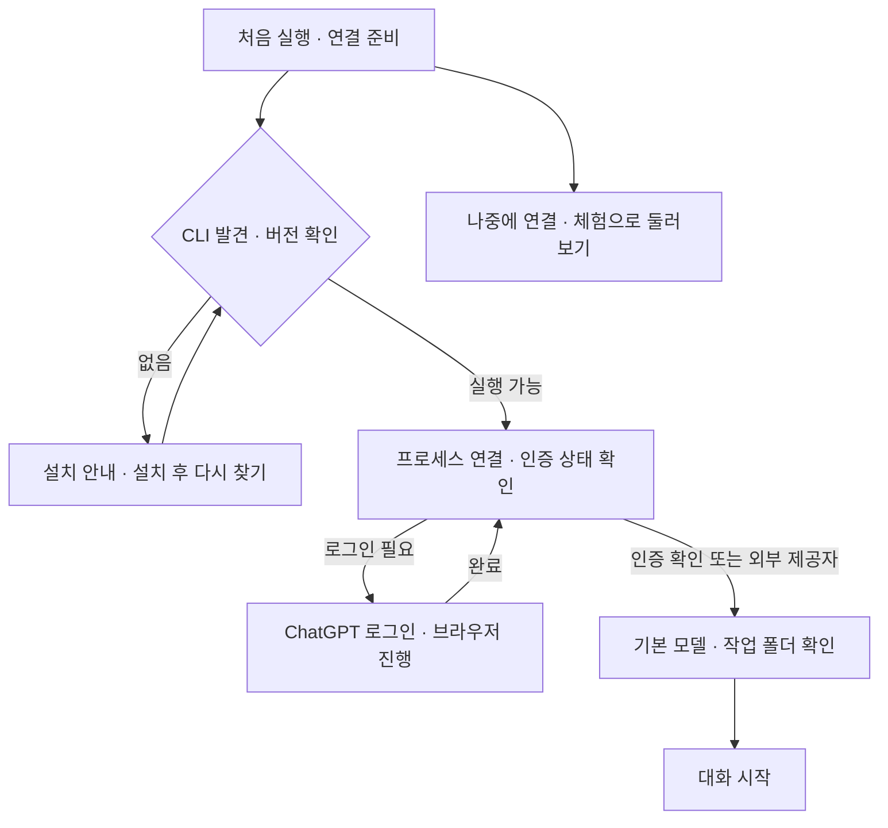

# 최초 설치·Codex 연결 편의성 검토

검토일: 2026-10-06. 대상: 옹기봇 alpha.9 / macOS build14, 설치된 Codex CLI 0.160.0.

현재 코드, 설치 CLI의 생성 스키마, OpenAI 공식 문서를 확인했다. 새 PC의 실제 설치·미로그인 브라우저 인증·Windows 실행을 검증한 것은 아니다. 로그인/로그아웃·CLI 설치·모델 호출·앱 수정/재배포는 진행하지 않았다. 사용자의 계정·기록·설정과 실행 중인 앱을 유지한다.

## 결론

현재 알파는 **Codex가 이미 설치되고 로그인도 완료된 개발자**에게는 편리하지만, Codex를 처음 쓰는 사용자에게는 준비 단계가 부족하다. 연결 마법사, 로그인 상태 진단, 설치 직후 재탐색을 먼저 개선하는 것이 적절하다. Slack은 계속 대기한다.

## 현재 실제 흐름

1. 실행 시 PATH와 macOS의 몇 가지 고정 위치에서 CLI를 찾는다. 없으면 실행 경로를 문자열 `codex`로 둔다.
2. 캐릭터가 표시된다. 별도의 최초 설정 화면·준비 완료 확인은 없다.
3. 사용자가 캐릭터/트레이를 누르면 대화창을 열고 CLI 연결·모델 목록/설정을 조회한다.
4. 성공하면 `Codex · 연결됨`이라고 표시한다. 계정 인증 상태 조회는 수행하지 않는다.
5. 실패하면 모델 조회 오류를 보여주며, 사용자는 설정에서 실행 파일을 고르거나 외부 터미널에서 설치·로그인을 해야 한다.

자동 CLI 탐색: `src/main.cjs:243`. 연결 표시: `src/main.cjs:52`, `src/ui/renderer.mjs:185`. 현재 연결 설정: `src/ui/index.html:83`.

## 확인한 이점과 문제

| 항목 | 현재 상태 | 초기 사용자에게 미치는 영향 | 우선순위 |
|---|---|---|---|
| 기존 CLI 재사용 | PATH·Homebrew·`~/.local/bin`·현재 Mac 앱 내 CLI 탐색 | 이미 준비된 사용자는 별도 API 키 입력 없이 사용할 가능성이 높음 | 유지 |
| 기본 작업 폴더 | 앱 데이터 아래 빈 workspace 생성 | 일반 대화는 프로젝트 선택 없이 시작 가능 | 유지 |
| 설치와 로그인 안내 | 앱에는 경로 선택·체험 토글만 존재 | 설치 여부/로그인 여부를 스스로 구분해야 함 | 높음 |
| 연결 상태의 의미 | initialize·모델 목록·설정 조회 결과로 표시, `account/read` 없음 | “연결됨”을 로그인 완료·모델 실행 가능으로 오해할 수 있음 | 높음 |
| 설치 후 재탐색 | 이전 저장 경로가 새 기본 탐색 결과를 덮어씀 | 미설치 때 저장한 `codex` 또는 없어진 경로 때문에 설치 후에도 실패 가능 | 높음 |
| 실행 파일 선택 | 파일 선택 직후 저장·대화 전환, 실행/버전 검증 전 확정 | 잘못된 파일 선택이 연결 설정에 반영됨 | 높음 |
| 오류 복구 | 원인별 해결 버튼 없음, stderr는 버림 | 파일 누락·작업 폴더 누락·로그인·네트워크 오류 구분이 어려움 | 높음 |
| Windows 탐색 | PATH의 `codex.exe`만 탐색, 추가 후보는 macOS 중심 | 공식 설치 위치·npm 런처·WSL 환경을 충분히 안내하지 못함 | 높음 |
| 기본 모델 | Luna/high 유지, 없으면 오류 및 수동 선택 | 처음 시작할 때 선택 모델 부재를 준비 단계에서 알리면 좋음 | 중간 |
| 처음 보여줄 화면 | 캐릭터에서 대화 열기·설정 진입을 알아야 함 | 최초 실행의 다음 행동이 불명확함 | 중간 |
| 배포 준비 | Mac 로컬 unsigned `.app`, Windows 실기/설치 배포 미검증 | 다른 PC에서는 앱 실행 자체의 준비도 필요함 | 후속 |
| 버전 표시 | 설정 화면·CLI clientInfo에 alpha.8 하드코딩 잔존 | 프로젝트 alpha.9/build14와 달라 진단 시 혼동 | 낮음 |

### 설치 후 자동 회복의 구체적인 공백

`src/main.cjs`는 시작 때 찾은 CLI 경로를 기본값으로 넘기지만 `src/store.cjs:25`에서 저장 설정을 우선한다. 따라서 처음 실행에서 CLI를 찾지 못해 `codex`가 저장되고, 나중에 CLI가 GUI PATH 밖의 위치에 설치되면 재실행 시 발견한 절대 경로가 적용되지 않을 수 있다. 현재 모델 새로고침은 실행 파일 탐색을 다시 수행하지 않는다.

수정 시 기존 사용자가 의도적으로 선택한 CLI를 무조건 다른 후보로 바꾸지 않는다. 저장 경로가 실행 불가능하면 발견한 후보·버전·출처를 보여주고 연결을 복구하는 흐름이 필요하다. 일반 설치 경로만 늘리는 것으로 이 공백이 모두 해결되지는 않는다.

### 연결됨과 인증·실행 가능의 구분

현재 앱에는 계정 관련 RPC나 로그인 버튼이 없다. 모델 카탈로그 조회는 실제 추론 성공과 다른 단계다. 공식 문서도 카탈로그를 모델 접근 권한의 검증으로 보지 않도록 안내한다. 사용자가 선택한 테스트 요청이 완료된 경우에만 그 요청의 실행 성공을 표시한다. [공식 app-server 연동 안내](https://developers.openai.com/siwc/token-sharing-open-source/codex-app-server)

추천 상태는 `CLI 설치됨 → 프로세스 연결됨 → 인증 확인됨 → 모델 설정 준비됨`이다. 실제 응답 확인은 선택 단계로 두고, 이용량이 사용되는 테스트 질문을 자동 전송하지 않는다.

## 사용할 수 있는 공식 연결 기능

설치된 CLI에서 JSON Schema를 생성해 다음 형태의 존재를 확인했다. 생성된 스키마는 `artifacts/onboarding-protocol-schema/`에 있다. 스키마 확인은 브라우저 로그인 왕복이나 모든 API의 실행 성공을 뜻하지 않는다.

| 목적 | 기능 | 확인한 형태 |
|---|---|---|
| 로그인 상태 확인 | `account/read` | `refreshToken`, 응답의 `account`·`requiresOpenaiAuth` |
| 브라우저 로그인 | `account/login/start` | `type:chatgpt`, 응답의 `loginId`·`authUrl` |
| 기기 코드 로그인 | 같은 메서드 | `type:chatgptDeviceCode`, `verificationUrl`·`userCode` |
| 완료 확인 | `account/login/completed` | `success`·`error`·`loginId` |
| 상태 변경 확인 | `account/updated` | `authMode`·`planType` |
| 로그인 취소 | `account/login/cancel` | `loginId` |

초기 상태 조회는 `refreshToken:false`로 시작하고, 실패를 파일 없음·인증 필요·정책/네트워크 문제로 구분한다. `requiresOpenaiAuth:false`인 사용자 지정 제공자는 계정이 null이라는 이유만으로 OpenAI 로그인을 강요하지 않는다. 브라우저 인증을 시작하면 완료 알림과 로그인 ID를 대응하고 취소·시간 초과·앱 종료를 정리해야 한다. [공식 인증 API](https://learn.chatgpt.com/docs/app-server#auth-endpoints)

기기 코드 방식은 브라우저 콜백이 실패할 때 대안이 될 수 있지만 계정/조직의 허용 여부가 필요하다. 기존 인증 정보는 CLI가 관리하게 하고 앱이 `auth.json`이나 토큰을 복사해 저장하지 않는다. 연결 해제와 CLI 로그아웃을 구분해야 한다. 같은 인증 저장소를 사용하는 다른 CLI/확장에도 로그아웃이 영향을 줄 수 있다. [공식 인증 문서](https://learn.chatgpt.com/docs/auth)

## 권장 최초 설정 흐름

- 처음에는 설치·연결 카드 하나와 진행 상태를 보여준다. 기존 사용자는 준비가 확인되면 마법사를 건너뛴다. 항상 원래의 대화/이전 대화 탐색을 유지한다.
- CLI가 이미 있으면 그대로 재사용한다. 없으면 OS에 맞는 공식 설치 안내와 `다시 찾기` 버튼을 제공한다. 일반 사용자에게 npm·Node 설치를 필수 경로로 제시하지 않는다. 공식 standalone 설치도 가능하다. [CLI 설치](https://learn.chatgpt.com/docs/codex/cli)
- 로그인되지 않았을 때만 `ChatGPT로 로그인`을 제공한다. 브라우저 URL을 검증해 열고 완료 상태를 자동 반영한다. 인증 링크·일회용 코드·토큰을 일반 로그에 남기지 않는다.
- 기본값은 요청대로 `gpt-5.6-luna/high`를 유지한다. 목록에 없거나 실행이 거절되면 이유와 지원 목록을 보여주고 사용자가 변경하게 한다. 다른 모델로 자동 대체하지 않는다.
- 일반 대화는 빈 workspace로 시작할 수 있게 한다. 프로젝트 질문이 필요할 때만 폴더 선택을 안내하며 읽기 범위가 해당 폴더에 한정된다고 설명하지 않는다.
- 설정 완료 정보는 CLI 출처/버전·인증 방식·선택 모델·기본 작업 위치 정도로 표시한다. 자세한 경로·진단 정보는 펼쳐보기로 둔다.
- 체험 응답은 실제 답변과 계속 구분한다. 체험을 선택했다는 이유만으로 CLI 연결이 완료됐다고 저장하지 않는다.

## Windows와 설치 방식

현재 공식 standalone 기본 설치 위치는 macOS/Linux의 `~/.local/bin`, Windows의 `%LOCALAPPDATA%\Programs\OpenAI\Codex\bin`이다. 사용자 지정 설치 위치도 지원되므로 저장 경로·환경·표준 위치를 함께 탐색하고 재검증해야 한다. [설치 위치 설정](https://learn.chatgpt.com/docs/config-file/environment-variables)

| 방식 | 장점 | 필요한 처리 | 제안 순서 |
|---|---|---|---|
| 이미 설치된 CLI 재사용 | 빠르고 중복 설치/관리 감소 | 후보·실행·인증 검증 | 먼저 |
| 공식 설치 안내 | 앱 구현과 배포 부담이 작음 | OS별 안내, 설치 후 다시 찾기, 앱 재시작 없이 복구 | 먼저 |
| 앱에서 직접 내려받기/동봉 | 준비 단계 감소 | OS/CPU·업데이트·무결성·배포·버전 호환 검증 | 이후 |

Windows는 네이티브 환경을 우선 지원 대상으로 제안한다. WSL의 CLI·설정·인증은 Windows 네이티브와 다른 홈에 있을 수 있다. Windows에서 WSL 바이너리를 일반 파일 선택으로 받는 방식은 적절하지 않다. 지원하려면 실행 어댑터·배포판·작업 경로를 별도로 설계해야 한다. [Windows 환경과 WSL](https://learn.chatgpt.com/docs/windows/windows-app)

현재 프로세스 실행은 `shell:false`이며 Windows 런처·Node 실행 환경을 구분하는 로직이 없다. `.cmd`/`.ps1`·npm 관리 설치 등은 실행 방식과 실제 바이너리 발견을 검증할 작업으로 남긴다. 경로 문제를 해결하기 위해 전체 실행을 무조건 `shell:true`로 바꾸지 않는다. Windows 콘솔 창 숨김과 공백·한글 사용자 경로도 확인한다. 이 항목은 Windows 실기 결과가 아니다.

## 작업 목록

아래 구현은 모두 **미착수**다. 순서는 연결 진단과 재탐색을 먼저, 최초 설정 UI와 로그인 흐름을 그다음으로 제안한다.

| ID | 우선순위 | 작업 | 완료 기준 |
|---|---|---|---|
| O01 | 1 | CLI 발견·실행·버전·작업 폴더 진단 | 누락/잘못된 파일/없어진 폴더를 구분하고 검증 전 설정을 확정하지 않음 |
| O02 | 1 | 인증·모델 준비 상태 분리 | 프로세스 연결만으로 사용 가능 표시하지 않음; 외부 제공자 분기 |
| O03 | 1 | 설치 후 재탐색·경로 회복 | 실패한 저장 경로를 복구하고 설치 후 앱 재시작 없이 재연결 |
| O04 | 1 | 최초 설정 카드·설치 안내 | 새 사용자의 다음 행동이 명확함; 기존 사용자 건너뛰기·체험·재개 |
| O05 | 2 | 브라우저 로그인·완료·취소 | 설치 버전 호환, 정상/취소/콜백 실패, 인증 정보 별도 복제 없음 |
| O06 | 2 | 모델·일반 대화/프로젝트 폴더 안내 | Luna/high 유지, 미지원 시 명시적 선택, 선택형 테스트 질문 |
| O07 | 1–2 | Windows 탐색·실행 경로 | 공식 설치 위치·런처·콘솔 숨김·공백/한글 경로·네이티브/WSL 구분 |
| O08 | 2 | 오류·진단 메시지 개선 | 원인별 해결 버튼·재시도, 제한된 비밀 제외 진단 정보 |
| O09 | 3 | 버전 표시 정리 | 앱 UI·CLI clientInfo·프로젝트/빌드 정보의 일관성 |
| O10 | 전달 전 | 새 환경 검증·배포 | 아래 시나리오 통과, Mac 초기 설치·Windows 설치 패키지 검증 |

### 필요한 실제 검증

- CLI·로그인 모두 없음: 사용자가 설치부터 대화까지 다음 행동을 알 수 있는지.
- CLI 있음/미로그인: 모델 호출 전 인증 필요를 안내하는지.
- CLI 있음/기존 로그인: 중복 로그인·계정 전환 없이 시작하는지.
- 앱 실행 후 CLI 설치: 저장된 실패 경로가 있어도 재탐색·복구하는지.
- 저장 CLI 삭제/교체, 작업 폴더 삭제, 잘못된 실행 파일 선택.
- 로그인 취소·브라우저 닫기·콜백 실패·조직 인증 정책·외부 제공자.
- 네트워크 단절·프록시·연결 시간 초과: 무조건 설치/로그인 오류로 분류하지 않는지.
- Luna/high 미지원, 이용량 제한, 첫 테스트 응답 거절: 자동 모델 대체/자동 질문 반복 없는지.
- Windows 네이티브 설치·npm 런처·혼합 설치·공백/한글 경로·필요시 WSL 별도 실행.
- 기존 사용자 기록·모델·속도 보존, 초기 설정 재진입·재실행.

## 향후 인증 구조의 분기

현재 목표인 개인 로컬 CLI 재사용과, 나중에 공개/상용/호스팅 서비스로 제공하는 인증은 구분한다. 공식 문서는 기존 로컬/오픈소스 app-server 인증의 지속 사용을 설명하면서 Sign in with ChatGPT 이전을 권장한다. 서비스 배포를 결정할 때 공식 인증 경로를 다시 검토한다. 현재 개인 앱의 최초 설정 분석을 이유로 새 인증 체계를 곧바로 도입하지 않는다. [app-server 인증 안내](https://learn.chatgpt.com/docs/app-server#auth-endpoints)

## build25에서 달라진 사항

위 표는 build14 당시 검토 기록이다. build25는 Windows 네이티브 CLI의 표준 설치 후보와 콘솔 숨김을 추가하고, `.cmd/.bat/.ps1` 대신 네이티브 실행 파일 선택을 안내한다. 실행 파일/작업 폴더의 기본 파일 종류·접근성 검사 후 대화와 설정을 함께 확정하며 선택창 대기 중에는 전환을 잠근다. CLI 버전 자체를 실행해 검증하거나 인증 상태를 진단하는 마법사는 아직 없다.

clientInfo는 소스 package version과 패키징 시 별도로 보존한 project version을 사용한다. alpha.8 하드코딩 설명은 현재 문제로 읽지 않는다. 패키징 앱의 OS 표시 버전 0.1.0과 프로젝트 alpha.10, build25는 역할이 다르다. Windows 실행 어댑터는 모의 검증이며 실제 설치·로그인·응답 성공은 아직 확인하지 않았다.

2026-10-08 alpha.12/build27의 추가 코드 검토 수정·회귀와 현재 미검증 조건은 [이슈 수정 결과](ISSUE_REMEDIATION_RESULT_2026-10-08.md)를 따른다. 위 기록의 검사 수·버전·환경은 당시 기준으로 유지한다.

## alpha.13/build28 연결 복구 적용

2026-10-08에 CLI/작업 폴더·인증·모델 조회 상태를 구분하는 연결 카드, 다시 연결, CLI 재탐색, 작업 폴더 선택, 공식 설치 안내를 구현했다. ChatGPT 로그인은 기존 CLI의 account API를 사용해 공식 브라우저 URL을 열고 시도 ID로 완료·취소·5분 만료를 처리한다. 기존 인증 캐시는 재사용하며 앱 기록에 토큰·이메일·인증 링크를 저장하지 않는다. 연결 중단 뒤 자동 복구는 한 번이며 실패한 질문과 대기 질문은 자동 실행하지 않는다.

CLI 0.162.0-alpha.2의 스키마를 대조하고 설치된 CLI의 기존 캐시 인증과 이미지 생성 capability를 읽기만 했다. 브라우저 로그인 정상·취소·중복·콜백 순서·URL 거절·타임아웃은 테스트 CLI/단위 검사이며 실제 미로그인 계정의 브라우저 인증 콜백은 검증하지 않았다. 설치 프로그램, CLI 버전 진단 UI, 단계별 최초 설치 마법사, 선택형 유료 테스트 질문, Windows 신규 PC 설치/실행은 후속 범위다. 위 미착수 표는 최초 검토 당시 기준이고 현재 작업별 상태는 [TASKS의 O01–O10](TASKS_BEFORE_CLEANUP_2026-10-10.md#최초-설치연결-편의성-검토)을 따른다.

이미지 표시와 패키지 전달을 포함한 자세한 구현·검증·제한은 [현재 적용 기록](../CONNECTION_AND_IMAGES_2026-10-08.md)에 기록했다.
