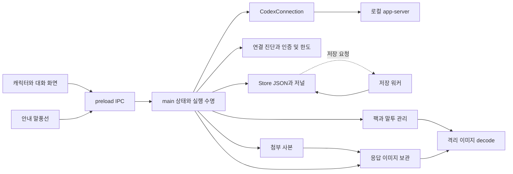

# my_budy 전체 코드 검토와 리팩터링 계획

2026-10-13의 최종 감사 보고서다. 프로젝트 소유 파일 186개를 검토했고, 확인한 결함 및 안내·검사 이슈 11개를 보완했다. 수정 전 재현과 변경 후 회귀는 별도 자료로 보존한다. 제삼자 코드 전수 보안 감사와 OS 실기 완료를 뜻하지 않는다. 앞선 9개 항목의 변경 상세는 [최적화 결과](OPTIMIZATION_RESULT_2026-10-13.md)에 있다.

my_budy는 로컬 Codex CLI와 연결하는 바탕화면 버디다. 작은 캐릭터와 일반 대화창 및 미니 대화창이 같은 대화 상태를 사용한다. 기존 질문 순서, 읽기 전용 실행, 실제 응답과 체험 응답 구분, 소유 대화와 파일의 보존을 리팩터링의 기준으로 유지한다.

입력 ID와 저장 복원의 자료형, 공유 이미지 저장 한도, 계정 사용량 조회 수명, 팩 내보내기 실패 정리, 대화상자의 Escape 처리와 검사 수명에 보완할 부분을 확인해 좁은 수정으로 처리했다. 남은 구조적 부채는 큰 함수의 상태 결합과 읽기·복사 비용이며 실제 경합 계약과 계측에 맞춰 단계적으로 정리하는 것이 적절하다. 함수 길이만을 이유로 단순 로직을 헬퍼로 옮기지는 않는다.

## 검토 범위와 완료 기준

[AGENTS.md](../../AGENTS.md)의 단순 로직 인라인·책임별 경계·데이터 팩·실제/체험 구분·검증 사실 기록 규칙을 적용했다. 저장 보고서는 앞서 읽은 `pages:write-page` 스킬의 기존 문서 형식·근거·이력 보존 기준을 따라 저장소 Markdown으로 작성했다. 새 DB·그림 생성·게임 모딩이나 외부 앱 쓰기 작업은 감사에 필요하지 않아 적용하지 않았다.

최초 작업 트리의 184개 파일을 기준으로 저장했고, 이후 중복 fixture 1개를 통합하고 테스트·결과 문서·이 보고서를 추가해 현재 목록은 186개다. JavaScript 64개(제품 16개, 검사/생성 스크립트 35개, 테스트 7개와 fixture 5개, ESLint 설정 1개), 제품 HTML/CSS, 캐릭터·스킨 56개, 배포 자산 7개, 루트 설정·잠금·고지와 문서 전체를 확인했다. 남았던 문서 28개도 원문을 읽고 현재 구현·검증·backlog와 대조했다. 생성 파일은 생성 소스와 출력 바이트를 비교했으며 vendor의 모든 실행 코드와 ignored 개인 자료·과거 앱을 제품 소스처럼 전수 감사한 것은 아니다.

검토 진행 목록은 [최종 coverage.json](../../artifacts/final-review-2026-10-13/coverage.json), 최초 기준은 [inventory.json](../../artifacts/full-review-2026-10-13/inventory.json)에 있다. 파일별 최종 해시·판정과 제거한 fixture의 근거를 기록하고, 최초 기준과의 변경은 보존된 수정·검증 내역으로 설명한다. 이전 날짜의 검사 결과를 이번 결과로 대체하지 않는다.

| 이번 검증 | 결과와 범위 |
|---|---|
| 린트 | ESLint 및 CSS 문법과 값 및 같은 블록의 중복 검사 통과 |
| 단위 검사 | 최종 135개 통과, 실패 및 건너뜀 0개. 이전 분석의 126개·최적화 단계의 134개는 해당 시점 기록으로 유지 |
| Electron 통합 | 최종 현재 소스에서 14종 모두 exit 0. 이미지·첨부·기록·삭제·FIFO·모달·팩·숨김/복구·decoder를 격리 프로필/모의 CLI로 검사. 실제 모델 호출 없음 |
| 구문과 기본 팩 검사 | JavaScript 구문 및 기본 팩 4개 검사 통과 |
| 추가 재현 | 최초 8개 경계 사례, 손상 저장 ID 추가 재현, 실제 첨부 검사 준비 시점 실패를 확인하고 수정 후 회귀와 대조. 실제 모델 호출 없음 |
| 의존성 분석 | 프로젝트 JavaScript 64개에서 AST의 문자열 require/import 경로 92개 수집. 해당 경로의 순환 0개 |
| 생성 번들 | esbuild의 write false 결과와 기존 renderer.bundle.js 및 LEGAL.txt 바이트 일치. 원본과 결과 파일을 덮어쓰지 않음 |
| 캐릭터 생성과 파일 참조 | 생성기를 가상 파일 쓰기로 실행한 38개 결과 바이트 일치. 팩 4개의 미참조 파일 및 unknown manifest key 0개 |
| 생성 고지 및 의존성 | THIRD_PARTY_NOTICES.txt 메모리 생성 결과 일치. lock 158개 package의 metadata와 integrity 확인, 직접 고정 버전 일치. 취약점 부재를 보장하는 검사는 아님 |

수정 전 분석 원본은 [최초 검사 폴더](../../artifacts/full-review-2026-10-13), 현재 검사·그래프·완료 대조는 [최종 폴더](../../artifacts/final-review-2026-10-13)에 있다. 최초 결함 재현 assertion은 수정 후 통과를 요구하는 회귀가 아니다. 정적 의존성 분석은 조건부 smoke import도 포함하며 IPC, EventEmitter, 워커 메시지, 계산한 경로의 의존성은 별도로 설명한다. 정적 순환이 없다는 결과가 상태 결합이 낮다는 뜻은 아니다.

## 모듈 경계와 데이터 흐름

| 책임 | 코드와 현재 경계 |
|---|---|
| 앱과 창 및 질문 실행 | `main.cjs` 1,413줄. 창, IPC, 접수, FIFO, 승인, 완료 저장, 알림, 복구와 종료의 상태를 소유한다 |
| 화면 표시와 입력 | `renderer.mjs` 901줄. 대화 및 설정 및 기록 화면, 메시지와 초안 캐시, 이미지와 애니메이션, 입력 이벤트를 관리한다 |
| 프로세스와 프로토콜 | `codex.cjs`가 child와 RPC 및 소유 turn을 관리한다. `models.cjs`가 모델 목록과 설정 호환성을 해석한다 |
| 인증과 연결 보조 | `connection-setup.cjs`가 CLI 발견과 버전, 인증 확인과 로그인 시도, 정제한 계정 사용량을 관리한다 |
| 저장과 복구 | `store.cjs`가 소유 대화 및 JSON 및 저장과 삭제 저널을 관리한다. `store-worker.cjs`는 큰 저장을 워커에서 실행한다 |
| 팩과 말투 | `packs.cjs`는 데이터 검증과 바이트 사본, `asset-validator.cjs`는 격리 decode, `pack-library.cjs`는 설치와 교체 및 복구와 export, `personas.cjs`는 편집 및 registry를 관리한다 |
| 첨부와 응답 이미지 | `attachments.cjs`는 선택 파일과 클립보드의 사본, `response-images.cjs`는 이미지 검증과 원본 및 미리보기 캐시를 관리한다. 이미지 첨부도 같은 캐시를 이용한다 |
| IPC와 안내창 | `preload.cjs`가 action과 상태 이벤트 및 trusted 첨부 입력을 연결한다. `notice.js`는 짧은 텍스트와 클릭 영역만 관리한다 |

`main.cjs`는 정적 모듈 의존성과 상태 의존성이 모이는 지점이다. 저장·연결·팩 모듈의 반환값과 이벤트를 화면 상태로 변환하고 같은 전역 변수로 IPC 작업을 판단한다. 따라서 기능 하나의 수정이 실행 큐, 저장, 숨긴 창과 종료를 함께 고려하게 만든다. 기존 책임별 모듈은 유지할 근거가 충분하고, 프로세스나 디스크 실패 경계를 다시 합치는 것은 수정 범위를 넓힌다.

질문 접수는 첫 await 전에 설정, 말투, 첨부와 목적을 캡처하고 접수 순서를 예약한다. 모델 준비와 저장이 끝난 질문만 FIFO에 추가한다. 실행은 하나씩 진행하고 thread 연결, turn 시작, 부분 이벤트 수신, 이미지 보관, 최종 저장을 거쳐 다음 질문으로 넘어간다. 승인은 FIFO를 기다리지 않는 제어 경로다. 접수 Promise, 실행 큐, 저장 워커의 세 순서는 다른 책임을 갖는다.

화면 상태는 50ms 단위로 묶이며 완료 시 즉시 예약한다. 패널에는 메시지 ID 순서와 변경분을 보내고, 캐릭터와 안내창에는 각 창에 필요한 상태만 보낸다. 렌더러는 숨긴 동안 캐시만 갱신하고 다시 표시할 때 DOM을 반영한다. 메시지 카드와 Markdown 재파싱을 줄이는 현재 최적화는 유지한다.

파일 첨부는 대화별 임시 ID를 통해 접수하고 실행 전에 보관 사본의 해시를 다시 확인한다. 이미지 첨부와 모델 응답 이미지는 같은 이미지 보관 모듈을 사용한다. 후자는 답변마다 순차 처리하지만 전자는 진행 중인 답변과 동시에 실행될 수 있다. 이 공유 저장 수명이 FULL02의 원인이다.

## 확인된 이슈와 우선순위

아래 표는 수정 전 확인한 문제다. FULL01–FULL09는 앞선 최적화에서, FULL10–FULL11은 최종 대조에서 보완했다. 위험도는 발생 시 영향과 도달 가능한 경로를 기준으로 한다. 비용은 파일 수와 회귀 경계의 상대적 크기이며 확정 일정이 아니다. 재현 코드와 결과는 [reproduce.cjs](../../artifacts/full-review-2026-10-13/reproduce.cjs), [repros.json](../../artifacts/full-review-2026-10-13/repros.json)에 있다.

| ID | 우선순위와 비용 | 문제와 영향 |
|---|---|---|
| FULL01 | P1, 작음 | 외부 팩 ID와 말투 및 스킨 ID 검증이 정규식의 자료형 변환을 허용한다. 잘못된 팩이 시작 검증을 통과한 뒤 말투 폴더 생성에서 시작 실패를 일으킬 수 있다 |
| FULL02 | P2, 중간 | 공유 이미지 캐시의 사용량 확인과 비동기 쓰기가 묶이지 않아 동시 요청이 각자 남은 공간을 사용할 수 있다 |
| FULL03 | P2, 작음 | 사용량 조회의 진행 Promise를 process/account와 구분하지 않아 새 연결의 조회도 이전 요청에 합쳐진다 |
| FULL04 | P2, 작음에서 중간 | 팩 export 실패의 재귀 제거가 새 폴더에 외부에서 추가된 파일까지 제거한다. 외부 파일 추가와 쓰기 실패가 겹치는 특수 상황이다 |
| FULL05 | P2, 작음 | 전역 Escape 처리에 대화상자와 이미 처리된 이벤트를 구분하는 조건이 없어 확인창 사용 중 패널도 숨길 수 있다 |
| FULL06 | P3, 작음 | 추가 질문 입력의 label과 input/select가 연결되지 않는다. 보조 기술의 입력 이름을 보완해야 한다 |
| FULL07 | P2, 작음 | 실제 CLI 삭제 검사에서 turn 시작이 실패하면 완료 대기 타이머가 정리되지 않는다. 검사 종료와 실패 처리의 문제이며 제품 실행 문제는 아니다 |
| FULL08 | P2, 작음 | native floating 검사는 passed 저장 이후의 스크린샷 실패가 async interval 바깥 catch에 잡히지 않는다. 결과 파일과 종료 상태가 어긋날 수 있다 |
| FULL09 | P3, 작음 | 현재 안내의 검사 수와 팩 목록, export 실행 조건과 일부 이름 및 시간 측정 설명을 코드와 맞출 필요가 있다 |
| FULL10 | P2, 작음 | 손상된 저장 이미지·첨부 ID와 hash/extension 배열이 정규식의 자료형 변환을 통과한다. 이미지가 ready여도 문자열 ID 조회와 맞지 않는다 |
| FULL11 | P3, 작음 | 첨부·연결 검사가 메인 준비/RPC 완료 직후 DOM 반영 전에 버튼을 조작·판정해 정상 비동기 전이도 실패할 수 있다 |

### FULL01 입력 ID의 자료형 검증

`packs.cjs`의 팩 ID 및 말투 ID, `skins.cjs`의 스킨 ID는 정규식 test 전에 문자열 여부를 확인하지 않는다. JavaScript가 `undefined`, `null`, `true`, 문자열 한 개를 담은 배열을 문자열로 변환하고 해당 정규식이 이를 통과시킨다. 반환 metadata는 원래 값을 유지한다.

재현에서 ID가 없거나 null 또는 boolean 또는 배열인 팩 모두 `loadPack`을 통과했다. 말투를 포함하면 `PersonaLibrary` 생성자의 `path.join`에서 자료형 오류가 발생한다. 앱 시작은 팩 로딩을 개별 try/catch로 처리하지만 이 잘못된 팩의 말투 초기화는 이후 공통 단계에서 실행하므로 시작 실패 안내와 종료로 이어진다. 정상 기본 팩의 문제가 아니라 외부 또는 손상된 팩의 예외 경계 문제다.

해결은 각 경계의 조건식에 문자열 확인을 인라인으로 추가하는 것이다. 스키마와 유효 ID 규칙은 바꾸지 않는다. 누락 및 null 및 boolean 및 배열과 정상 문자열을 검사하고 잘못된 팩이 개별 오류 목록으로 빠지면서 다른 기본 팩으로 시작하는지 확인한다. 저장 및 팩 복구 저널의 ID 조건도 같은 기준으로 검토한다.

### FULL02 이미지 캐시의 동시 용량 계산

`ResponseImages.capture`는 decode 후 폴더 사용량을 합산한 뒤 await가 있는 임시 파일 쓰기를 한다. 그 사이 다른 capture도 같은 기존 사용량을 읽을 수 있다. `main.cjs`의 답변 이미지 체인은 같은 job 내부만 순차화한다. 첨부 입력은 실행 중 질문이 있다는 이유로 차단되지 않고 같은 ResponseImages를 호출한다.

실제 크기를 가진 sparse 임시 파일로 512MiB 한도 직전 상태를 만들고 기존 PNG 두 개의 쓰기를 겹치게 했다. 두 요청 모두 ready를 반환했고 계산한 폴더 파일 크기는 한도보다 589바이트 컸다. 썸네일 decode는 캐시 커밋 검증을 위해 모의 처리했다. 이 결과는 물리 디스크 512MiB를 사용했다는 의미나 Electron decode 검증 결과가 아니다.

기존 decode를 병렬로 둘 수 있지만 용량 확인부터 원본과 미리보기 커밋까지는 같은 인스턴스의 저장 순서를 보장해야 한다. 실패한 작업이 다음 저장을 막지 않도록 Promise 수명을 정리한다. 파일 이름과 해시 및 최대 크기와 오류 metadata 계약은 유지한다. 서로 다른 이미지, 같은 해시, 원본 쓰기 및 미리보기 쓰기 실패, 두 요청 중 하나의 실패와 다음 요청 재개를 확인한다. 비이미지 첨부의 캐시도 실제 호출 직렬화 범위와 함께 확인한다.

### FULL03 계정 변경 중 사용량 조회

`ConnectionSetup.readUsage`는 process와 accountRevision을 캡처하기 전에 `usageWork`를 재사용한다. 오래된 응답은 기존 검사로 폐기하므로 다른 계정의 값을 덮어쓰지는 않는다. 문제는 새 계정이나 연결에서 조회해도 새 RPC가 발행되지 않는다는 점이다.

재현에서 이전 조회를 보류한 채 process를 바꾸고 연결 해제 및 account 변경 이벤트를 전달했다. 새 조회까지 포함해 RPC는 하나뿐이었으며 이전 응답 이후 상태는 조회하지 않은 idle로 남았다. 인증 조회인 `check`는 이미 process/revision을 기준으로 진행 요청을 구분한다.

같은 소유 범위의 조회만 합치고 변경된 범위는 새 조회를 시작하도록 read 수명을 관리한다. 오래된 finally가 새 `usageWork`와 `usageRead`를 지우지 않도록 소유 객체를 비교한다. 같은 계정의 중복 조회와 항목별 notification 병합, 오래된 성공 및 오류 응답 폐기 계약은 유지한다. 연결 교체, 계정 변경, 부분 업데이트, 새 조회가 먼저 끝나는 순서를 검사한다.

### FULL04 팩 내보내기의 실패 정리

`PackLibrary.export`는 새 목적지 폴더에 파일을 쓴 뒤 실패하면 폴더 전체를 재귀 삭제한다. 임시 재현에서 이미지 쓰기 직전에 다른 파일을 추가하고 쓰기 실패를 주입했을 때 그 다른 파일도 사라졌다. export가 동기 함수이므로 같은 앱의 사용자 조작이 쓰기 사이에 끼어드는 상황은 아니다. 다른 프로세스의 파일 추가까지 겹치는 경우의 보존 문제다.

실패 때 자신이 만든 파일의 소유 정보만 확인해 정리하고 나머지가 있으면 폴더를 보존한다. 보존된 부분 결과가 있는 경우 안내에 경로를 남긴다. 파일 쓰기 실패, 외부 추가 파일, 같은 이름 충돌, 수정되거나 교체된 출력 파일, 성공 export의 팩 재검증을 확인한다. 이미 대화 및 이미지 내보내기에 적용한 보존 기준과 맞추되 별도 범용 파일 프레임워크는 도입하지 않는다.

### FULL05 확인창의 Escape 처리

렌더러의 document keydown은 Escape가 들어오면 모델 popover를 닫거나 패널을 숨긴다. 열려 있는 dialog 또는 처리된 이벤트를 확인하지 않는다. 삭제와 팩 적용 중에는 dialog cancel을 막지만 전역 keydown 경로의 패널 숨김은 별개다.

원본 keydown 등록 코드를 AST로 추출해 VM에서 실행했을 때 `defaultPrevented: true`인 dialog의 Escape에도 hide-panel을 요청했다. 실제 키보드와 Chromium dialog의 이벤트 순서는 별도 화면 수용 검사에서 확인해야 한다. 수정은 해당 이벤트와 활성 모달의 소유를 먼저 확인하는 인라인 조건으로 제한한다. 대화창 기본 Escape, 모델 popover, 취소 가능한 dialog, 진행 중 취소 불가 dialog, 수정 초안 보존을 함께 검사한다.

### FULL06 추가 질문의 접근성

추가 질문 카드는 label, select, input을 형제 노드로 추가하고 label의 for나 입력의 aria-labelledby를 지정하지 않는다. 질문마다 안정적인 DOM ID 또는 감싸는 label을 적용하고 선택 목록도 질문과 연결한다. 도구 질문 ID를 그대로 HTML 문자열로 삽입하지 않고 DOM 속성으로 설정한다. 동적 입력의 접근성 이름과 키보드 이동을 확인한다. 화면 읽기 프로그램의 실제 동작은 검증 완료로 표시하지 않는다.

### FULL07 CLI 검사 실패의 타이머 정리

`codex-delete-smoke.cjs`는 thread 생성 이후 완료 Promise와 60초 타이머를 만들고 turn/start RPC를 기다린다. RPC가 거절되면 외부 catch와 bridge.stop을 실행하지만 타이머와 notification listener는 정리되지 않는다. 완료 Promise를 await하지 못한 상태에서 나중에 타이머가 이를 reject하므로 실패한 검사가 지연되거나 처리되지 않은 rejection으로 종료될 수 있다.

원본 스크립트를 VM에서 실행하고 turn 시작 실패를 주입했을 때 exitCode 1 및 bridge.stop 이후에도 60초 타이머 하나가 남았다. 타이머 callback과 실제 모델은 실행하지 않았다. 완료 대기 수명을 RPC 시작부터 finally까지 한 범위로 두고 모든 실패에서 타이머와 listener를 해제한다. 검사에 만든 thread의 정리 실패는 생성한 ID와 함께 구분해 기록한다. 실패한 실행이 이전 passed JSON을 최신 결과처럼 남기는지도 검사 결과 저장 정책에서 함께 보완한다.

### FULL08 네이티브 검사 결과와 비동기 실패

`native-floating-smoke.cjs`는 async setInterval에서 성공 결과 JSON을 먼저 쓴 뒤 capturePage를 기다린다. setInterval callback의 rejection은 callback을 등록한 바깥 try/catch에서 처리되지 않는다. 타이머도 이미 해제했으므로 성공적인 app.quit이나 실패한 app.exit를 직접 보장하는 경로가 사라진다.

원본 스크립트와 모의 창 이벤트에서 capturePage 실패를 주입했을 때 passed JSON이 존재했지만 callback은 reject했고 바깥 catch 및 정상 종료와 오류 종료 호출은 모두 0회였다. 네이티브 포인터를 실제 검증했다는 뜻은 아니다. callback 안에서 예외를 처리하고 필수 캡처와 정리가 성공한 뒤 passed를 기록한다. 다른 검사도 최종 필수 작업 전에 passed를 쓰는 곳을 같은 기준으로 점검한다. 통합 runner의 exitCode와 개별 JSON을 함께 확인해야 한다.

### FULL09 현재 안내와 구현의 차이

현재 버전 기준인 BUILD_GUIDE의 npm test 행은 90개 통과라고 쓰지만 현재 검사는 126개다. 과거 적용 기록의 90개는 날짜별 근거이므로 보존하고 현재 명령표만 최신 결과에 연결한다. README의 캐릭터 소개는 기존 두 팩을 기본 팩으로 설명하지만 현재 제공 팩은 4개다. BUDDY_MODES_REVIEW는 export도 작업 종료 후 진행한다고 설명하지만 실제 pack-export는 진행 작업 및 대기열을 조건으로 막지 않는다. export는 현재 job의 말투 snapshot을 바꾸지 않으므로 코드에 새 차단을 추가하기보다 허용 조건을 정확히 설명하는 편이 적절하다.

이름 변경이 CLI 입력을 바꾸지 않는다는 문구는 질문 원문과 페르소나 지시를 구분해야 한다. 실제 질문 원문은 유지하지만 새 질문의 persona instructions에는 캡처한 버디 이름이 포함된다. RESPONSE_TIMING의 첫 응답 정의도 agent 텍스트 외에 계획 및 리뷰 결과와 완료 이미지에 timestamp를 기록하는 현재 구현을 설명하도록 보완한다. 과거 측정의 시각과 범위를 최신 수치로 덮어쓰지 않는다.

### FULL10 손상된 저장 참조의 자료형

`Store.readHistory`는 이미지 ID/previewId, 첨부 ID/hash/extension/previewId, 스킬 hash를 정규식으로 검사하지만 일부는 문자열 여부를 먼저 확인하지 않았다. 임시 Store에 정상 해시를 배열에 담은 기록을 넣고 다시 열면 ready 이미지와 첨부·스킬 참조가 배열로 유지됐다. renderer의 dataset은 이를 문자열로 바꾸지만 main의 소유 ID 조회는 엄격한 동등 비교를 하므로 미리보기 대상과 일치하지 않는다. 정상 앱이 배열 ID를 생성한다는 뜻이 아니라 손상·외부 수정 기록의 복원 경계다.

기존 필터/failed 표시 정책 안에 문자열 조건을 인라인으로 추가하고 ResponseImages/AttachmentStore의 직접 읽기도 같은 기준으로 보강했다. 손상된 참조만 실패·제외하며 텍스트와 정상 참조 및 원본 파일은 보존한다. 대화 ID 배열도 파일 접근 전에 거절한다. [수정 전 재현](../../artifacts/final-review-2026-10-13/stored-id-before.json), [최종 단위 로그](../../artifacts/final-review-2026-10-13/unit.log)에 근거가 있다.

### FULL11 첨부 검사의 화면 준비 시점

최종 저장 경계 회귀 중 attachments 검사가 `show-panel` RPC 직후 `send.disabled=false`를 바로 요구하며 실패했다. action 응답과 renderer의 state/DOM 반영은 서로 다른 시점이다. 제품의 busy 보호를 완화하지 않고 같은 검사 안에서 실제 버튼 활성화를 최대 5초 기다린 뒤 기존 assertion을 수행하도록 보완했다. 연결 검사도 메인의 login-required와 UI 버튼 준비를 구분해 실제로 표시·활성화된 뒤 클릭한다. 후속 선택·제거와 큐 취소에서도 목록 표시와 실제 입력 잠금 해제를 함께 기다리도록 보완했다. 실패 로그와 수정 전 스크립트를 보존했고 최종 현재 소스의 전체 14종이 통과했다. 첨부 기능 확인 로그 뒤 앱 정상 종료 지연으로 timeout 난 실행도 보존하며, 이 한 번의 관찰만으로 제품 종료 결함의 원인을 확정하지 않는다. [최초 실패](../../artifacts/final-review-2026-10-13/integration/attachments.log), [최종 검사](../../artifacts/final-review-2026-10-13/integration-current/integration.json)를 구분한다.

## 구조와 최적화 후보

`main.cjs`에는 창 위치 및 포인터, 알림, 접수와 실행, 기록 검색과 병합 및 export, 첨부 입력, 연결 설정, 팩과 말투 설정이 모여 있다. 각 작업의 중단 여부를 전역 플래그 조합으로 판단하므로 누락이나 수명 변경에 취약하다. 지금은 대규모 이동보다 확인된 예외를 수정하고 경합 계약을 테스트로 고정할 단계다.

렌더러의 `onState`는 250줄 이후에도 여러 화면과 메시지 및 큐 및 승인 표시를 함께 수행한다. 모델·말투·팩 목록의 signature 캐시, 메시지 카드 재사용은 실제 반복 비용을 줄이므로 유지한다. 분리한다면 메시지 DOM과 이미지 관찰 수명처럼 독립적인 책임부터 옮긴다. 단일 select 갱신이나 문자열 생성마다 헬퍼를 추가하지 않는다.

| 후보 | 판단과 다음 확인 |
|---|---|
| 이미지 decode 픽셀 예산 | 이미지마다 합산해 한도 초과 시 후속 decode를 중단하도록 적용했다. 후속 호출·bitmap/창 해제와 실제 자산 검사를 확인했으며 메모리 초과 재현이나 성능 개선률로 단정하지 않는다 |
| 경로 및 원본 검증 반복 | 팩 변경의 realpath 확인과 말투 이름 정규화 일부가 반복된다. 외부 파일 변경을 방어하는 경계 검사는 보존하고 동일 동기 구간의 불필요한 계산만 구분한다 |
| 모델 중복 확인 | 최대 200개에서 선형 탐색을 반복한다. 상한이 있으므로 우선순위는 낮다. 측정 없이 Map 전환의 효익을 주장하지 않는다 |
| 긴 기록 처리 | 페이지 읽기는 비동기지만 로컬 JSON 전체 읽기 및 parse, 검색과 일부 전환은 메인에 남는다. 크기별 지연을 측정한 뒤 기존 저장 워커와 별도의 읽기 경계가 필요한지 결정한다 |
| 팩 없는 복구 상태 | 정상 팩이 없으면 원본을 보존하고 복구 캐릭터를 표시하되 질문은 차단한다. 실행 가능한 데이터 팩을 복구하기 전 기존 질문을 보내지 않는 현재 정책을 유지한다 |
| 생성 번들과 배포 파일 | 원본과 라이선스 및 패키지 manifest를 대조해 판단한다. 생성 코드 내부의 헬퍼를 직접 수정하지 않는다 |
| fixture 중복 | delete-codex.cjs와 persona-codex.cjs는 51줄 중 turn의 personaInstructions 한 필드만 다르다. 해당 필드를 기존 삭제 fixture에 포함해 두 검사에서 공통 사용하도록 통합했다. 가짜 프로토콜 전체를 범용 프레임워크로 추출할 필요는 없다 |
| 구현 문자열을 추출하는 테스트 | 일부 VM 검사는 줄의 startsWith/includes로 renderer 코드 조각을 찾는다. 의미 없는 줄바꿈 변경에도 깨질 수 있다. 기능 책임을 분리할 때 실제 입력과 DOM 결과를 검증하는 계약 검사로 이전하되 경합과 파일 실패를 주입하는 현재 검사는 유지한다 |

## 주석과 컨벤션

프로젝트 JavaScript의 AST는 현재 주석 항목 10개를 반환했다. 이 중 설명 주석은 7개이고 3개는 fixture의 실행 지시인 hashbang이다. 제품 코드의 턴 소유, 이전 child의 실패 격리, 창의 OS 검증 한계, 편집 초안 복구, 파생 삭제 확인, 접수 순서 주석과 CSS 검사기의 변수 치환 주석은 현재 코드의 이유를 설명한다. 완료한 TODO를 남겨 둔 형태로 확인되지 않았다. CSS의 데이터 스킨 주석도 현재 구조와 맞는다. 실행 지시와 필요한 실패 경계 주석은 제거 대상이 아니다.

기존 CommonJS 및 renderer ESM, 인라인 동기 처리, 책임별 class 경계를 따른다. 작은 상태 변경의 헬퍼 추출은 필요하지 않다. dense한 한 줄에 검증과 I/O 및 복구가 함께 있는 곳은 관련 조건을 같은 함수에서 여러 줄로 펼치는 편이 검토와 실패 지점 확인에 도움이 된다. 새 formatter나 lint 규칙을 전체 적용하면 현재 기능 변경과 무관한 diff가 커지므로 별도 단계로 판단한다.

린트 통과는 자료형 검증, 동시 I/O, 사용자 입력 접근성을 보장하지 않는다. AST의 주석 및 require/import 목록과 실행 재현을 함께 사용해 이 차이를 구분한다.

## 외부 계약을 유지하는 단계별 계획

1–5와 검사·현재 안내 보강은 적용했다. 최종 저장 참조 검증 FULL10과 화면 준비 검사 FULL11도 같은 경계 안에서 처리했다. 6–8의 구조 이동·계측은 아래 D01–D07의 후속 조건에 따라 진행한다.

| 순서 | 변경 범위 | 기존 계약과 완료 조건 |
|---|---|---|
| 1 | FULL01 ID 자료형 조건 | 팩 schema 1/2 및 유효 문자열 ID 그대로 유지. 잘못된 외부 팩만 거절하고 기본 팩의 시작과 가져오기 및 말투 선택 확인 |
| 2 | FULL02 공유 캐시 저장 수명 | SHA 이름 및 metadata 및 512MiB 한도 유지. 다른 이미지 동시 저장과 같은 해시, 실패 이후 저장 재개 확인 |
| 3 | FULL03 조회 소유 객체 | 인증 정책 및 계정별 정제 값 유지. 새 process/account RPC를 실제 발행하고 이전 응답 및 finally의 간섭 방지 |
| 4 | FULL04 export 정리 | 성공 출력 규격 유지. 실패 시 외부 파일과 수정한 출력 보존 및 부분 결과 안내 확인 |
| 5 | FULL05 및 FULL06 UI 제어 | dialog가 Escape를 먼저 소유하고 패널 기본 닫기는 유지. 질문 input/select의 이름 및 키보드 이동 확인 |
| 5 이후 | FULL07 및 검사 코드 정리 | 실 모델 호출 없이 실패 경로의 timer/listener 정리 검사. fixture 통합은 삭제와 말투 Electron 검사를 같은 모의 환경에서 통과한 뒤 확정 |
| 5 이후 | FULL08 결과 기록 및 FULL09 현재 안내 | screenshot 및 종료 실패를 모의 주입하고 JSON 상태와 exitCode 대조. 현재 안내를 갱신하고 날짜별 이력은 보존 |
| 6 | 경합 회귀와 모듈 경계 확정 | 접수 FIFO 및 단일 turn 및 완료 저장, 승인과 중단 및 종료 수명을 먼저 고정. 새로운 상태 프레임워크는 도입하지 않음 |
| 7 | 메시지 표시 책임 정리 | 독립적인 DOM과 observer 수명만 필요한 경우 분리. preload action 및 state patch, 초안과 목록 캐시 계약 유지 |
| 8 | 큰 기록과 decode 최적화 | 같은 크기와 실행 조건의 전후 계측 후 결정. 자동 재전송, 저장 형식 변경, DB 도입은 이 단계에 포함하지 않음 |

모듈 이동은 한 책임씩 진행하고 각 단계에서 기존 검사와 수정 경계에 필요한 회귀를 수행한다. 버전 변경이나 패키징은 실행 코드 수정 및 검증이 확정된 이후 결정한다. 분석만으로 새 릴리스나 설치 파일을 만든 것으로 표시하지 않는다.

## 버디 사용 경험 개선 방향

첫 연결 안내는 현재 CLI 발견, 로그인, 폴더, 모델의 순서와 해결 버튼을 유지한다. 복구 동작이 질문을 자동 재전송하지 않는다는 안내와 대기열 재개의 선택을 화면에서 일관되게 보여 주는 것이 중요하다. 계정 사용량이 오래된 요청에 묶이면 새 조회를 즉시 허용하는 FULL03이 연결 편의성 개선의 우선 작업이다.

일반 입력을 계속 작성하면서 진행 작업은 하나씩 실행하는 현재 구조를 유지한다. 대기 보류의 사유가 여러 개면 사용자에게 현재 사유와 해결 버튼을 표시하고, 수정 중 질문과 일반 초안의 구분을 유지한다. 단순한 버디 대화에서 작업 목적 및 스킬과 상세 사용량을 접힌 옵션으로 둔 선택은 적절하다.

캐시 한도 오류에 폴더 안내만 제공하기보다 향후 보관 크기와 참조 상태를 확인하는 화면을 검토할 수 있다. 삭제된 대화의 이미지가 다른 대화나 첨부에서 재사용될 수 있으므로 참조 검증 없는 자동 삭제는 하지 않는다. 실제 보존 정책과 제거 계획은 전체 호출 및 문서 검토 뒤 확정한다.

OS 알림 배너와 실제 클릭, 물리 IME 및 드롭, 새 계정 브라우저 로그인, Windows 및 혼합 DPI와 배터리는 코드와 모의 검사로 완료를 대신할 수 없다. 기존 정리의 합성 검사 PNG 두 개 원본 미복구 제한도 [정리 결과](LEGACY_FILE_CLEANUP_RESULT_2026-10-12.md)에 유지한다.

## 파일·문서별 최종 판정

현재 파일 목록은 루트 8개, src 22개(생성 번들/고지 포함), scripts 35개, test 12개, 캐릭터·스킨 56개, 자산 7개와 docs 46개다. 각 파일의 판정·해시는 최종 ledger에 있다. 검사 코드 전체와 자산 및 의존성 검토를 마쳤다. 캐릭터 Markdown은 동일 해시를 묶어 모든 원문을 대조했고, 각 팩에서 독립적으로 사용하는 파일이므로 중복만을 이유로 외부 공유 경로로 바꾸지 않는다. SVG는 검토한 생성 코드의 결과와 기존 바이트가 모두 일치한다. v2의 상태 이미지 및 blink 참조가 유효하며 미참조 파일은 없다. 스킨의 팔레트 3개도 실제 사용 목록과 일치한다.

brand는 CSS 마스크, tray 및 tray@2x는 macOS와 Retina, icon PNG/ICO/ICNS는 실행 및 플랫폼 패키징, tray-source는 사용자 생성 원본으로 필요하다. binary의 구조 및 크기와 참조를 확인했으며 실제 메뉴 막대 외관을 이번 검사로 완료한 것은 아니다. 각 자산에 역할이 있어 현재 삭제 대상은 없다. 생성 라이선스 고지는 실제 패키지 의존성 파일에서 메모리로 재생성한 결과와 일치하며 현재 실행 의존성 3개와 개발 의존성 5개를 추측으로 제거하지 않는다.

현재 문서 25개와 이력 21개 및 루트 문서를 상호 참조, 완료·미검증 표현, 중복된 작업계획, 버전·설치 경로에 대조했다. 레거시 파일이라는 이유로 실행 회귀 fixture, migration과 복구 코드, 과거 측정 근거와 사용자 보관 자료를 삭제 대상으로 처리하지 않는다. 전체 목록에 미검토 파일이 없는지와 검증 당시 해시를 최종 대조했다. 역사 문서의 고정 staging/소스 경로는 현재 내용으로 재사용될 수 있으므로 당시 결과 JSON·해시를 함께 읽는다. 반복 계획은 현재 TASKS와 결과 링크로 찾을 수 있게 유지하고, 과거 실패·검사 수·복구 근거는 제거하지 않는다.

## 남은 기술 부채의 우선순위와 수정 비용

다음 항목은 미측정 병목·환경 수용·구조 부채다. 이미 수정한 FULL01–FULL11을 다시 미착수 결함으로 계산하지 않는다. 비용은 상대적인 구현·회귀 범위이며 일정 약속이 아니다.

| ID | 위험도·비용 | 근거와 다음 작업 | 완료 조건 |
|---|---|---|---|
| D01 | P2 · 중간 | 기존 staging build34는 추가 수정 전 소스다. 다음 전달 시 새 후보를 별도 보존·생성하고 source/ASAR/unpacked worker/version을 대조 | 최신 소스의 패키지 검증·격리 실행·필요한 OS 화면 확인 후 전달. 기존 앱·프로필·롤백 보존 |
| D02 | P2 · 중간~큼 | main 1,413줄에 창·IPC·질문·저장·복구 상태가 모인다. 접수·실행·종료 저장의 소유 범위를 먼저 고정 | FIFO·취소/승인 우선·중복 완료·저장 실패·절전/재연결의 기존 회귀 유지 후 한 책임씩 이동 |
| D03 | P3 · 중간 | renderer 901줄의 큰 onState가 화면과 카드·초안·큐·요청을 함께 관리한다. 메시지 DOM과 이미지 observer 수명부터 독립 여부 판단 | 미니/전체·숨김/복원·스크롤·초안·접근성·Markdown 정제·ACK 계약 보존. 필드별 helper는 추가하지 않음 |
| D04 | P2 · 계측 작음, 수정 중간 | 전체 로컬 JSON 읽기/parse·검색·워커 구조화 복사는 메인 비용으로 남는다 | 1/16/30MiB와 많은 작은 메시지에서 heartbeat·읽기/저장·취소 전달·peak memory를 같은 조건으로 계측한 뒤 변경 |
| D05 | P3 · 작음~중간 | 일부 VM 검사는 구현 문자열의 위치에 의존하고 UI 검사는 메인 완료와 DOM 준비를 구분해야 한다 | 책임 경계를 바꿀 때 실제 입력/결과 계약 검사로 이전. 실패 결과·exitCode·필수 캡처/정리를 함께 확인 |
| D06 | P3 · 중간 | 이미지/첨부 캐시·팩 archive·MD 백업은 자동 만료하지 않는다 | 보관량·참조·소유 범위를 보여 주는 명시적 정리 설계. 공유 해시와 사용자 추가/수정 파일 보존 |
| D07 | P2 · 환경별 중간~큼 | Windows/혼합 DPI·Snap·물리 IME/드롭·절전/Spaces·새 로그인·알림 배너/클릭은 자동 검사로 대체되지 않는다 | TASKS C08/C10/E07/E08/E10/O02/O05/O07/O10/BUD 수용 표를 실제 환경에서 확인하고 날짜·소스·한계를 기록 |

현재 단순한 작은 모듈을 합칠 근거는 없다. decode와 파일 형식 검사, Store와 worker, CLI와 연결 진단, 첨부와 응답 이미지는 서로 다른 책임·실패 경계다. 큰 main/renderer의 코드를 나누더라도 이런 경계를 흐리지 않고 실제 소유 객체와 계약을 기준으로 진행한다.

## 완료 요구와 근거 대조

| 요청 | 최종 근거와 판정 |
|---|---|
| 모든 프로젝트 코드·문서·규칙 실제 확인 | 현재 186개 파일 ledger와 최초 184개 기준, 문서 잔여 28개 원문 대조. 제품·검사·테스트·데이터·생성물별 검토 방식 구분 |
| 모듈·의존성·데이터 흐름·상태·핵심 경로 | 위 책임/흐름 분석과 최종 AST 그래프. 문자열 경로 92개·순환 0개, IPC/event/worker의 동적 의존은 별도 설명 |
| 결합·책임 혼재·중복·추상화·기술 부채 | main/renderer 집중과 D02–D06, fixture 통합 및 기존 책임별 모듈 보존 이유 |
| 위험·비용·안전한 단계 계획 | FULL01–FULL11의 재현/회귀와 단계별 계획, D01–D07의 착수·완료 조건. 권한/저장 형식·FIFO·사용자 원본 계약 유지 |
| 주석·린트·컨벤션·헬퍼·데드코드·문서 | 설명 주석 7개/실행 지시 3개·CSS 1개 대조, 린트/구문·파일 참조·데이터/자산 소비 확인. 필요 없는 fixture만 통합, 단순 로직 인라인 유지 |
| 오류·예외·특수 상황 | 동시 저장·조회 소유·실패 정리·모달·잘못된 ID/저장 참조·검사 timeout/RPC/캡처 실패의 직접 근거. OS 미검증과 수용 계획 별도 |
| 사용하기 쉽고 안전한 UI/UX | 단계별 연결 복구·초안/FIFO·정숙·작업 정보의 접힘·추가 질문 label·모달 Escape, 보관 정리와 플랫폼 수용 개선 방향 |
| 최종 보고와 사실 기반 완료 | 미검토 파일 0, 최종 해시와 검사별 실행 범위를 대조. 실제 모델 재호출·새 배포·제삼자 전수 보안 감사·OS 실기 완료로 확대하지 않음 |

최종 원자료는 [final-review-2026-10-13](../../artifacts/final-review-2026-10-13)에 있다. 분석 목적의 전체 탐색·정합성 검토·리팩터링 계획은 완료하며, 위 기술 부채와 환경 수용은 그 결과로 남긴 후속 작업이다.
