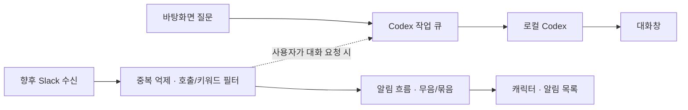

# 옹기봇 기획·구조·코드 검토

초기 분석 기준: 2026-10-06, alpha.6. 아래의 남은 이슈는 당시 상태이며 alpha.7 적용 결과는 문서 마지막에 갱신했습니다. 기존 소스와 문서, 설치 CLI 0.160.0의 실제 응답, 핵심 테스트 및 네이티브 UI 검증을 근거로 작성했습니다. 제품·라이브러리의 현재 설계는 공식 문서로 확인했으며 시장 점유율이나 유행을 추정하지 않았습니다.

## 시작한 문제와 전제

대화에서 확인한 목표는 **바탕화면에서 빠르고 편하게 질문하기**, **움직이는 나만의 캐릭터 보기**, 이후 **Slack 호출·키워드 알림 받기**입니다. 여러 클라이언트의 공용 FIFO 서버는 이후 과제입니다. 시작 계기는 앱을 전환해 질문하는 번거로움과 중요한 대화를 놓치는 불편으로 해석할 수 있습니다. 특정 업무 사고가 있었다는 근거는 없습니다.

캐릭터는 접근성을 높이고 지속 사용을 돕는 접점입니다. 실질적인 가치는 질문까지의 마찰과 필요한 소식을 확인하는 시간을 줄이는 데 있습니다. 외형을 바꾸어도 대화·모델·알림 정책이 유지되는 데이터 팩 방식은 이 목표에 맞습니다. 캐릭터마다 실행 스크립트를 허용할 필요는 없습니다.

검증해야 할 전제는 다음과 같습니다.

- 캐릭터가 사용 동기를 높이면서 업무를 방해하지 않는가? 클릭을 가로막거나 반복 안내가 떠 있으면 목표에 반합니다.
- 느린 원인은 모델뿐인가? 현재 측정은 모델 조회·큐·연결·최종 응답·화면 반영을 분리합니다. Fast가 큐나 UI 지연까지 해결하지는 않습니다.
- 로컬 앱이면 오프라인인가? 화면과 기록은 로컬이지만 모델 응답은 CLI의 계정·네트워크에 의존합니다.
- 모든 Slack 메시지를 AI로 읽어야 하는가? 호출과 명확한 키워드는 규칙으로 먼저 처리할 수 있습니다. 뉘앙스 감지는 실제 오탐 사례가 쌓인 뒤 평가해야 합니다.
- 공용 FIFO가 편리함을 높이는가? 긴 요청이 모든 사용자를 막을 수 있습니다. 현재 단일 사용자에서는 연결 재사용과 빠른 접근이 먼저입니다.

## 기획자가 먼저 확인할 사항

지금 확정된 우선순위를 다시 묻지 않고, 다음 단계 착수 시 아래 결정을 구체화합니다.

1. 질문창을 여는 데 허용할 시간, 첫 답변과 완료 답변의 목표 지연은 얼마인가? 체감 속도는 최종 시간 외에 첫 응답도 봅니다.
2. Slack에서 누가 호출할 수 있는가? 본인 멘션·봇 멘션·지정 키워드 중 무엇이며, 대상 채널은 어디인가?
3. 알림은 말풍선·배지·소리 중 무엇이고 무음 시간, 반복 묶음, 최대 빈도는 어떻게 할 것인가?
4. PC가 잠들거나 꺼졌을 때 알림을 나중에 받아야 하는가? 이 조건이 로컬 수신과 상시 서버의 분기점입니다.
5. 우선은 질문/알림만 하는가, 파일 변경·명령 실행도 필요한가? 필요한 작업별 승인 경계를 정합니다.
6. 유휴 메모리·CPU·배터리 목표가 있는가? 캐릭터 움직임과 상시 창의 비용을 실제 사용 시간에 맞춰 측정합니다.
7. FIFO 단계에서는 접수 순서·실행 시작 순서·완료 순서 중 무엇을 보장해야 하는가? 사용자별 대화, 계정, 취소, 재시도 정책도 함께 정합니다.

첫 출시 평가에는 질문창을 연 횟수, 첫 응답/전체 시간의 중앙값·p95, 알림의 유용/불필요 표시, 무음/종료 이유를 쓰는 것이 적절합니다. 수집 범위와 저장 정책을 먼저 정하고 대화 원문을 불필요하게 전송하지 않습니다. 아직 해당 사용 지표 수집은 구현하지 않았습니다.

## 현재 기술 흐름과 구조 선택

현재 Codex는 UI가 stdio JSON-RPC로 대화·턴·스트리밍·승인 등을 다룰 수 있는 App Server 인터페이스를 제공합니다. 따라서 터미널 화면을 자동 타이핑하고 긁어오는 대신, CLI 인증과 실행 체계를 재사용하는 얇은 데스크톱 UI가 적합합니다. 이는 공식 인터페이스를 근거로 한 설계 판단입니다. [Codex App Server](https://learn.chatgpt.com/docs/app-server)

현재 구조는 `캐릭터/대화창 → 제한된 IPC → 메인 프로세스 → Codex app-server`입니다. 모델 카탈로그, 질문별 모델·추론·속도 스냅샷, 대화별 소유 기록을 유지합니다. 모델 목록 갱신은 실제 CLI 응답을 사용하며 계정 실행 권한을 보장하는 목록으로 취급하지 않습니다.

Slack의 로컬 첫 단계에는 Socket Mode가 맞습니다. 공개 수신 URL 없이 WebSocket으로 이벤트를 받고 envelope를 ACK합니다. 연결 재수립과 중복 전달을 고려해야 하므로, ACK를 LLM 판단이 끝날 때까지 미뤄서는 안 됩니다. 내구성 있는 접수 후 ACK, event/envelope 식별자 기반 중복 억제, 호출/키워드 필터, 알림 표시를 분리하는 방향입니다. PC가 꺼져도 수집해야 하면 상시 실행 서버를 검토합니다. [Slack Socket Mode](https://docs.slack.dev/apis/events-api/using-socket-mode/)

알림은 긴 작업 뒤에 밀리지 않도록 작업 큐와 별도 흐름으로 둡니다. 뉘앙스 판단이 필요한 일부 이벤트만 제한된 분석 큐에 넣습니다. 외부 메시지를 접수했다는 사실이 로컬 도구 실행을 허가하지는 않습니다.

다중 클라이언트 브로커는 실제 동시 수요가 생겼을 때 도입합니다. FIFO 큐의 접수/시작 순서와 완료 순서는 다릅니다. 여러 워커가 실행하면 완료는 뒤바뀔 수 있습니다. 전체 완료 순서까지 엄격히 보장하려면 동시성 1의 비용을 감수하거나 순서대로 결과를 전달하는 별도 정책이 필요합니다. 기본 추천은 대화별 순서 유지와 사용자별 공정성입니다. BullMQ의 FIFO 문서도 동시 처리 시 완료 순서 차이를 명시합니다. [BullMQ FIFO](https://docs.bullmq.io/guide/jobs/fifo)

데스크톱 런타임에는 OS WebView와 Rust를 쓰는 Tauri 같은 선택지가 있습니다. 작은 배포·리소스 목표를 검토할 후보지만 현재 투명 창, 클릭 통과, 한국어 입력, CLI, 패키징이 검증된 Electron을 바로 교체할 근거는 부족합니다. 장시간 유휴 측정이 목표를 넘으면 동일 기능의 작은 프로토타입을 비교합니다. 구조 차이가 이 앱의 실측 성능 차이를 보장하지는 않습니다. [Tauri 구조](https://v2.tauri.app/concept/architecture/)

## 이번에 수정한 코드·문서 이슈

| 발견 사항 | 조치 | 확인 근거 |
|---|---|---|
| 설정 탭이 주요 탐색 영역을 차지 | 대화/이전 대화 두 탭과 우측 설정 톱니바퀴 | 네이티브 UI·timing smoke |
| 응답 지연의 어느 단계가 느린지 알 수 없음 | 선택형 단계 측정, 첫 응답·큐·전체 포함 | 구간 순서·합·실제 CLI·화면 ACK |
| 완료 응답에도 50ms 묶음 갱신 적용 | 완료/측정 확정은 즉시 갱신 예약, 스트리밍은 50ms 유지 | timing smoke |
| 캐릭터 창에 전체 대화/목록 전송 | 필요한 상태만 전달, 팩은 변경 때 전달 | 캐릭터·대화 UI 회귀 |
| 설정/위치 변경도 전체 대화 JSON 직렬화 | 설정 전용 저장은 대화 직렬화·파일 쓰기 생략 | 저장 경계 핵심 테스트 |
| 목록 자동 갱신이 선택 중인 옵션 DOM 교체 가능 | 선택 중 교체 보류, blur 뒤 반영, 캐시 있으면 활성 유지 | model smoke의 포커스/목록 확인 |
| 용량 초과 저장 실패 전에 큐 등록 가능 | 응답 예약 공간을 접수 전에 확인, 저장 성공 뒤 큐 등록 | 코드 검토·전송 회귀; 용량 경계 별도 자동 검증은 미실시 |
| 사용하지 않는 stderr 문자열 유지 | 문자열 버퍼 제거, stderr는 계속 drain | 프로토콜·실제 CLI 검증 |
| 패키징 앱에서도 개발 smoke 플래그 사용 가능 | 개발 플래그를 unpackaged 환경으로 제한 | 소스·패키징 확인 |
| FIFO 서버가 초기 핵심처럼 읽히는 계획 | 바탕화면/Slack 우선, 다중 클라이언트는 이후 명시 | TASKS·README 갱신 |

Electron 공식 성능 지침은 프로세스를 막는 동기 작업과 실제 프로파일링을 강조합니다. 위 개선은 불필요한 데이터 전송/직렬화를 줄입니다. 메모리나 배터리가 몇 퍼센트 개선됐다는 수치는 아직 산출하지 않았습니다. [Electron 성능](https://www.electronjs.org/docs/latest/tutorial/performance)

## 이번 지연 측정에서 확인한 범위

최종 실제 Luna/high·Standard의 짧은 질문 1회는 입력 0.80ms, CLI 전송까지 306.02ms, CLI 완료 4897.18ms, 화면 반영 13.91ms, 전체 5217.90ms였습니다. 첫 답변 수신은 CLI 전송 뒤 4833.39ms였습니다. `artifacts/real-response-timing.json`에 원시 시각을 남겼습니다. 앞선 동일 목적 왕복은 전체 약 3.25초였으므로 모델·통신 변동을 UI 변경 효과와 혼동하면 안 됩니다.

통제된 테스트 CLI에서는 최종 응답 화면 반영이 두 질문에서 약 11.55ms와 5.20ms였고, 설정 화면에 머문 경우 약 308ms였습니다. 기존 50ms 예약을 제거한 구조의 동작 확인이며 통계적 개선율/하드웨어 성능 보장이 아닙니다. 큐가 밀린 두 번째 질문은 전송까지 약 831ms였고 그중 큐 대기가 약 831ms였습니다. 측정 설정으로 어떤 단계가 체감을 바꾸는지 확인할 수 있습니다.

## 남은 이슈와 최적화 순서

**P1 — Slack 알림의 신뢰성.** 실제 연동 전 접수/ACK/재연결/중복 억제/무음 시간/알림 목록을 설계합니다. 호출과 키워드의 기대 이벤트부터 테스트하고, PC 종료 중 보존이 요구되면 서버의 필요성이 생깁니다. 현재 Slack 코드는 없습니다.

**P2 — 긴 대화의 UI와 저장.** 패널에는 아직 전체 대화를 전달하고 메시지 DOM을 순회합니다. 설정 전용 저장은 개선했지만 접수/완료 때 JSON 동기 직렬화·저장이 있습니다. 32MiB 한계까지 큰 기록에서는 메인 프로세스를 막을 수 있습니다. 먼저 긴 대화의 p95 이벤트 지연을 측정하고, 변경분 IPC·목록/메시지 페이지 읽기·DOM 가상화·직렬화 작업 분리를 검토합니다. 질문 접수 전 JSON 용량 계산 자체도 큰 기록에서는 비용이 있으므로 후속으로 누적 크기 관리가 필요합니다.

**P2 — CLI 기록 조회 크기.** 로컬 대화 한도는 32MiB이고 JSONL 버퍼 보호 한도는 8×1024×1024 문자열 단위입니다. 메시지/도구 기록이 큰 `thread/read` 응답은 한도에 도달해 CLI 연결이 종료될 수 있습니다. 로컬 기록 fallback은 있지만 한도가 일치하지 않습니다. 설치 CLI의 페이지 조회 지원을 확인하고 분할 읽기/프레임 단위 처리를 검토해야 합니다. 단순히 보호 한도를 무제한 늘리는 방향은 피합니다.

**P2 — 두 파일 저장의 일관성.** 각 파일은 tmp→rename 교체지만 대화 파일과 목록 파일을 함께 커밋하는 트랜잭션은 아닙니다. 디스크 부족·중간 종료에서 고아 기록이나 오래된 목록이 가능하며 초기 저장 실패의 메모리 등록 변경도 완전 롤백되지 않습니다. 복구 스캔/저널 또는 DB 도입의 실제 판단 지점입니다. 이번 수정은 질문의 큐 등록 순서를 개선했으며 이 문제 전체를 해결했다고 주장하지 않습니다.

**P2 — 유휴 리소스 기준.** timing smoke에 Electron 프로세스 working set 스냅샷을 기록했습니다. 이는 프로세스별 값이며 공유 페이지가 있어 합을 고유 RAM으로 해석할 수 없습니다. Codex 자식은 별도이며 한 번의 샘플·첫 CPU 조회로 유휴 CPU/배터리를 평가할 수 없습니다. 유휴 30분, 대화 100/1000개, 화면 숨김, Slack 연결 상태의 기준을 정해 비교해야 합니다. [Electron MemoryInfo](https://www.electronjs.org/docs/latest/api/structures/memory-info)

**P2 — 배포와 권한 호환성.** Apple Silicon 로컬 unsigned alpha입니다. 서명/공증/자동 업데이트/다른 OS와 다중 모니터는 후속 검증입니다. 설치 CLI가 제한 읽기 `readOnly.access`를 거부하여 현재 readOnly를 사용하며 작업 폴더 외 읽기 격리는 보장하지 않습니다. Node 통합 꺼짐, context isolation/sandbox, 제한 IPC와 정제는 유지합니다. 외부 렌더러/도구 확장이 생기면 sender 및 프레임 출처 검증을 더 엄격히 검토합니다. [Electron 보안](https://www.electronjs.org/docs/latest/tutorial/security)

## 데드코드·의존성 선택의 이유

확인한 실제 미사용 항목은 stderr 문자열 보관으로 제거했습니다. 캐릭터의 상태 fallback, 팩/아이콘 생성 스크립트, 테스트 fixture, 번들 파일은 기능·재생성·빌드에서 쓰므로 데드코드가 아닙니다. 현재 검토만으로 미사용 코드가 전혀 없다고 보장하지 않습니다. CSS 후반 덮어쓰기와 main의 개발 smoke 코드는 추후 정리 후보입니다. 행동 검증 없이 일괄 삭제/범용 헬퍼 추출을 하지 않았습니다.

| 선택 | 현재 이점 | 유지/변경 기준 |
|---|---|---|
| Electron | 투명 창·클릭 통과·tray·Node CLI 실행을 한 환경에서 구현 | 유휴 리소스 목표 미달 때 Tauri 비교 |
| Codex app-server | 로컬 인증·모델 카탈로그·대화 재개·승인 체계 재사용 | 설치 버전별 프로토콜 호환 검증 유지 |
| markdown-it | 스트리밍 텍스트의 표/목록/코드 표시 | 직접 Markdown 파서 구현보다 경계 검증 집중 |
| DOMPurify | 허용 DOM으로 한 번 더 정제 | 파서 HTML 비활성 외의 방어 경계 유지 |
| CJK 강조 플러그인 | 한국어 괄호·조사 경계의 실제 강조 문제 해결 | 코드/이스케이프 회귀 유지 |
| esbuild | renderer 의존성을 로컬 번들 하나로 묶음 | 빌드 때만 사용; CDN 런타임 불필요 |
| 대화별 JSON | 단일 설치·단일 writer에서 단순 복구/확인 | 대규모 검색·트랜잭션·다중 writer 필요 시 SQLite 등 검토 |
| 브로커 미도입 | Redis/서버 운영·계정 분리 비용 절약 | 다중 클라이언트 수요와 실패/재시도 정책 확정 후 |

배포 앱의 생산 의존성에는 renderer 번들에 이미 포함된 라이브러리 원본도 있을 수 있습니다. 지금은 재현 가능한 패키징을 우선하며 실제 main 의존성을 조사한 뒤 중복 파일 제외를 검토합니다. 앱 실행에서 쓰는 파일을 먼저 삭제하지 않습니다.

이 프로젝트를 하는 이유는 기존 Codex를 다시 만드는 데 있지 않고 **사용자가 바탕화면에서 질문하고 필요한 소식을 제때 받는 접점**을 제공하는 데 있습니다. 그 효과가 확인되기 전에 범용 에이전트 프레임워크·중앙 큐·새 DB·전체 런타임 교체를 추가할 필요는 없습니다. 다음 구현은 Slack 명시적 호출→키워드→무음/중복/알림 목록 순서가 적절합니다. 뉘앙스 분류와 공용 FIFO는 평가 자료와 실제 수요가 생긴 뒤 진행합니다.

## alpha.7 적용 결과와 변경된 우선순위

사용자 지시에 따라 Slack은 후순위로 두었습니다. C01 저장 저널/등록·전환 실패 복구, C02 프레임별 UTF-8 수신, C03 최대 100개/256KiB 단계 표시, C04 메시지 변경분 IPC/카드 Map, C05 1000개 규모·용량·저장 실패 큐 검증을 적용했습니다. 생산 앱의 중복 node_modules 원본도 제외하고 번들·라이선스 고지를 유지합니다.

위 P2의 전체 메시지 IPC·카드 전체 탐색·두 파일 중간 종료 문제를 개선했습니다. JSON 동기 저장과 전체 파일 읽기, 큰 CLI 전체 기록 조회, 완전한 DOM 가상화, 전원 장애 내구성, 장시간 리소스 측정은 아직 남습니다. 프레임 한도는 64MiB로 명시적으로 제한합니다. 구현과 측정 근거는 [LOCAL_STABILITY.md](../LOCAL_STABILITY.md), 후속 우선순위는 [TASKS.md](TASKS_BEFORE_CLEANUP_2026-10-10.md)에 있습니다.

## 2026-10-07 build24 상세 재검토

이번 절은 현재 소스를 기준으로 한 재검토다. 위 alpha.6/alpha.7 절은 당시 변경 기록으로 보존한다. 검토 대상은 `src/`의 직접 작성한 런타임 코드, HTML/CSS, 빌드·생성·검증 스크립트, 테스트/fixture, manifest/스킨/페르소나, README·작업 계획·관련 설계/검증 문서다. 생성된 번들에 포함된 제삼자 라이브러리 전체와 Electron 네이티브 소스의 전수 보안 감사는 수행하지 않았다.

`AGENTS.md`의 인라인 작성·책임 경계 분리·팩 실행 코드 금지·체험 구분·검증 사실만 기록 규칙을 적용했다. Codex 연결 검토에는 OpenAI Docs 스킬과 [공식 App Server 문서](https://learn.chatgpt.com/docs/app-server)를 사용했고, [Electron 보안 지침](https://www.electronjs.org/docs/latest/tutorial/security), [Node child_process](https://nodejs.org/api/child_process.html)도 대조했다. 앱 실행 코드는 수정하지 않았고 재패키징·실제 모델 호출·사용자 대화 삭제는 하지 않았다. 아래 조치는 모두 제안이며 완료 상태가 아니다.

### 다시 실행한 검사

| 검사 | 이번 결과 | 해석 |
|---|---|---|
| `npm run check` | 통과, 기본 팩 2개 | JS 구문과 팩 검증이며 린트가 아님 |
| `npm test` | 32개 모두 통과 | 기존 테스트의 시나리오가 통과한 것 |
| `git diff --check` | 통과 | Git이 검사한 변경의 공백 오류; 모든 코드 품질 검사가 아님 |
| 임시 파일·모의 Electron IPC·로컬 오작동 CLI | 관련 실패 동작 기록 | 실제 사용자 프로필/모델을 쓰지 않은 경계 재현 |
| 비표시 Electron CSS 검사 | 입력창 focus-within=true, box-shadow=none | 잘못된 CSS 값의 실제 계산 결과 |
| 임시 대화 동기 저장 | 약 1/16/30MiB, 조건별 3회 | GUI p95·장시간 배터리 측정이 아님 |

근거: `artifacts/audit-probes.cjs`, `audit-probes.json`, `audit-css.cjs`, `audit-css.json`, `audit-storage-cost.json`. 프로브는 해당 실패 동작의 관찰 기록이다. 정상 기능 수용 테스트나 수정 완료 증거로 해석하지 않는다. 이번에 전체 GUI smoke·실제 모델·Windows 실행을 새로 수행하지 않았다. build24의 이전 GUI 검증은 `UI_UX_REFINEMENT.md`의 범위를 따른다.

### 먼저 수정할 오류 경로

P1은 연결/작업/데이터 상태가 깨지는 경로를 우선 처리한다는 의미이며, 실제 사용자 피해나 외부 공격이 관찰됐다는 뜻은 아니다. P2는 기능·경계·호환 문제, P3는 정리·명료화 항목이다.

| ID | 우선순위·근거 | 위치 | 트리거·문제 | 권장 조치와 완료 기준 |
|---|---|---|---|---|
| R01 | P1 · 로컬 CLI 재현 | `src/codex.cjs:38–50`, `src/main.cjs:213–249` | JSON 문법만 검사한다. `null` 프레임에서 id 접근 TypeError로 호출 프로세스가 종료됐다. turn/item/approval 필드 누락도 이벤트 핸들러가 직접 접근한다. | 객체/메서드/필수 필드 검증 후 잘못된 프레임은 명시적 프로토콜 실패로 정리. null·배열·누락 params·누락 turn·오류 프레임에서도 pending/현재 작업 정리 검증. |
| R02 | P1 · 모의 프로세스 재현 | `src/codex.cjs:15–19,69,88–93` | 이전 connect 중 stop 후 새 connect를 시작하면 이전 Promise의 catch가 새 프로세스까지 stop한다. 새 child killed=true, 양쪽 연결 실패를 확인했다. | 실패한 연결의 child/세대에 한해서 정리. 중단·새 연결·늦은 실패 순서에서 새 연결 보존 검증. |
| R03 | P1 · 모의 IPC 재현 | `src/main.cjs:198–201,750–761` | interrupt RPC가 시간 초과되면 cancel은 실패하고 current가 남는다. 성공한 turn/start 후의 10분 watchdog까지 기다릴 수 있다. | 취소 실패를 명확히 표시하고 연결 종료/작업 중단 확정 정책을 적용. 처리된 작업을 자동 재전송하지 않으면서 큐가 무기한 남지 않는지 검증. |
| R04 | P1 · 저장 실패 주입 | `src/main.cjs:595–602,649–651,690–705` | 저장 실패에도 모델·캐릭터·measureResponseTime의 메모리 값이 바뀐다. settings는 skinId/chatMode만 복구하며 alwaysOnTop 창 상태도 되돌리지 않는다. 혼합 payload는 busy 검사 전 외형을 바꿀 수 있다. | 해당 action의 변경 필드·필요한 창 상태를 함께 복구하거나 저장 성공 후 효과 적용. 실패 응답 후 질문 설정/재실행 설정이 달라지지 않는지 검증. 단순 필드 복원은 각 action 안에서 처리. |
| R05 | P2 · 저장 실패 주입 | `src/main.cjs:504–512` | response-rendered가 메모리에 renderedAt을 먼저 넣는다. 저장 실패 후 재시도는 이미 측정됐다는 이유로 성공을 반환하고 다시 저장하지 않는다. 재현에서 save 호출은 1회였다. | 저장 실패 시 timing 변경 복구 또는 미저장 표시·재시도. 재시도 성공 후 디스크의 측정값 확인. |
| R06 | P1 · 비동기 선택창 모의 재현 | `src/main.cjs:672–677` | 파일 선택창을 기다리기 전만 busy를 검사한다. 기다리는 동안 작업이 시작돼도 선택 확정 뒤 newConversation과 CLI stop이 실행된다. 모의 환경에서 실행 중 대화 변경을 확인했다. | 선택 작업을 preparing/별도 전환 상태로 잠그거나 await 뒤 재검사. 단축키/다른 창 요청과 선택 완료가 경쟁해도 실행 중 대화가 바뀌지 않아야 한다. |
| R07 | P2 · 임시 팩 재현 | `src/main.cjs:658–670` | packs.push 후 PersonaLibrary 준비가 실패하면 디렉터리만 삭제한다. 팩은 메모리에 남고 중복 ID/실제 파일 상태가 불일치한다. 심볼릭 링크를 거절하는 준비 실패로 재현했다. | 로드·페르소나 준비 성공 후 카탈로그 확정 또는 실패 시 메모리/카탈로그도 복구. 바로 재가져오기·재시작 검증. |
| R08 | P2 · 임시 상태 파일 재현 | `src/store.cjs:25,34–43`, `src/main.cjs:287–300`, `src/ui/renderer.mjs:81` | saved.settings와 목록 날짜/중복 메시지 ID 등 검증이 약하다. workspace=42, alwaysOnTop='wrong'을 경고 없이 수용했고 잘못된 updatedAt은 Intl 포맷에서 Invalid time value를 냈다. 저장 위치 폭/높이도 타입 검증이 없다. | 알려진 설정 필드의 타입/값 정규화와 목록·메시지 식별자/시각 검증. 잘못된 항목을 격리하고 UI·시작 실패로 확산하지 않게 검사. |
| R09 | P2 · 임시 파일 재현 + 경로 확인 | `src/main.cjs:577–586`, `src/store.cjs:43,186` | CLI 기록 가져오기는 텍스트 제한을 적용하지 않지만 다시 로드하면 100,000자로 자른다. 120,000자 파일이 로드 후 재저장에서 100,000자가 됐다. 100,000자 상한 자체는 기존 문서에 명시되어 있다. | 상한 정책을 수신·가져오기·저장·로드에서 통일하고 잘림 표시/원문 보존 정책 명시. 표시 제한을 저장 원문 절삭과 혼동하지 않게 한다. |
| R10 | P2 · 늦은 알림 모의 재현 | `src/main.cjs:525–551` | thread/delete 응답 후 도착하는 하위 thread/deleted는 listener 제거 뒤 놓친다. 모의 부모 성공→늦은 자식 알림에서 로컬 deletedIds에 자식이 포함되지 않았다. 실제 CLI의 하위 알림 순서는 이번에 미검증이다. | 원격 삭제 완료 범위 확인 또는 제한된 후속 알림 정리 방식 검증. CLI 부재와 로컬 자식 등록부가 엇갈리지 않아야 한다. |
| R11 | P2 · 모의 카탈로그 재현 | `src/models.cjs:8–22` | 모델 수와 반복 커서는 제한하지만 서로 다른 커서의 빈 페이지 수는 제한하지 않는다. 501회째 fixture가 강제로 종료할 때까지 계속 요청했다. | 전체 페이지 수/전체 조회 시간 제한, malformed data 검증. 실패 시 기존 카탈로그 보존 검사. |

### UI·예외 처리의 추가 확인 대상

| ID | 상태 | 위치 | 내용 |
|---|---|---|---|
| R12 | P2 · 정적 데이터 흐름 확인 | `src/main.cjs:89,97`, `src/ui/renderer.mjs:193–198`, `src/ui/notice.js:8–9` | replying는 캐릭터 렌더러에서만 일시 생성하지만 안내 창은 메인 characterState를 받는다. 완료 직후 안내 문구가 캐릭터의 응답 도착 상태와 다를 수 있다. 공통 실제 표시 상태의 소유자를 정하고 완료→표시→숨김 흐름 검증 필요. |
| R13 | P2 · 명세 차이 | `src/ui/renderer.mjs:115–121,503–511` | 현재 3초는 표시/진입부터 계산하며 mouseleave 기준 타이머는 없다. 오래 hover한 뒤 떠나고 3초 후 숨김이라는 사용자 설명과 차이가 있다. 테스트도 떠난 시점부터의 3초를 검증하지 않는다. 진입/유지/이탈/재진입 시간 정책을 먼저 명시. |
| R14 | P2 · 복구 미구현 | `src/main.cjs:306–315`, `src/ui/notice.js:13–20` | renderer 종료·불응답 복구 핸들러가 없고 안내 창의 void IPC Promise에는 오류 표시/정리가 없다. 안내 창 재로드에서는 main의 noticeHit/마우스 정책도 함께 재검증해야 한다. 자동 질문 재실행 없이 UI만 복구하는 경계 필요. |
| R15 | P3 · Electron 계산 재현 | `src/ui/style.css:60` | `box-shadow:0 0 0 2px var(--green)10`은 색상 토큰 뒤에 알파 문자열을 붙일 수 없어 유효한 그림자를 만들지 못한다. focus-within=true일 때 computed boxShadow=none. 별도 유효 색상/토큰으로 교체하고 세 스킨 검증. |
| R16 | P2 · 정적 호환 공백 | `src/main.cjs:256–259`, `src/codex.cjs:18`, `test/fixtures/*.cjs` | Windows 탐색은 PATH의 codex.exe 위주다. cjs 셔뱅 fixture 직접 실행·심볼릭 링크 테스트도 Windows에서 그대로 성공한다고 볼 수 없다. 네이티브 exe/런처 구분, windowsHide, 한글·공백 경로, 취소/배율/창 동작 실기 확인 필요. |

Windows의 `.cmd/.bat`는 Unix 셔뱅 파일과 같은 직접 실행 대상으로 취급할 수 없다. 무조건 shell:true로 변경하면 원문/경로의 셸 해석 위험을 늘린다. 실행 대상별 어댑터를 마련하고 [Node의 Windows 실행 설명](https://nodejs.org/api/child_process.html#spawning-bat-and-cmd-files-on-windows)을 기준으로 검사한다. macOS 검증 결과를 Windows 완료로 옮기지 않는다.

### 최적화와 과작업 판단

현재 실측은 약 29.98MiB 기록에서 접수 용량 계산용 JSON 직렬화 22.16~35.05ms, Store.save 58.63~63.18ms였다. 약 15.98MiB 첫 save는 107.41ms였다. 표본은 각 3회이며 ASCII 임시 대화/현재 PC/OS 캐시 조건이다. 실사용 p95·기존 대비 향상율·배터리 수치로 해석하지 않는다.

- **동기 저장은 우선 개선 후보:** 질문 접수의 전체 JSON 직렬화, 저장용 직렬화, 해시·파일 쓰기가 메인 스레드에 집중된다. `save({includeHistory:false})`도 전체 목록 복사/JSON 쓰기는 남는다. 예약 용량 관리와 직렬 저장 순서를 유지한 비동기/worker 방식을 비교한다. 모든 함수를 비동기로 바꾸거나 DB를 먼저 추가하지 않는다.
- **화면 변경분 전달은 유지할 가치가 있다:** upsert·100개/256KiB 시작·카드 Map은 실제 사용 경로다. 다만 목록 전체 정렬/전송·history signature 직렬화, 이미 펼친 모든 카드 순회는 매 publish에 남는다. 숨겨진 history/패널과 변화 없는 목록의 작업을 줄일 수 있다.
- **현재 mini는 DOM 생성까지 작게 하는 방식은 아니다:** 100개를 만들고 마지막 2개만 CSS로 표시한다. 필요한 항목만 렌더링하는 범위를 검토하되 전체로 펼칠 때 기록·초안·순서를 보존한다. ACK도 CSS로 숨긴 메시지까지 화면 반영으로 판정하지 않도록 확인한다.
- **응답 Map의 총량 제한 필요:** `current.items`는 항목별 100,000자만 제한하고 항목 개수/총량은 제한하지 않는다. 매 delta에서 전체 values.join을 한다. 긴 도구 작업/여러 답변 항목에서 표시 문자열 상한보다 메모리·복사량이 커질 수 있다. 최종 텍스트 예산과 잘림 안내를 함께 설계한다.
- **80ms 포인터 폴링은 실측 후 조정:** 숨겨진 캐릭터에서도 타이머와 bounds 조회가 남는다. 전부 이벤트 방식으로 없애면 멈춰 있는 커서 아래 창 이동의 클릭 통과를 놓칠 수 있다. 숨김/표시와 드래그 상태별 정책 및 30분 CPU/배터리 측정부터 진행한다.
- **안내 창 분리는 과분리가 아니다:** 캐릭터 창 리사이즈 없이 안내를 숨기는 기능 경계이고 전용 페이지는 Markdown/이미지를 로드하지 않는다. 캐릭터 페이지는 여전히 전체 index/약 174,219byte renderer 번들을 로드한다. 더 가벼운 캐릭터 렌더러는 리소스 측정 후 검토한다. 제삼자 라이브러리를 삭제할 근거는 아니다.

프로젝트의 직접 런타임 함수 분리는 `loadPack`, `loadSkins`, Store, PersonaLibrary, CodexConnection, ModelCatalog처럼 책임·검증 경계가 대부분이다. `publish`, `runQueue`, `showPanel`, `finishJob`, `syncPetLayout`, `act`도 반복되는 수명/오류/비동기 경계를 갖는다. 단순 필드·조건 처리만을 위해 만든 과도한 헬퍼는 이번 범위에서 뚜렷하게 발견하지 못했다.

문제는 반대로 큰 콜백과 조밀한 한 줄이다. main은 800줄이고 367–485줄의 대규모 smoke 시나리오가 런타임 파일에 들어 있다. 개발 플래그로 실행을 제한하지만 검토와 배포 소스에서 잡음을 만든다. 실제 테스트 경계로 분리하는 것은 합리적이다. IPC 각 action을 한 줄짜리 helper/범용 dispatch framework로 다시 나누는 것은 불필요하다. renderer onState의 역할별 블록·줄바꿈부터 정리하고, 메시지/승인/설정의 독립 검증 경계가 생길 때만 별도 함수/파일을 선택한다.

### 주석·린트·컨벤션·데드코드

직접 작성한 실행 코드에는 macOS 창 옵션 설명 1개, CSS 설명 2개 정도로 주석이 적다. 작업 완료 때문에 지울 TODO/FIXME나 대규모 주석 처리된 과거 구현은 찾지 못했다. 코드 내용을 그대로 되풀이하는 주석을 늘릴 필요는 없다. 저장 저널의 확정 순서, 연결 세대 정리, CLI 응답보다 늦은 이벤트, 보안 제한의 이유에는 짧은 설명이 도움이 된다.

macOS `roundedCorners:false` 설명은 왜 옵션이 필요한지를 남길 가치가 있다. 다만 ‘native titled style 제거’는 [공식 옵션 문서](https://www.electronjs.org/docs/latest/api/base-window)의 공개 계약보다 구체적인 구현 주장이다. 설치 Electron 구현 근거/버전 또는 관찰된 효과를 명시하고, 타일링 미리보기 소멸이 검증됐다는 문장으로 확대하지 않는다. 작업 완료됐다는 이유로 이 설명을 삭제하지 않는다.

현재 ESLint/Biome/Stylelint/Prettier 설정과 lint npm script가 없다. 따라서 ‘린트 오류 없음’이라고 판정할 수 없다. 실제 확인한 것은 구문 통과, 공백 검사 통과, 잘못된 CSS 값 1건이다. 필요하면 기존 스타일을 기준으로 no-undef/no-unused-vars와 CSS 값·중복 검사부터 도입하며 자동 대규모 포맷/추상화는 피한다. 의존성 취약점 DB 전체 스캔도 이번에 수행하지 않았다.

정리 후보는 다음과 같다.

- CJS와 renderer ESM 분리는 Node/browser 경계라 유지한다. 기존 `const fs = require(...)` 방식과 최근 `const fs=require(...)`의 공백, 여러 선언/조건/예외를 한 줄에 넣는 방식은 서로 다르므로 2칸 들여쓰기·읽을 수 있는 블록 형태로 통일한다.
- `lastState`는 실제로 warning 문자열을 기억한다. `lastWarning`처럼 내용이 드러나는 이름이 적절하다. 마지막 focusin의 event 인수는 event.currentTarget에 사용되므로 유지한다(적용 단계에서 재확인). 정책 없는 상태에서 이를 린트 오류라고 단정하지 않는다.
- `style.css:140–141,190`의 같은 max-height 조건을 한 곳에 합친다. 앞의 welcome padding/margin 일부는 뒤에서 덮어진다. 기본 색상→스킨용 동일 속성 재선언도 현재 토큰 기준으로 정리 가능하다. responsive/compact 덮어쓰기는 의도된 것이므로 일괄 중복 삭제하지 않는다.
- 두 페이지 labels 사전은 중복이지만 별도 무거운 공유 모듈을 만들 이유는 없다. 상태 문구가 자주 바뀔 때 작은 데이터 사전 공유를 검토한다.
- `#pet-bubble`은 캐릭터 페이지에서 안 보이지만 타이머·bubbleVisible 계산에 사용한다. 데드 DOM으로 바로 지우면 안내 동작이 깨진다. 향후 명시적인 변수 상태로 바꾸면서 숨겨진 버튼·문구·꼬리 계산을 함께 제거할 수 있다.
- 현재 `bubbleAnchor`는 검증/manifest/숨겨진 버튼의 꼬리 스타일에 남지만 실제 별도 안내는 petAnchor를 사용한다. 문서의 앵커 조정 약속과 실제 결과가 다르다. 실제 안내에 연결하거나 호환 필드로만 보존한다고 명시해야 한다.
- 아이콘·캐릭터 생성기, fixture, 번들·라이선스 파일, 상태 fallback, rollback·저널은 쓰임이 있다. 겉으로 길거나 테스트용이라는 이유로 삭제하지 않는다. model/delete/persona fixture는 중복이 있으나 목표별 독립성이 있으므로 범용 mock framework로 만들 필요는 없다.

### 문서에서 확인한 어긋남

| 문서 | 확인한 내용 | 조치 제안 |
|---|---|---|
| `MARKDOWN_MODELS.md:20` | 현재 사용법도 입력 박스 밖에서 선택한다고 안내 | 현재 composer 안의 모델 버튼/팝업 흐름으로 수정. 이전 빌드 검증은 역사 기록으로 남김 |
| `CHARACTER_PACKS.md:3,27,48` | 이미지/JSON만 포함, 앵커가 보정한다고 설명, 이미지 복사만 명시 | optional personas/base/modes MD와 16KiB/UTF-8/예약 base 규칙·복사/편집 경로 추가. 현재 안내 앵커 정책 명시 |
| `BUDDY_MODES_REVIEW.md:66` | pickerSettingsSignature를 제거했다고 기록 | 실제 renderer에서 선언·사용하므로 제거 완료 설명 정정. 이 변수는 데드코드가 아님 |
| `BUILD_GUIDE.md:173` | 최신 가이드의 npm test 개수는 28 | 현재 32개로 정정. 과거 alpha.8 보고의 28은 당시 기록이므로 보존 |
| `FIRST_RUN_REVIEW.md:36` / TASKS O09 | alpha.8 하드코딩을 현재 남은 문제로 읽을 수 있음 | 검토 당시 문제임을 표시. clientInfo는 package metadata 사용으로 바뀌었고 소스 alpha.10/패키징 appVersion 0.1.0 차이는 남음 |
| `PROJECT_REVIEW.md` 이전 절 | 이미 개선한 전체 IPC/옛 프레임 한도/중복 node_modules와 Slack 다음 순서 | 당시 기록으로 유지하고 최신 상태로 연결. 이번 R 항목을 완료로 기록하지 않음 |
| `native-floating-smoke.cjs:23` | 허용 최대 창 크기가 이전 196×195 | build24 캐릭터 고정 크기 회귀를 잡도록 현재 팩 치수 기준으로 보완 |

설계/검증 문서를 한 문서로 합치기보다 README/ARCHITECTURE/BUILD_GUIDE/규격은 최신 사용 계약, 나머지는 날짜·빌드별 변경 기록으로 구분하는 것이 적절하다. 상태·우선순위의 기준표는 TASKS로 모으고 보고서에서 링크한다. 이미 작업한 과거 기록을 지우면 왜 현재 경계가 생겼는지 잃는다. 잘못된 현재 사용법과 완료 주장은 바로 정정할 대상이다.

### 유지할 이점과 다음 작업 순서

Electron은 macOS·Windows의 같은 UI/CLI 프로세스 경계를 유지하려는 사용자 요구에 맞는다. Codex app-server는 기존 인증·모델 카탈로그·세션·승인 수명을 재사용하며 터미널 UI를 자동 입력/스크래핑하는 비용을 피한다. 공식 문서는 JSONL·thread/turn·interrupt 흐름을 제공하지만 실험 API 변경 위험을 명시한다. 버전별 경계 검증이 필요하다. 모델 카탈로그 존재와 모델 실행 권한은 구분한다. [공식 App Server](https://learn.chatgpt.com/docs/app-server)

markdown-it·CJK 플러그인·DOMPurify·로컬 esbuild 번들은 실제 Markdown/한국어/보안/배포 문제에 대응한다. 이를 직접 파서로 교체하거나 다른 UI 프레임워크를 더할 근거는 없다. 색상 스킨·페르소나·팩의 파일 검증 경계도 유지할 이유가 있다. 지금 중앙 브로커·Redis·새 DB·범용 plugin manager·런타임 교체를 추가하면 로컬 빠른 질문이라는 가치보다 관리 비용이 먼저 늘어난다.

추천 순서는 **R01/R02 연결 경계 → R04/R06 상태 일관성 → R03 취소 → R05/R07/R08 저장·팩 경계 → R09/R10/R11 기록·삭제·목록 → 안내/UI/CSS·문서 정리 → 긴 저장/유휴 측정 → Windows 검증**이다. 각 단계는 관련 재현을 회귀 테스트로 고정하고 수정 후 기존 기능을 검증한다. Slack 구현과 다중 클라이언트 FIFO는 계속 대기한다. 이번 보고서를 기능 수정 완료나 새 배포 완료로 해석하지 않는다.

## build25 재검토 적용 기록

2026-10-07, 앞 절의 제안을 사용자 승인에 따라 우선순위 순서로 구현했다. 이전 절은 수정 전 재현 기록이며 아래가 현재 상태다. 사용자 실제 프로필을 테스트 입력으로 사용하지 않았고, 검증은 별도 임시/아티팩트 프로필에서 수행했다. Slack과 다중 클라이언트 FIFO는 계속 대기한다.

### 오류 경계와 적용 결과

| 항목 | 현재 처리 | 확인 근거·남은 범위 |
|---|---|---|
| R01/R02 연결·프로토콜 | JSONL 객체/응답/알려진 이벤트 필드를 검증하고 malformed 입력은 명시적 연결 실패로 정리. 이전 연결의 실패는 자기 프로세스만 정리. stdin 오류도 pending 종료 | 실패 fixture, 연결 교체 경쟁, stdin 오류 테스트; 실제 CLI 0.160.0 Luna/high 1턴 성공 |
| R03 취소 | interrupt 실패·완료 알림 누락을 제한 시간 뒤 중단 확정. 자동 재전송하지 않음 | 취소 RPC 시간 초과·취소 승인 뒤 완료 누락 테스트 |
| R04/R05 설정·측정 | 저장 성공 후 창 효과 적용, 실패 시 모델/설정/캐릭터/측정 복구. 렌더 ACK 저장 실패도 재시도 가능 | 혼합 설정·창 효과·측정 실패 주입/재시도 |
| R06/R07 컨텍스트·팩 | 파일 선택 대기 중 전환 잠금, await 후 busy 재검사. 팩 검증/페르소나 준비/저장 성공 뒤 목록 반영 | 선택창 경쟁·컨텍스트 저장 실패·팩 준비 실패/재가져오기 |
| R08 저장 데이터 | 알려진 설정 타입·위치·날짜·목록/메시지 ID 정규화. 안전한 등록 ID의 일반 파일만 읽고 잘못된 데이터 백업 | 손상/중복/잘못된 날짜·타입·크기/경로 검사 |
| R09 긴 원문 | 가져온 원문은 파일 한도 안에서 보존하고 표시만 제한. 새 스트림 수집 상한 초과는 별도 안내 | 120,000자 재로드·재저장 원문 보존; 미니/전체 표시 검사 |
| R10 삭제 | 소유한 같은 연결/폴더의 parentThreadId 관계를 미리 확인해 삭제 저널에 범위 저장. 응답 뒤에도 원격 부재 확인 후 로컬 정리 | 늦거나 없는 알림·후속 확인 실패·재시도 모의 테스트. 이번에는 실제 사용자 대화/실제 CLI 파생 세션을 삭제하지 않음 |
| R11 모델 목록 | 최대 20페이지/전체 30초와 스키마 제한, 실패 시 이전 카탈로그 보존 | 빈 페이지·커서·malformed 카탈로그 테스트 |
| R12/R13 안내 | 응답 도착 상태를 메인이 통일. 대기 안내는 hover 유지, 이탈 뒤 3초 숨김. 하단 메뉴는 표시 뒤 3초 숨김 | UI 상태 대조·hover 유지/이탈 테스트. 별도 안내 창 표시/숨김 프레임에서 캐릭터 이동/resize 0 |
| R14 화면 예외 | renderer 종료 시 UI만 1회 재로드, 반복 실패는 트레이 화면 복구. 준비되지 않은 프레임 전송 생략. 안내 IPC 거절 처리 | 강제 renderer 종료 후 기록 유지/자동 질문 재전송 없음; 실제 OS 입력 상태 복구는 별도 확인 필요 |
| R15 CSS | 유효한 color-mix 포커스 그림자, 중복 반응형 규칙/팔레트 선언 정리 | CSS-tree 문법·값/중복 검사; 세 스킨 실제 계산 검증은 stability smoke에 포함 |
| R16 Windows | 네이티브 exe와 Node fixture 실행 분리, shell:false/인수 배열/windowsHide, 일반 설치 경로 탐색. cmd/bat/ps1은 안내 후 거절 | Windows 분기·한글/공백 cwd 모의 테스트. Windows 네이티브 Snap/배율/CLI/설치 실행은 미검증 |

### 성능·구조 변경과 판단

대화 저장의 JSON 직렬화·해시·저널·파일 교체를 `store-worker.cjs`에서 실행한다. 책임이 다른 저장 경계만 분리했고, 필드 검증/롤백/상태 분기는 기존 함수 안에 작성했다. `saveAsync()`는 워커 결과 수신부터 메인 등록부 반영까지 한 Promise로 직렬화한다. 저장 중 변이를 일으키는 IPC는 완료를 기다리고, 창 열기·포인터·복사는 처리할 수 있다. 정상 종료는 진행 중 저장과 중단 상태 저장을 마친 뒤 워커를 종료한다. 비정상 워커 종료/시간 초과는 쓰기를 막고 원본·저널을 유지한다. 임의 DB/브로커/플러그인 프레임워크는 추가하지 않았다.

워커를 사용한다고 총 저장 시간이 짧아지는 것은 아니다. 예열 후 조건별 3회 측정에서 30MiB 저장 총 시간은 101.2–405.5ms, 메인 heartbeat 최대 공백은 5.84–38.95ms였다. 구조화 복사·응답 snapshot 전달 비용은 남는다. 동기 방식의 이전 58.63–63.18ms와 조건이 완전히 같지 않으며 향상률로 비교하지 않는다. 저장 대기 중 이벤트 루프가 계속 진행하는 기능을 회귀 테스트로 확인했다. `artifacts/worker-storage-cost.json`에 원자료를 보관한다.

변경 없는 목록은 revision 기준 정렬/전송 캐시를 사용한다. 숨겨진 패널은 상태만 기억하고 보여질 때 DOM을 갱신한다. 잠금 상태에서 네이티브 창은 숨겨졌지만 document.hidden=false인 예외를 재현하여 실제 BrowserWindow 표시 상태도 함께 사용한다. 숨긴 창의 ACK는 메인에서도 거절한다. 미니 화면은 최신 두 카드만 생성하고 숨긴 메시지의 표시 ACK를 보내지 않는다. 접수 용량 계산의 텍스트 JSON 바이트 수는 WeakMap에 캐시한다. CLI 답변은 총 100,000자/128항목, 도구/승인 데이터는 개수·크기 상한을 두고 불완전한 변경 미리보기로 허용하지 않는다. 로컬 파일 전체 읽기와 일부 대화 전환/작은 설정 저장은 동기 경로가 남는다.

핵심 상태 흐름을 새 헬퍼로 감추지 않았다. 공통 history 검증은 저장 모듈의 읽기 경계로 모았고, 큰 알파 UI 검증 블록만 개발용 스크립트로 옮겼다. 포커스 이벤트의 event 인수는 실제 사용하므로 유지한다. `lastState`는 실제 내용에 맞게 `lastWarning`으로 바꿨다. `bubbleAnchor`는 실제 별도 안내 창 위치에 반영한다. 숨겨진 pet-bubble DOM은 안내 상태·레이아웃 계약에 사용하므로 데드코드로 제거하지 않았다. 반응형/미니의 의도적인 재정의는 중복으로 일괄 제거하지 않았다.

### 검증과 배포 범위

- `npm run check`, `npm run lint`, `npm test` 통과. 테스트 51개, 실패 0개. ESLint의 미정의/미사용 식별자와 CSS-tree의 문법·값·중복 속성을 검사하며 모든 접근성/보안 감사를 뜻하지 않는다.
- `smoke`, `smoke:history`, `smoke:models`, `smoke:timing`, `smoke:delete`, `smoke:performance`, `smoke:buddy`, `smoke:stability`, 플로팅 위치 재시작/유실 복구 검증 통과. 삭제 smoke는 테스트 CLI/격리 기록이며 실제 사용자 삭제가 아니다.
- 실제 Luna/high·Standard 1회 UI 왕복과 렌더 ACK 저장 확인. 이 테스트에서 만든 세션만 출처/폴더/ID 대조 후 archive했다. 실제 대화 삭제나 성능 비교는 하지 않았다.
- staging macOS build25 패키징과 ASAR 밖 `store.cjs`/`store-worker.cjs` 저장 확인. 패키지 `onggiProjectVersion`은 alpha.10, OS appVersion은 0.1.0이다. 개발 도구는 배포 런타임에 포함하지 않는다.
- 최종 `npm audit` 보고된 취약점 0개. 린트 후보 의존성에서 취약점이 확인되어 제거했고 최종 ESLint/CSS-tree 조합을 검사했다. 신규/미보고 취약점 부재를 보장하지 않는다.
- 장시간 자원 측정과 최종 앱 교체 상태는 아래 검증 결과를 따른다. Windows 네이티브·서명/공증·배터리·새 PC 로그인 안내는 후속 범위이며 완료로 표기하지 않는다.

근거: `test/stability.test.cjs`, `artifacts/stability-ui-smoke.json`, `pet-notice-smoke.json`, `real-response-timing.json`, `packaged-worker-smoke.json`, `stability-dependency-audit-final.json`. 사용자는 빠른 바탕화면 질문과 이후 Slack 알림을 원한다. 이번 작업은 그 흐름의 오류 복구/응답성에 직접 기여하며 Electron·기존 Codex 인증/카탈로그/세션 재사용이라는 선택을 유지할 이유가 있다. 중앙 FIFO나 큰 프레임워크를 먼저 도입할 근거는 아직 없다.

### 최종 파일과 네이티브 확인 상태

최종 staging 패키지는 `dist/staging/OnggiBot-darwin-arm64/OnggiBot.app`이다. 직접 작성한 src/팩/스킨/이미지 52개와 ASAR·외부 워커 파일의 바이트 일치를 확인했다. ASAR는 1,427,975bytes이며 개발용 node_modules/scripts/tests/artifacts/docs를 포함하지 않는다. 런타임 전체 크기나 RAM 개선율로 해석하지 않는다.

CUA에서 Mac 잠금을 확인해 사용자의 잠금 해제를 요청했다. 정상 UI 종료/새 앱 실행·최종 화면 확인은 잠금 해제 전 진행하지 않으며 기존 canonical build24를 덮어쓰지 않았다. staging 파일 생성·워커 검증과 실제 설치/네이티브 확인은 구분한다. 프로필 전후 검사는 로컬 설정/등록부/대화 파일 해시를 읽어서 수행하고 직접 수정하지 않는다. 결과는 `artifacts/stability-packaged-verification.json`에 기록한다.

### 30분 자원 측정 결과

2026-10-07 18:18:49–18:48:50 KST, 체험 전용 격리 프로필/질문 0개에서 각 구간 10분, 각 60표본(총 180개)을 수집했다. 표는 앱이 수집한 자기 Electron 프로세스의 percentCPUUsage 합이다.

| 조건 | CPU 합 중앙값 | CPU 합 p95 |
|---|---:|---:|
| 캐릭터 움직임 켜짐 | 0.701% | 0.771% |
| 움직임 줄이기 | 0.060% | 0.089% |
| 캐릭터·패널 숨김 | 0.056% | 0.063% |

이 PC 한 번의 관찰이며 다른 데스크톱 작업을 통제하지 않았다. 두 번째 구간 중 CUA에서 Mac 잠금을 확인했으므로 순수한 애니메이션 차이로 원인을 단정하지 않는다. 측정 프로세스 시작 뒤 추가된 네이티브 패널 표시/CSS 보완은 별도 UI smoke로 검증했으며 이 표는 최종 번들의 전후 비교가 아니다. 배터리·고유 RAM 합·Windows 측정·최적화 향상률은 제공하지 않는다. 원자료는 `artifacts/resource-smoke.json`, 요약은 `stability-resource-summary.json`에 보관한다.

최종 설정/활성 ID/등록부/대화 파일 해시의 전후 비교는 모두 일치했다. 실제 프로필의 등록 대화는 0개이며 긴 기록 보존은 격리 회귀 테스트에서 확인했다. Mac 잠금으로 최종 설치/네이티브 확인은 계속 대기한다.

## build26 개인화·프레임 적용

G1–G5의 실제 구현, 파일/registry 실패 경계, 58개 테스트와 Electron 회귀, 최종 패키징/네이티브 확인·Windows 잔여 조건은 [build26 적용 보고서](BUDDY_MODES_REVIEW.md#build26-구현과-검증-기록)를 따른다. 앞의 build25 분석/수치/잠금 대기는 당시 결과이다. 단순 로직의 인라인 규칙을 유지하며 decoder와 팩 복구 수명만 실제 별도 책임으로 분리했다. 미저장 초안의 영속 보존·archive 자동 정리·장시간 최종 번들/Windows 실기 검증은 완료로 표시하지 않는다.

2026-10-08 alpha.12/build27의 추가 코드 검토 수정·회귀와 현재 미검증 조건은 [이슈 수정 결과](ISSUE_REMEDIATION_RESULT_2026-10-08.md)를 따른다. 위 기록의 검사 수·버전·환경은 당시 기준으로 유지한다.
