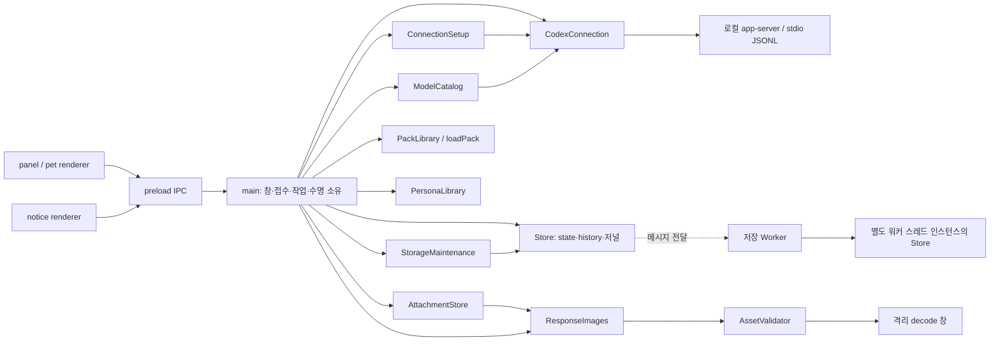

# my_budy 전체 코드 분석과 단계별 개선 계획

> 이 문서는 수정 전 분석과 계획을 보존한다. 이후 F01–F11 구현·독립 재검토·성능 전후 측정은 [2026-10-19 구현 결과](IMPLEMENTATION_RESULT_2026-10-19.md)를 따른다. 아래 미해결 표와 테스트 수는 당시 기준이다.

검토 기준은 `f4cb7ebcf5fd2b3db4856a9f4f71693a88739b5a`, 프로젝트 `0.1.0-alpha.22`다. 시작 시 staged/unstaged 변경은 없었다. 이 보고서는 **코드 분석·문제 재현·작업계획**의 결과다. 아래 미해결 문제를 제품 코드에 수정하거나 새 패키지로 배포한 결과가 아니다.

핵심 판단은 기존 Electron·직렬 FIFO·JSON 저널·데이터형 팩 구조를 유지하면서 **승인 내용 확인, 편집 보존, 복구 실패, 목록 갱신과 조작 정확성**을 먼저 보강하는 것이다. main/renderer의 책임 집중은 실제 유지 비용을 만들지만, 파일 길이만으로 잘게 나누면 수명 검사가 흩어진다. 재현된 경계를 먼저 고치고, 측정한 비용과 테스트 가능한 책임을 기준으로 분리한다.

## 1. 범위와 근거의 강도

| 대상 | 확인 방법과 범위 |
|---|---|
| 기준 추적 파일 198개 | 경로·SHA-256·바이트 수를 고정하고 파일별 검토 방식을 기록 |
| 작성한 JS/config 67개 | src의 JS 17개, scripts 36개, test 13개, ESLint 설정 1개를 실제 소스로 읽음. 함수·분기·소비자·예외와 테스트를 대조 |
| 나머지 src 4개 | index/notice/검증용 HTML 3개와 CSS 전체를 읽고 DOM·IPC·선택자·보안 정책 연결 확인 |
| 팩 53개·스킨 3개 | manifest 4개, SVG 29개, MD 20개. 전체 참조를 loader로 검증, SVG XML 구조 파싱, MD 내용 확인, 4캐릭터·3스킨 실제 렌더 확인 |
| 이미지·아이콘 7개 | 형식·치수를 `file`/`sips`로 확인하고 생성·런타임·패키징 참조 대조. 사용자 원본 유지 |
| 의존성·생성물 | 직접 의존성 8개와 설치/lock 버전 일치. renderer 번들·LEGAL·THIRD_PARTY_NOTICES를 쓰기 없이 재생성해 바이트 일치 확인 |
| 문서 | 현재 안내·계약·계획 22개와 루트 README/TASKS/AGENTS를 코드와 대조. 이력 35개는 작성 시점·목차·참조/보존 필요성을 조사. 과거 실험을 모두 재실행하거나 외부 서비스·라이선스의 현재 상태를 재인증한 것은 아님 |

파일별 근거는 [검토 범위 장부](../../artifacts/staff-review-f4cb7eb/coverage.json), [기준 해시](../../artifacts/staff-review-f4cb7eb/baseline.json), [의존성/함수/주석 분석](../../artifacts/staff-review-f4cb7eb/dependencies.json)에 있다. 이력과 외부 벤더 코드를 프로젝트 작성 소스와 같은 수준으로 전부 수동 감사했다고 표현하지 않는다. `node_modules`, 생성된 minified 코드, 이전 앱/사용자 대화는 이번 소스 인수 분석의 별도 소유 자료다.

[AGENTS.md](../../AGENTS.md)의 인라인 작성·책임 경계 분리·실제/체험 구분·검증 사실성 규칙을 적용했다. 문서 작업에는 `pages:write-page`의 기존 저장소 형식/위치 우선 원칙을 적용했다. 새 프레임워크나 스킬 설치는 필요하지 않았다.

## 2. 모듈 경계와 의존성

정적 import/require 326개에서 순환 의존성은 발견하지 않았다. Store가 파일명으로 Worker를 만들고 그 Worker가 Store를 사용하는 것은 **분리된 실행 인스턴스의 메시지 경계**다. 동일 모듈 초기화의 require 순환으로 세지 않았다. HTML loadFile, preload, worker, 동적 smoke 진입점도 별도로 확인했다.

| 파일/경계 | 현재 책임 | 판단 |
|---|---|---|
| `src/main.cjs` | 앱 부트스트랩, 창/전원/알림, IPC 권한, 질문 접수·실행, 원격 기록 병합, 모든 기능의 연결 | 책임 집중. action 콜백 867행/98,880바이트. 소유권을 보존한 부분 개선 필요 |
| `src/codex.cjs` | child 프로세스·JSONL 프레임·RPC·턴 소유권·초기 이벤트 버퍼·중단 | 분리 타당. UI/Store를 가져오지 않는 transport 경계 유지 |
| `src/connection-setup.cjs` | 실행 파일 탐색/버전, 인증·로그인 시도·계정 사용량의 수명 | transport와 다른 인증 수명이 있어 유지 |
| `src/models.cjs` | 목록 페이지·기본 설정·모델/추론/속도 해석 | 작지만 외부 카탈로그 계약이 독립적. main에 합칠 이유 부족 |
| `src/store.cjs`, `src/store-worker.cjs` | v1 이관, v2 상태/기록, 정제, 저장·삭제 저널, 직렬 worker | 재사용은 타당. sync/worker 상태와 revision 계약은 명확히 할 필요 |
| `src/attachments.cjs` | 입력 파일/바이트의 제한 읽기·불변 사본·quota·해시 조회 | 사용자 입력의 소유 경계. 이미지 모듈과 일괄 통합하지 않음 |
| `src/response-images.cjs` | CLI 결과 추출·이미지 사본/preview·공유 캐시 직렬 확정 | 입력 첨부와 출처·오류 정책이 다름. decode는 기존 경계 재사용 |
| `src/asset-validator.cjs` | sandbox 실제 decode·픽셀/프레임 예산·검증 창 종료 | 별도 검증 창 수명이 있으므로 유지 |
| `src/packs.cjs`, `src/pack-library.cjs` | 데이터형 팩 snapshot 검증 / 설치·교체·보관·export·복구 | 검증과 다중 파일 변경 경계가 다름. 구분 유지 |
| `src/personas.cjs` | 제공/사용자 말투·MD·registry·생성 복구 | 외부 편집을 지원하는 소유 파일 경계. 저장 충돌 검사 보완 필요 |
| `src/storage-maintenance.cjs` | 전체 참조 조사·선택한 미참조 캐시 보관·복원 | Store 일반 쓰기와 다른 복구 책임. 분리 타당 |
| `src/skins.cjs` | 허용된 팔레트만 읽음 | 작은 데이터 검증 모듈. 임의 CSS와 합치지 않음 |
| `src/preload.cjs` | 좁은 IPC, trusted 드롭/붙여넣기 경로 | 임의 파일 접근을 renderer로 확대하지 않음 |
| `src/ui/renderer.mjs` | 상태 수신·초안/카드·이미지·승인·설정·캐릭터/창 입력 | onState 콜백 398행/48,829바이트. 부분 상태 갱신 경계가 필요 |
| `index.html`, `style.css` | 세부 UI 구조·레이아웃·스킨·심플/상세 표시 | JS보다 먼저 남은 레거시 CSS의 실제 충돌을 수정 |
| `notice.html`, `notice.js`, `validate-images.html` | 경량 안내 / 격리 검증 문서 | Markdown/전체 앱을 로드하지 않는 목적이 있으므로 유지 |

main의 최상위 바인딩 143개, renderer 68개에는 import·상수·검증 플래그도 포함된다. 이를 전부 가변 전역 상태라고 세지 않았다. 문제의 핵심은 개수보다 한 변경이 저장 revision·화면·큐의 여러 수명에 영향을 준다는 점이다.

## 3. 데이터 흐름·상태 관리·핵심 실행 경로

### 질문부터 답변까지

1. renderer의 대화별 텍스트/첨부 초안 → preload → 소유 panel/main frame 검증.
2. 첫 await 전에 문맥·말투·이름·자료 ID·대기 자리를 캡처한다. `preparing + queue`는 최대 10개다.
3. `admissionTail` 순서로 접수 검증과 저장을 확정하고 실행 FIFO에 넣는다. 접수 순서·모델 실행 순서·worker 저장 순서는 서로 다른 책임이다.
4. `runQueue`가 한 작업만 실행한다. 모델/계정·스킬 파일 변경을 확인하고 thread start/resume 또는 review를 요청한다.
5. `CodexConnection`이 RPC 응답의 thread/turn을 소유한다. RPC보다 먼저 온 이벤트는 한도 내에서 보류하고 다른 턴의 알림을 버린다.
6. 메인은 텍스트/계획/리뷰·도구 상태를 누적한다. 이미지는 별도 순차 처리 후 종료 저장에 합류한다.
7. `finishJob`의 단일 종료 Promise가 저장을 확정한다. 실패하면 화면 원문을 유지하고 쓰기/다음 실행을 차단한다.
8. `publish`가 변경 메시지와 작은 상태만 전송한다. renderer는 카드/이미지 준비를 확인하고 ACK한다. 다음 질문은 종료 저장 뒤 실행한다.

### 영속 상태와 런타임 상태

| 소유자 | 상태 | 수명·보존 계약 |
|---|---|---|
| Store | 설정·소유 대화 목록·활성 ID·메시지, 이미지/첨부 metadata | state 8MiB, 대화 32MiB. 저널 복구 후 미완료 질문은 중단 처리, 자동 재전송 없음 |
| main | current/queue/preparing/admissionTail, pause 사유 Set, requests, 임시 첨부 예약 | 같은 실행 안의 작업 수명. 저장 상태와 별개인 실행 여부를 보존 |
| main의 조회 작업 | 원격 cursor/seenTurns, 검색 revision, 연결·frame·세대 | 늦은 조회는 적용하지 않음. 저장 성공 뒤 cursor를 확정 |
| 창 | rendererReady/renderGeneration, messageView/limit, simple 표시 세대·deadline, resize token | 재로드/숨김/잠금·전원/탭 변경에서 각 예약 무효화 |
| renderer | 대화별 초안·첨부 ID, 큐 편집 UI, message cache/cards, 이미지 observer, ACK token | 앱 메모리. 재시작 영속 초안이라고 안내하지 않음 |
| 각 라이브러리 | 파일 snapshot/hash, pack revision, 인증 attempt/account revision | 해당 소유 경계에서 재검증. 모든 revision을 하나의 의미로 통합하지 않음 |

현재 state 객체와 Window 속성에 내부 상태를 함께 두는 방식은 추적 비용이 있다. 그러나 새 전역 상태 컨테이너로 옮기기 전에 **어떤 주체가 언제 확정·폐기하는지**를 위 계약대로 고정해야 한다.

### 제어·오류 경로

| 상황 | 유지할 동작 | 확인 근거/한계 |
|---|---|---|
| 저장 대기 중 중단·승인 | 제어 요청을 FIFO/일반 저장 대기 뒤로 밀지 않음 | stability 단위와 timing smoke의 기존 경계 확인 |
| 연결 종료·절전·앱 재시작 | 불확실한 실행 자동 재전송 금지, 보류 큐는 사용자 계속 | transport/Store/수명 단위 검증. 물리 절전 실기는 별도 |
| 오래된 frame·계정·대화 | 늦은 첨부·사용량·기록·ACK 적용 금지 | 비동기 경계별 단위 검증 확인 |
| pending 저장/삭제 저널 | 원본/저널 보존, 불확실하면 쓰기 차단 | exact-limit·성장/축소·변조·UTF-8·교체·worker 종료 검증 |
| 원격 페이지/이미지 실패 | 기존 로컬 텍스트·metadata/cursor 보존, 부분 실패 안내 | 원격 병합 단위와 현재 기록 smoke 결과를 분리해 기록 |
| 심플 자동 숨김 | 준비된 선택 답변 뒤 30초. 초안/IME/첨부/메뉴/승인/실행/저장 보호 해제 뒤 새 30초 | 이번 `chat-ui` 실제 30초 검사 통과. X는 즉시 숨김, 삭제/취소 아님 |
| 삭제 | 같은 연결의 소유 범위를 먼저 기록, 원격 확인 뒤 로컬 정리 | 지연 알림·다른 문맥·부분 실패의 기존 단위 검증 유지 |

## 4. 새로 확인한 문제와 실행 우선순위

P2는 조건부 동작 오류·보존/승인 경계·검증 신뢰성 보완, P3는 안내/정리 개선이다. 이번 근거로 P0/P1 장애를 확정하지는 않았다. **순번은 위험과 수정 비용을 함께 고려한 착수 순서**다. S는 대략 1개 개발일 이내, M은 2–4일 규모의 설계 추정이며 OS 수용·배포 시간은 별도다.

| 순서 | ID | 문제 | 우선도 / 비용 | 확인 방식 |
|---:|---|---|---|---|
| 1 | F10 | 명령/대상 미리보기 없이도 명령 승인을 보낼 수 있음 | P2 / S–M | 실제 action + 합성 요청 |
| 2 | F03 | 앱 MD 편집 저장이 외부 최신 편집을 덮어씀 | P2 / M | 격리 파일 재현 |
| 3 | F05 | 추가 질문 목록 변경 시 작성 중 답변이 사라짐 | P2 / S–M | 실제 Electron renderer |
| 4 | F02 | 복원 중 부분 쓰기 실패가 손상 목적 파일을 남겨 재시도 차단 | P2 / M | 부분 쓰기 후 ENOSPC 주입 |
| 5 | F07 | 대화 제목 버튼과 삭제 버튼이 겹침 | P2 / S | 3너비×3스킨, 좌표 hit test |
| 6 | F01 | 제목/즐겨찾기 저장 뒤 목록 캐시가 갱신되지 않음 | P2 / S | 실제 publish 경로 |
| 7 | F04 | 팩·MD 계열의 읽기 상한이 할당 전에 보장되지 않음 | P2 / M | manifest 성장 재현 + 유사 경로 조사 |
| 8 | F06 | 손상 기록을 검색 완료로 세어 누락을 숨김 | P2 / S | 손상된 비활성 기록 검색 |
| 9 | F09 | 기록 smoke의 비결정적 대기와 이전 심플 가정 | P2 / S–M | 기존 검사 실패·계측 반복·소스 대조 |
| 10 | F08 | SVG 재생성이 별도 캐릭터의 편집 MD를 덮어씀 | P2 / S | 저장소 격리 사본 실행 |
| 11 | F11 | 현재 안내에 이전 버전/심플 동작 설명이 남음 | P3 / S | 실행 코드·package·문서 대조 |

### F10 — 승인할 내용을 확인할 수 없는 요청

위치: [main](../../src/main.cjs:1532), [승인 UI](../../src/ui/renderer.mjs:661). 파일 변경은 diff가 없으면 허용을 막지만 명령 승인은 `params.command`와 `details.command`가 모두 없고 네트워크 대상도 없어도 `accept`를 전송한다. UI에는 일반 권한 안내만 나타나고 허용 버튼이 살아 있다.

소유 thread/turn/item과 startedAtMs를 가진 합성 요청에서 `{decision:"accept"}`가 전송됐다. 저장된 로컬 프로토콜 스키마에서도 command는 nullable/선택 필드다. 실제 CLI가 이런 요청을 보냈다거나 위험 명령이 실행됐다는 증거는 아니다. 사용자의 클릭이 필요하지만 그 클릭을 판단할 구체적 내용이 없다. [재현](../../artifacts/staff-review-f4cb7eb/approval-preview-reproduction.json).

수정은 main/UI에서 **표시할 수 있는 승인 대상**을 확인하는 것이다. 정상 명령, 유효한 managed-network 대상, 지원 가능한 다른 승인 kind를 구분한다. 미지원/불완전한 요청은 허용을 막고 거절·취소와 원인 안내를 유지한다. 단순 조건은 현재 분기에 둔다. null/빈 문자열/잘못된 형식/잘린 도구 정보, 정상 명령·network-only, 오래된 요청, 허용되지 않은 decision의 회귀를 추가한다. 임의 자동 승인이나 세션 전체 허용은 추가하지 않는다.

### F03 — MD 저장의 lost update

위치: [PersonaLibrary.read/save](../../src/personas.cjs:45), [편집 UI](../../src/ui/renderer.mjs:772). 편집기를 연 뒤 `MD 폴더`에서 같은 파일을 수정하고 앱의 오래된 초안을 저장하면 외부 편집이 백업 없이 사라진다. `modes.json`에는 외부 변경 대조가 있지만 본문 save에는 없다. [재현](../../artifacts/staff-review-f4cb7eb/file-failure-reproductions.json).

읽을 때의 본문 해시/버전을 편집 초안에 연결하고 저장 시 현재 파일과 대조한다. 충돌 시 파일과 앱 초안을 모두 유지하고 다시 읽기·비교 후 명시적 덮어쓰기를 제공한다. 정상 atomic 교체·16KiB·경로 검증은 유지한다. 저장 전 외부 수정/삭제/링크 교체, 저장 실패, 모드 전환, 기본 복원과 충돌을 검증한다. 같은 권한의 외부 프로세스와 완전한 파일 시스템 CAS를 구현했다고 과장하지 않는다.

### F05 — 추가 질문 답변 초안 손실

위치: [renderer 요청 목록](../../src/ui/renderer.mjs:643). request ID 목록이 달라지면 루트의 `replaceChildren()`로 모든 입력을 다시 만든다. A 질문에 입력한 상태에서 B 요청이 추가되면 A/B 입력 모두 빈 문자열이 된다. 실제 renderer에서 `보존되어야 하는 작성 중 답변` → `['','']`를 확인했다. [JSON](../../artifacts/staff-review-f4cb7eb/ui-audit.json) · [화면](../../artifacts/staff-review-f4cb7eb/requests-after.png).

request ID + question ID로 카드/초안의 소유자를 유지하고 추가/해결된 카드만 변경한다. 같은 ID의 질문 형식이 바뀌면 이전 답을 조용히 다른 질문에 적용하지 않는다. 포커스·선택값·작성 중 한글 조합도 보존하고, 성공 응답/해결 이벤트에서 해당 요청만 정리한다. 일반 composer 초안 보호와 별개의 회귀가 필요하다.

### F02 — 캐시 복원 실패 후 재시도 불가

위치: [StorageMaintenance.restore](../../src/storage-maintenance.cjs:171). 최종 목적 파일에 바로 `writeFileSync(...,{flag:'wx'})`한다. 27바이트 중 5바이트를 쓴 후 ENOSPC를 주입하자 손상 파일이 남고, 재시도는 기존 파일 보존 때문에 복원하지 못했다. **복구 보관 원본은 그대로 남아 있다.** [재현](../../artifacts/staff-review-f4cb7eb/file-failure-reproductions.json).

완성된 바이트를 소유한 배타 임시 파일에 먼저 기록·확인하고 최종 경로에 덮어쓰기 없는 방식으로 확정한다. 단순 rename으로 기존 외부 파일을 교체하는 해법은 금지한다. 실패 정리는 이번 작업이 만든 파일의 identity를 확인한 범위만 대상으로 한다. 부분 쓰기·확정 직전 외부 파일 생성/교체·같은 이름 존재·quota·취소·재시도까지 확인한다.

### F07 — 제목/삭제 동작 영역 충돌

위치: [대화 동작 구성](../../src/ui/renderer.mjs:185), [동작 열 CSS](../../src/ui/style.css:48), [기존 삭제 절대 배치](../../src/ui/style.css:132). 네 동작을 세로로 배치했지만 삭제 버튼의 이전 absolute 위치가 남았다. 390/460/720px × paper/night/mono의 9조건 모두 **제목 버튼 중앙의 hit target이 삭제 버튼**이었다. 삭제 확인창이 있으므로 클릭 즉시 영구 삭제되지는 않는다. [좌표 결과](../../artifacts/staff-review-f4cb7eb/ui-geometry.json) · [화면](../../artifacts/staff-review-f4cb7eb/history-overlap.png).

absolute 배치를 제거하고 동작을 한 레이아웃 규칙으로 정렬한다. 공간이 부족하면 `더 보기` 안에 제목·MD·삭제를 두고 고정만 노출하는 구성을 검토한다. 삭제 확인의 기본 취소 포커스·처리 중 중복/취소 차단은 유지한다. 기존 `.click()` smoke는 겹침을 건너뛰므로 9조건의 실제 좌표 hit test와 키보드 이동을 완료 기준에 추가한다.

### F01 — metadata 저장과 캐시 revision의 분리 누락

위치: [conversation-meta](../../src/main.cjs:931), [목록 정렬/발행](../../src/main.cjs:167), [Store revision](../../src/store.cjs:310). metadata만 저장하면 `registryRevision`이 증가하지 않는다. 디스크 제목/고정값은 바뀌지만 다음 payload의 conversations가 빠지고 정렬도 재계산하지 않는다. 강제 sync에서도 배열 순서가 `[고정 안 됨, 고정됨]`으로 남았다. [재현](../../artifacts/staff-review-f4cb7eb/metadata-reproduction.json).

최소 수정은 metadata 저장 성공 뒤 목록 변경 버전을 무효화하는 것이다. 실패 rollback에서는 버전을 전진시키지 않는다. 기존 revision은 worker snapshot 동기화에도 쓰이므로, 우선 동일 버전 증가의 정확성을 확인하고 비용이 커지는 경우에만 UI catalog revision을 구분한다. 단순 증가를 새 helper로 만들 이유는 없다. 추가 메시지 저장 없이 제목/정렬/검색이 즉시 바뀌는 검사와 다음 worker 저장 후 보존을 함께 확인한다. 기존 테스트가 metadata 뒤 `saveAsync()`를 수행해 놓친 경우다.

### F04 — 크기 검증 이후 무제한 파일 읽기

위치: [팩 manifest](../../src/packs.cjs:9). stat와 read 사이에 파일을 늘렸을 때 64KiB 한도에도 1,049,904바이트를 읽은 뒤 거절했다. 검증이 최종 수락은 막지만 **읽기 할당 상한**을 지키지 못한다. 무한 할당이나 실제 OOM을 유발하는 시험은 하지 않았다. [재현](../../artifacts/staff-review-f4cb7eb/file-failure-reproductions.json).

동일 패턴은 packs의 MD/이미지, PersonaLibrary의 MD·registry·생성 저널·복원, PackLibrary의 복구/정리 비교, skins 읽기에 남아 있다. 이 중 이번 동적 재현은 manifest 한 경로다. 나머지는 코드로 확인한 동일 위험 패턴이며 묶어서 모두 재현했다고 세지 않는다. 번들 스킨은 사용자 가져오기 팩보다 노출도가 낮다.

기존 Store처럼 FD로 일반 파일·상한을 확인하고 **처음 확인한 크기+1 이내**만 읽으며, 부분 읽기/UTF-8/파일 동일성·경로 변경과 finally close를 검증한다. 팩별 허용 경로·UTF-8 정책·사용자 편집 보존은 각 경계에 남긴다. 동일한 읽기 계약이 확정된 경우에만 제한 읽기 모듈을 고려하고, 옵션이 많은 범용 파일 프레임워크는 만들지 않는다.

### F06 — 검색 실패가 정상적인 0건으로 표시됨

위치: [본문 검색](../../src/main.cjs:963). `scanned++` 뒤 readHistory 예외를 빈 catch로 넘긴다. 손상된 비활성 기록 하나를 검색하면 `{ok:true,matches:[],scanned:1,limited:false}`가 반환됐다. [재현](../../artifacts/staff-review-f4cb7eb/search-reproduction.json).

방문/성공/읽기 실패 건수를 구분하고 결과가 불완전함을 알린다. 실패 ID·원인에는 길이/개수 상한을 두고 원문·민감 경로를 진단에 넣지 않는다. 검색 취소와 100개/32MiB/50건 한도는 유지한다. 손상·권한·삭제·한도·취소가 섞였을 때 정상 결과도 보존하고 실패를 성공으로 세지 않는지 확인한다.

### F09 — 검증 스크립트의 대기 조건과 이전 가정

기존 `integration history chat-ui`에서 history는 실패하고 chat-ui는 통과했다. 계측한 반복 실행에서 [동일한 페이지 검사 실패](../../artifacts/staff-review-f4cb7eb/history-trace-1/history-failure-diagnostic.json)를 다시 확인했다. `open-conversation` 후 Store는 54개지만 `panel.messageLimit`과 마지막 발행은 아직 4개였다. 곧바로 `load-older`를 호출하니 로컬 표시만 54개로 확장하고 RPC는 1회로 남았다. 이는 [기존 검사](../../scripts/history-ui-smoke.cjs:63)가 기대한 원격 2번째 페이지와 다르며 기록 유실의 증거는 아니다.

별도 반복에서는 `document.hidden:true` 상태로 목록 렌더를 기다려 실패했다. [실패 로그](../../artifacts/staff-review-f4cb7eb/history-no-wait-0.log). 계측 실행의 성공도 있었으므로 전체 history 검사를 안정적으로 통과했다고 표시하지 않는다. 고정 sleep을 늘려 해결 완료로 삼지 말고 창의 실제 가시성·메시지 ID/표시 한도·remote cursor 상태가 준비된 뒤 다음 동작을 해야 한다.

또한 [alpha smoke](../../scripts/alpha-ui-smoke.cjs:78)의 `--real-mini-smoke` 경로는 현재 assistant 하나를 표시하면서 공통 검증에서 카드 2개를 기대한다. 이 모순은 소스로 확인했고 유료 모델을 호출해 실패를 재현하지 않았다. 일반/심플 표시 계약을 각기 검사하도록 고친다.

stability의 mainHarness는 기본적으로 publish를 대역으로 바꾸며 renderer 일부 검사는 소스 문자열을 잘라 VM에서 실행한다. 이 방식은 수명 예외를 세밀하게 재현하지만 F01처럼 발행 계약을 놓치거나 포맷 변경에 깨질 수 있다. 전체 테스트를 새 프레임워크로 바꾸기보다, 해당 버그에 실제 publish·bundle·좌표 검증을 붙이고 책임 경계를 추출할 때 문자열 절단 테스트를 공개 모듈 계약 검사로 옮긴다.

### F08 — 생성기가 편집 가능한 원본까지 덮어씀

위치: [create-characters](../../scripts/create-characters.cjs:49). clip 폴더 전체를 blink 폴더에 재귀 복사한다. 격리 사본의 blink `personas/base.md`에 독립 내용을 넣고 재생성하자 clip 내용으로 교체됐다. 사용자 활성 프로필을 변경한 시험은 아니다. [재현](../../artifacts/staff-review-f4cb7eb/generator-reproduction.json).

생성 대상 SVG/manifest 필드를 명시하고 기존 MD/사용자 설정 필드는 보존한다. 필요한 새 템플릿은 없을 때만 만든다. 수정 MD·독립 모드 설정·불필요한 다른 파일이 보존되는지 격리 디렉터리에서 전후 해시로 검사한다. 파일명이나 동일한 현재 내용만으로 두 캐릭터의 원본을 통합하지 않는다.

### F11 — 현재 계약 문서와 사용자 안내의 잔여 설명

다음은 날짜가 명시된 과거 결과와 구분해 정리할 현재 안내다.

- [BUILD_GUIDE](../BUILD_GUIDE.md:174)의 통합 14종은 현재 드라이버 15종과 다르다. 같은 문서 228/231행의 프로젝트·clientInfo alpha20은 package/lock의 alpha22와 다르다.
- [BUDDY_MODES_REVIEW](DOCUMENTATION_BEFORE_CLEANUP_2026-10-21.md#buddy_modes_review)의 질문/답변 한 쌍, [RESPONSE_TIMING](../RESPONSE_TIMING.md:37)의 두 카드 설명은 현재 assistant 하나의 심플 계약과 다르다.
- [설정 푸터](../../src/ui/index.html:183)는 단축키를 바꿔도 기본 단축키를 안내한다. activeShortcut을 표시하거나 고정 단축키 문구를 제거하는 편이 맞다.
- 같은 페이지의 Slack `준비 중`은 구현 대기 정책보다 곧 제공할 기능처럼 보일 수 있다. 현재 설정 흐름에서 빼고 조건부 계획에 두는 것을 권한다.

버전·검사 수를 여러 문서에 복제하기보다 현재 결과 링크를 기준으로 삼는다. 과거 문서의 당시 버전·검사 수는 덮어쓰지 않는다. 원래 검증 산출물과 복구 앱도 보존한다.

## 5. 성능 분해와 측정 가능한 개선 가설

SQL DB는 사용하지 않는다. N+1 SQL은 없지만 파일별 반복 I/O와 대화별 순차 RPC가 같은 종류의 확대 비용을 만든다. 기존 성능 측정은 [Mac 후속 결과](MAC_FOLLOWUP_RESULT_2026-10-15.md)의 당시 표본이다. Store/worker, attachments, 이미지 모듈, 원격 main 분기의 원자료 해시가 현재 소스와 일치함을 다시 대조했다. 아래의 과거 측정은 이번 재실행 수치가 아니다.

| 순서 | 비용/측정 기준 | 원인·현재 근거 | 수정 가설과 완료 검증 |
|---:|---|---|---|
| 1 | CPU·메모리·blocking I/O | 30MiB 동기 저장 main CPU 중앙값 56.24ms, 초기 로드 heap 전후 +60.38MiB. JSON 읽기/parse·copy·hash·write가 남음 | 큰 읽기/전환을 저장 경계로 이동하고 불필요한 snapshot 복사를 줄임. 1/8/24/30MiB의 main CPU·loop 지연·전체 시간·메모리와 저널/취소/복구를 전후 비교 |
| 2 | 이미지 완료 지연·할당 | 2048px 중복 처리 865.14ms 중 validator 파이프라인 774.24ms. 파일 dedup 이후에도 decode 창/검증 반복 | 성공 SHA+검증 정책에 한정한 유한 metadata 재사용 검토. 변조·preview 누락·정책 변경·quota·다중 이미지 페이지 실패를 먼저 보장 |
| 3 | 대화 목록 렌더·DOM | 이번 실제 renderer 100/1,000/5,000개가 61.1/183.4/1,050.5ms, 하위 DOM 1,200/12,000/60,000개 | 목록을 단계 표시 또는 가상화하고 formatter를 재사용. 초기 카드 수 상한·정렬/검색/포커스/스크롤 보존을 검사하고 동일 자료 반복 측정 |
| 4 | 파일 I/O·stat·해시 | 10,000캐시/8개 중복 첨부 약478.74ms, 일반 파일 lstat 80,072회. O(첨부수×캐시파일수) | 외부 성장·링크·동시 변경을 감지하는 배치 조사 계약부터 설계. 신규/중복/정확 quota 경계와 I/O 횟수·loop 지연 비교 |
| 5 | 원격 전체 확장의 누적 저장 | 1,000턴 40페이지에서 전체 JSON 반복 저장. 논리 history 크기 누적 20.53배 | 페이지별 복구 확정을 유지할 차분/확정 단위를 검토. 초기 25턴과 전체 확장을 나눠 RPC·논리쓰기·재시작/실패 검증 |
| 6 | CLI RPC 수·삭제 대기 | 이번 실제 action+즉시 응답 대역: 소유 1/100/1,000개에서 read 1/100/1,000 + delete 1회 | 파생 관계의 저장/검증 범위·지원되는 조회 형태를 조사. 소유 scope 축소로 안전장치를 없애지 않음. 전체 deadline·진행 표시·실패 보존과 실제 RPC 수 검증 |
| 7 | 검색 CPU·파일 읽기 | 파일 사이에는 양보하지만 큰 JSON 하나의 read/parse는 동기. 전체 본문 소문자 변환도 할당 | F06의 부분 실패 의미를 먼저 확정한 뒤 취소 가능한 읽기/parse 분리. 100개/32MiB/50건 한도·결과 동일성 유지 |

목록 수치는 [이번 1회 관찰](../../artifacts/staff-review-f4cb7eb/ui-audit.json)이며 IPC·DOM·레이아웃·프레임 대기가 포함된다. 중앙값/p95·순수 JS 시간·개선률이 아니다. 삭제의 [RPC 계측](../../artifacts/staff-review-f4cb7eb/delete-rpc-cost.json)은 실제 모델/네트워크가 없는 합성 transport다. 그 실행 시간을 실제 CLI 대기 시간으로 사용하지 않는다. 삭제 후 파생 세션 확인은 별도 순차 조회여서 총 작업 deadline도 함께 검토해야 한다.

복잡도는 대체로 다음과 같다. 저장은 대화 바이트 B에 O(B) 처리와 복수 사본이 필요하다. publish는 표시 메시지 V에 O(V), 전체를 펼치면 V가 증가한다. 목록 정렬은 revision 변경 때 O(C log C), 목록 DOM은 O(C)다. 원격 페이지는 로컬 N개를 다시 인덱싱/병합·저장하므로 끝까지 확장할 때 누적 비용이 커진다. turn ID 매칭은 이미 Map으로 개선돼 있으며 모든 과거 O(N²) 문제를 미수정으로 되돌려 적지 않았다.

추가 측정 후보는 긴 스트리밍 Markdown의 반복 파싱, 설치한 팩 전체의 원본 Buffer+base64 snapshot 보유, 64MiB JSONL parse의 순간 메모리다. 코드상 비용 가능성은 있지만 현재 팩 4개나 실제 일상 데이터에서 병목·누수가 재현됐다고 확정하지 않았다. SHA cache를 넣기 전에 hit/miss·상한·정책 변경·폐기 시점을 측정한다. 저장의 메모리 전후 차이를 allocation 총량이나 peak RSS로 부르지 않는다.

모든 성능 변경은 같은 데이터/런타임·검증 계측으로 warmup과 반복 표본을 확보하고, 전후 순서를 교차해 중앙값·p95·변동을 남긴다. 정확성 회귀를 먼저 통과한 뒤 반복 변동보다 큰 개선인지 판정한다. 배터리·OS 합성·cold cache·실모델 속도는 해당 실험이 없으면 주장하지 않는다.

## 6. 결합도·중복·추상화·주석·정리 판단

### 실제 결합도가 높은 부분

main의 metadata 저장→Store revision→publish 정렬→renderer signature가 F01로 연결된다. renderer의 요청 목록 갱신이 입력 DOM 소유권까지 바꾸는 F05, action 열 변경이 과거 absolute CSS와 충돌하는 F07도 같은 종류다. 기능별 수정이 화면·저장·캐시 계약을 함께 검토하도록 테스트 경계를 보완해야 한다.

많은 한 줄에 여러 검증·변경·await·rollback이 함께 있어 실패 시점을 읽기 어렵다. 새 helper로 감싸기보다 같은 함수 안에서 **입력 확인 / 소유권 캡처 / 비동기 처리 / 재확인 / 확정 / 실패 복구**의 문단을 나누는 것이 우선이다. `historyLoading` 같은 플래그가 기록 외 설정/선택 작업의 잠금에도 쓰이는 부분은 전이표로 사용 범위를 먼저 고정한다.

설정 필드가 main 기본값·action 검증·Store 정제·renderer 폼에 반복된다. 각 층의 역할은 필요하지만 새 옵션을 추가할 때 누락되기 쉽다. 필드별 기본/유효값/이전 기록 복원/저장 실패/UI 적용 체크를 한 변경 단위로 관리한다. 현재 규모에서 모든 설정을 범용 schema 프레임워크로 생성하는 비용은 정당화되지 않았다.

### 합치지 않을 경계와 통합 후보

- CodexConnection/ConnectionSetup/ModelCatalog, Store/worker, pack parsing/lifecycle/decode, 일반 첨부/생성 이미지는 소유자·검증·실패가 다르다. 작은 파일이라는 이유로 합치지 않는다.
- await 전후의 창/frame/대화 검사는 시간 경계가 다르다. 같은 조건 문자열이라도 무조건 중복 제거하지 않는다.
- 제한 읽기·identity·UTF-8의 반복은 F04처럼 구현 편차가 생겼다. 공통 계약을 먼저 정한 뒤 실제로 동일한 바이트 읽기 책임만 통합할 수 있다. 팩/MD/저널의 허용 정책을 하나로 평탄화하지 않는다.
- 캐릭터별 동일한 MD는 독립 편집 가능한 템플릿이다. 중복 내용만으로 공유 파일이나 symlink로 바꾸지 않는다.
- CSS의 `.compact-mode .message.user`와 숨겨진 `.message-tools`에 대한 이전 크기 장식은 현재 assistant-only 계약에서 정리할 수 있다. F07의 absolute 삭제 배치는 실제 오동작 원인이다.
- 실행 JS 모듈·직접 의존성에서 추가로 안전한 통삭제 대상을 확정하지 못했다. v1 이관, legacy API fallback, 복구 journal, zero-pack 표시, 동적 motion/aria/resize ID는 사용 중이다.

### 주석과 lint

AST에서 일반 JS 주석 9개와 fixture shebang 3개를 구분했고 CSS 설명 주석도 코드와 대조했다. 종료된 TODO/FIXME나 주석 처리된 구현, 새 lint 억제는 발견하지 않았다. 남은 주석은 턴 소유권·자식 프로세스 교체·편집 보존·삭제 알림 순서·접수 직렬화·불변 IPC 객체·macOS 긴 문자열 비용 등 **현재 필요한 이유**를 설명하므로 유지한다. OS별 검증 필요 주석을 완료됐다고 지우지 않는다.

lint/check는 통과했다. 현재 lint는 미정의/미사용 변수와 CSS 구문/값/중복 속성을 검사하며, 타입·모든 Promise·CSS hit target·모든 보안 정책을 증명하지 않는다. 전면 formatter 도입이나 현재 테스트의 소스 절단 위치를 일괄 바꾸는 포맷 변경은 기능 수정과 분리한다.

문서는 현재 계약과 이력으로 이미 나뉘어 있다. 이력 35개·실패 로그·원자료·롤백 앱을 새 정리 대상으로 일괄 삭제하지 않는다. F11의 현재 안내만 먼저 바로잡고, 완료 계획을 추가 이동할 때 들어오는 링크·복구 위치와 당시 내용을 보존한다.

## 7. 더 쉽고 안전한 UI/UX 제안

현재 `말투 + 첨부/목적/스킬`, assistant 중심 심플, 조용한 알림, 상세 확장 흐름은 버디의 목적에 맞는다. 주요 개선은 기능 수보다 입력과 결과에 대한 신뢰다.

| 우선 | 제안 | 사용자가 얻는 결과 / 수용 기준 |
|---|---|---|
| 1 | 제목·삭제 hit target 분리 | 눈에 보이는 버튼과 클릭 결과 일치. 9배치와 키보드 focus 검사 |
| 2 | 추가 질문 초안 보존 | 여러 요청이 들어와도 작성 중 답이 남음. 해결된 요청만 제거 |
| 3 | 승인 내용 부족을 명시 | 무엇을 허용할지 확인할 수 없는 상태에서 허용 버튼을 활성화하지 않음 |
| 4 | MD 충돌 시 초안/디스크 내용 분리 안내 | 최신 외부 편집을 잃지 않고 다시 읽기·비교·명시적 선택 가능 |
| 5 | 검색/복원에 부분 완료 표시 | 0건·읽기 실패·기존 파일 충돌·복원 실패를 구분하고 복구 보관 위치를 안내 |
| 6 | 긴 대화 목록을 단계적으로 표시 | 수천 개를 열어도 첫 화면·검색·고정 동작의 응답성 유지 |
| 7 | 설정을 버디/대화, 연결, 보관·고급으로 점진 노출 | 자주 쓰는 외형/말투는 가깝게, 복구는 오류 상태에서 바로 이동. 고급 기술 항목의 상시 노출 축소 |
| 8 | 캐릭터 카드의 그림 박스·제목·설명 행 정렬 | 긴 설명이 다른 카드의 제목 기준선을 밀지 않게 함. 글자 100/110/120%·좁은 창 확인 |

[실제 설정 화면](../../artifacts/staff-review-f4cb7eb/settings-verified.png)에서는 이름/저장 줄·4캐릭터 배치와 여백을 확인했다. 이번 9조건은 너비 390/460/720px, 높이 740px, 세 스킨이다. 이전 검사의 390×580/460×740/720×900과 같은 매트릭스라고 쓰지 않는다. 전체 설정 스크롤, 모든 글자 배율·스크린리더·물리 IME를 이번 캡처로 완료 처리하지 않는다.

심플의 30초 전체 숨김·보호 해제 후 새 30초·X 즉시 숨김·버디 재열기는 유지한다. 입력 중 강제로 숨기거나 상세 확장 때 다른 대화를 만드는 UX로 바꾸지 않는다. 상세 창의 크기/위치는 현재처럼 런타임 보존을 기본으로 하고 재시작 영속화는 별도 사용자 요구다. 저장 실패·승인 대기·이미지 실패는 조용한 디자인 때문에 감추지 않는다.

## 8. 외부 계약을 보존하는 단계별 작업계획

이 절은 **2026-10-19에 구체화한 실행 계획**이다. 기존 전체 분석의 제품 소스와 현재 파일 해시가 같음을 대조하고, 승인 처리·MD 편집·복원·요청 DOM·metadata/worker revision·검색·생성기·검사 드라이버를 다시 읽었다. 이번 변경은 계획 문서에 한정하며, 아래 구현·회귀·벤치마크는 앞으로 수행할 작업이다. 준비 근거는 [계획 작성 전 대조](../../artifacts/issue-plan-f4cb7eb/before.json)에 남긴다.

### 8.1. 착수 순서와 변경 단위

사용자 영향의 우선순위는 **F10→F03→F05→F02→F07→F01→F04→F06→F09→F08→F11**이다. 다만 F09의 검사 준비 조건은 나머지 변경의 합격 판정에 필요하므로 **검증 기반으로 먼저 수정**한다. 이는 history 검사 실패를 해결했다고 가정하거나 승인·보존 결함의 중요도를 낮춘다는 뜻이 아니다.

| 실행 단계 | 작업 단위와 선행 조건 | 예상 개발·검증 공수 / 종료 조건 |
|---|---|---|
| 0 | 현재 dirty 문서 보존, 기준 hash·재현 fixture 고정. F09의 가시성/상태 준비 조건과 심플 카드 계약 수정 | 1–2인일. history 새 프로세스 반복 통과, 의도한 지연에서도 검사 의미 유지 |
| 1 | F10 승인 대상 확인 → F03 MD 충돌 → F05 추가 질문 초안 | 4–7인일. 정상/거절/취소·외부 편집·요청 추가/해결 회귀. F03에 필요한 제한 읽기만 함께 적용 |
| 2 | F02 복원 확정 → F07 조작 영역 → F01 목록 무효화 | 2–4인일. 손상 최종 파일 없음, 9조건 좌표 검사, 실제 publish 계약과 worker 저장 보존 |
| 3 | F04 나머지 제한 읽기 → F06 부분 검색 → F08 생성기 → F11 안내/무효 CSS | 4–7인일. 읽기 실패별 보존 정책·불완전 결과·격리 재생성 해시와 현행 안내 일치 |
| 4 | 8.6의 성능 과제 7개. F01/F04/F06 및 관련 정상·실패 회귀가 선행 | 과제마다 계측·설계 0.5–1인일 후 구현 공수 재산정. 효과와 안전성이 입증된 변경만 채택 |
| 5 | 전체 격리 통합·패키지 검증·보고 대조 | 1–2인일. 8.8의 배포 후보 기준 통과. 물리/타 플랫폼 수용은 별도 표시 |

단계 0–3과 5는 합계 **12–22인일의 초기 추정**이다. 성능 구현·새 포맷 이관·물리 수용·외부 배포는 포함하지 않으며, 일정 확약이 아니다. 작은 UI 수정과 저장/복구 변경을 한 커밋으로 묶지 않는다. 각 변경에서 재현 추가 → 최소 구현 → 정상/실패 검증 → 독립 재검토 → 지적 수정 → 최종 확인을 거친다.

검토 역할은 Architect가 데이터·수명 계약과 대안을 비교하고, Implementation Engineer가 기존 함수/모듈 안에서 구현하며, Reviewer가 별도 정상·실패 시나리오로 검토하고, SRE/Optimizer가 계측·중단/복구·패키지 근거를 확인하는 방식이다. 이후 구현 시 역할별 검토 기록을 남기며, 이번 계획 작성으로 네 역할의 구현 승인이나 최종 수용을 대신하지 않는다.

### 8.2. 검증 준비: F09

대상은 [history-ui-smoke](../../scripts/history-ui-smoke.cjs:55), [alpha-ui-smoke](../../scripts/alpha-ui-smoke.cjs:78), [통합 드라이버](../../scripts/integration-smoke.cjs:3)다.

1. history 탭은 소유 창이 보이고 `document.hidden === false`이며 해당 대화 ID/목록 revision이 renderer에 도달한 후 검사한다. 타임아웃 때 창 가시성·대화 ID·Store 메시지 수·마지막 발행 수·표시 한도·cursor·RPC 수를 기록한다.
2. 로컬 표시 확장과 원격 페이지 요청을 각각 검사한다. 첫 페이지의 Store 54개와 발행된 메시지 상태를 기다린 뒤, 로컬 미표시분이 있으면 이를 먼저 펼치고 **그 동작에서는 RPC가 늘지 않아야 함**을 확인한다. 로컬 표시가 소진된 다음 원격 2/3페이지를 요청해 104/124개와 중복 ID 없음·원본 metadata 보존을 확인한다.
3. 대기에는 제한 시간 있는 상태 predicate를 사용한다. 고정 100ms 추가로 통과시키거나 실제 main의 페이지 동작을 검사 기대값에 맞춰 바꾸지 않는다. 가시성/발행을 늦춘 fixture에서도 같은 계약을 확인한다.
4. 일반 모드는 질문/답변, 심플은 선택한 assistant 하나와 입력창이라는 조건으로 분기한다. `--real-mini-smoke`의 카드 수 모순은 합성 상태/현재 bundle로 검증하며 유료 모델 호출을 요구하지 않는다.
5. history를 새 격리 프로필/프로세스로 5회 반복하고 모두 성공해야 이후 history 관련 합격 근거로 사용한다. 실행·결과 JSON·프로필 정리가 모두 성공해야 통과다. 실패 로그/프로필은 보존한다. 이것만으로 전체 15종이 통과했다고 쓰지 않는다.

F01의 회귀에는 기본 publish 대역만 사용하는 mainHarness 대신 실제 발행 코드를 포함한다. F05/F07은 실제 bundle의 입력 DOM/좌표를 사용한다. 기존 VM 검사를 전부 다시 쓰거나 검사 편의를 위한 범용 production API를 추가하지 않는다.

### 8.3. 승인과 입력 보존: F10·F03·F05

**F10 — 내용을 확인할 수 있는 승인만 허용한다.** 대상은 [main respond](../../src/main.cjs:1517), [요청 카드](../../src/ui/renderer.mjs:643), 관련 protocol fixture다.

- main에서 요청 method·kind와 허용 가능한 미리보기를 다시 확인한다. 구형 서버의 생략된 kind는 로컬 스키마처럼 `command`로 해석한다. command는 비어 있지 않은 표시 가능한 명령이 있어야 한다. 유효한 host/protocol의 네트워크 전용 요청은 명령이 없다는 이유만으로 막지 않는다. 명령과 네트워크가 함께 있으면 전달된 대상 모두를 검증한다.
- 현재 표시 계약으로 실행 대상과 입력을 식별할 수 없는 `writeStdin`, 알려지지 않은 kind, 불완전/잘린 명령·변경 내용은 허용하지 않는다. `commandActions`, reason이나 cwd만으로 실행 명령을 추측하지 않는다. `writeStdin` 지원은 실제 입력/대상 프로토콜과 표시 규격이 확보된 별도 변경으로 둔다.
- renderer는 허용 버튼을 비활성화하고 이유를 카드 안에 표시한다. main이 최종 방어선이며, renderer를 거치지 않은 accept도 거절한다. 버튼을 막은 요청도 거절·취소할 수 있다. 기존 thread/turn/job/request 소유권과 사용 후 제거 순서는 유지한다.
- 회귀: 명령 없음/공백/잘못된 타입, 정상 명령, 유효/무효 네트워크 전용·혼합 요청, 누락/알 수 없는 kind, writeStdin, 잘린 diff, 이미 해결된 요청, 다른 턴, 중복 클릭. 거절된 accept는 `codex.respond` 호출 0회, 정상 요청은 정확히 1회여야 한다. session/영구 허용 옵션은 추가하지 않는다.

**F03 — 초안을 만든 버전과 저장할 파일 버전을 연결한다.** 대상은 [PersonaLibrary.read/save/manage](../../src/personas.cjs:45), [persona action](../../src/main.cjs:1403), [MD 편집기](../../src/ui/renderer.mjs:755)다.

1. 읽은 **원시 바이트 SHA-256**을 entry의 `contentHash`로 반환하고, editorDrafts를 초안 문자열에서 `{text, baseHash}` 소유 상태로 바꾼다. 키는 characterId/mode ID이며 catalog 갱신·말투 전환이 기존 초안의 baseHash를 새 디스크 버전으로 덮지 않게 한다.
2. `persona-save`에 `expectedHash`를 추가한다. main/PersonaLibrary가 형식과 현재 경로를 검증하고, 제한된 FD 읽기로 얻은 현재 hash와 다르면 쓰지 않는다. 누락된 hash를 무조건 저장으로 처리하지 않는다. clone/reset 등 내부 호출도 새 계약으로 갱신한다.
3. 예상 충돌은 이 action에서만 `{ok:false, conflict:true, currentHash, currentText}`처럼 명시적 결과로 전달하는 방향을 사용한다. 현재 `act()`는 throw를 `{ok:false}`로 축약하므로 Error의 임의 필드가 IPC를 넘어온다고 가정하지 않는다. 정상 성공은 저장한 hash를 반환한다. 일반 I/O 오류의 기존 toast 처리는 유지한다.
4. 충돌 UI에는 앱 초안과 최신 파일을 각각 보여준다. 다시 읽기는 초안 폐기를 명시적으로 선택한 뒤 적용하고, 덮어쓰기는 **확인한 최신 currentHash를 expectedHash로 다시 제출**한다. `force:true`로 검증을 우회하지 않는다. 비교 중 파일이 다시 바뀌면 다시 충돌한다. 선택 전까지 초안과 디스크를 보존한다.
5. 기본 복원은 원본 백업 후 진행하는 기존 계약을 유지한다. 잘못된 UTF-8 원본을 복원하는 현재 동작은 원시 바이트 hash/백업으로 처리하며 정상 텍스트 decode 성공을 선행 조건으로 만들지 않는다. 삭제·링크 교체·크기 초과는 일반 저장과 분리해 오류로 보존한다.
6. 저장 중 같은 편집기에 더 입력했거나 다른 모드로 이동한 경우 성공한 제출본만 정리한다. 아직 제출하지 않은 최신 초안에 반환 hash를 올바르게 연결한다. 접수된 FIFO 질문의 말투 snapshot은 바꾸지 않고 다음 신규 질문부터 적용한다.

회귀는 외부 수정/삭제/링크 교체, 같은 내용·다른 mtime, 다른 내용·같은 크기, 충돌 후 재편집, 명시적 재읽기/덮어쓰기, 비교 후 또 변경, ENOSPC/rename 실패, 모드 이동, 복원/clone/보관 해제다. 같은 권한의 외부 편집기가 마지막 검사와 rename 사이에 쓰는 경우까지 완전한 CAS를 보장할 수는 없다. 이 잔여 경합을 문서화하고 마지막 재검사·백업 정책을 검토하며, 보장할 수 없는 원자적 비교 교환이라고 부르지 않는다.

**F05 — 요청 카드와 입력의 소유 수명을 유지한다.** 대상은 [요청 렌더](../../src/ui/renderer.mjs:643)와 추가 질문 fixture다.

- request ID로 카드 DOM을 보유하고 question ID로 input/select를 유지한다. 추가된 카드만 만들고 해결된 카드만 제거한다. input의 value·선택 범위·포커스·조합 DOM을 다른 요청 때문에 재생성하지 않는다. 새 카드 삽입 시 기존 포커스를 강제로 옮기지 않는다.
- ID 목록만 비교하는 signature를 질문 내용/옵션 변경에도 반응하게 보완한다. 같은 question ID의 의미가 달라졌다면 이전 답을 자동 적용하지 않고 별도 초안으로 보존하며 재확인을 표시한다. ID는 DOM selector 문자열에 직접 삽입하지 말고 Map/안전한 내부 DOM ID로 대응한다.
- 전송 중 중복 응답을 막고 실패 때 카드/답을 남긴다. 성공 응답, 서버 해결, 턴 종료/취소에서 해당 소유자의 상태만 정리한다. 이미 해결된 ID가 재사용돼도 이전 턴 답을 가져오지 않는다.
- 회귀: A 작성 중 B 추가/해결, A 답변 실패/성공, 옵션 선택 후 직접 입력, 질문/옵션 변경, 순서 변경, 턴 교체·취소, 합성 composition 이벤트, 심플 숨김/재열기. 실제 한국어 IME 조작 검증은 별도 수용이다.

### 8.4. 복원·조작·목록 일관성: F02·F07·F01

**F02 — 복원 파일은 완성된 뒤에만 최종 이름으로 공개한다.** 대상은 [restore](../../src/storage-maintenance.cjs:145), [복원 회귀](../../test/storage-maintenance.test.cjs:41)다.

- 현재 백업의 경로·FD identity·바이트 수·SHA와 512MiB quota 검증을 유지한다. 같은 파일시스템의 전용 staging 위치에 `wx`/0600 임시 파일을 만들고 전체 쓰기·필요한 sync/close가 끝난 뒤 현재 작업·부모 경로를 다시 확인한다. staging이 기존 캐시 파일 수/용량 조사에 섞이지 않도록 위치와 재시작 시 처리 정책도 명시한다.
- macOS 우선안은 **완성 tmp에서 최종 경로로 hard link를 생성해 no-clobber 확정**하는 것이다. 기존 최종 파일이 있으면 EEXIST로 보존하고 ordinary rename으로 대체하지 않는다. hard link 미지원·권한/파일시스템 오류면 복원 실패와 보관 원본 유지를 알린다. 실제 대상 FS 지원은 구현 전 임시 디렉터리에서 검증한다. Windows 지원 완료로 확장해 주장하지 않는다.
- 실패 정리는 생성한 staging 파일의 identity가 같을 때만 한다. link 성공 뒤 tmp 정리만 실패한 경우 최종 파일을 다시 지우지 않고 성공+정리 경고로 구분한다. link 전 중단은 최종 파일 없음, link 후 중단은 완성 파일이 남는 상태로 설계한다. 프로세스 종료와 정전 내구성은 분리해 fsync/디렉터리 sync 범위를 확인한다.
- 공간/파일 수 예산에 임시 사본도 고려한다. 백업은 성공·실패 모두 보존한다. 중단/부분 성공은 항목별 결과로 표시한다. 이전 버전이 남긴 부분 최종 파일은 소유 증거 없이 자동 삭제하지 않으며 충돌과 수동 복구 안내로 남긴다.
- 회귀: 5/27바이트 후 ENOSPC, 부분 쓰기 반복, close/sync/link 실패, 확정 직전 외부 파일 생성/교체, EEXIST, cancel·isCurrent 변경, quota 경계, link 후 cleanup 실패, 단계별 강제 종료/재시작. 외부 파일이 없는 fixture에서는 실패 후 최종 파일이 없고 재시도 성공 후 정상 hash여야 한다. 기존/동시에 생긴 외부 파일은 hash가 달라도 덮지 않으며 보관 원본도 변하지 않아야 한다.

**F07 — 버튼 위치와 실제 클릭 대상을 일치시킨다.** [style.css](../../src/ui/style.css:132)의 삭제 absolute/top/transform 규칙을 제거하고 [기존 동작 열](../../src/ui/style.css:48)에 맞춘다. 제목/MD/고정/삭제의 최소 클릭 높이와 간격을 맞추고 긴 제목·disabled·재시도 문구의 overflow를 확인한다. 이번에는 더 보기 메뉴나 설정 전체 재설계를 함께 넣지 않는다.

검증은 390/460/720px × paper/night/mono에서 각 버튼 중앙과 모서리 안쪽의 `elementFromPoint`, 실제 좌표 클릭, Tab/Enter/Escape를 사용한다. 제목은 제목창, 삭제는 삭제 확인창을 열어야 하며 확인창 기본 포커스는 취소여야 한다. 글자 100/110/120%와 좁은 높이를 추가 확인하되 통과한 조합을 결과에 정확히 남긴다. `.click()` 성공만으로 완료하지 않는다.

**F01 — 저장 성공 후 catalog revision을 무효화한다.** 대상은 [conversation-meta](../../src/main.cjs:934), [Store.save/saveAsync](../../src/store.cjs:273), [publish](../../src/main.cjs:132), [renderHistory](../../src/ui/renderer.mjs:164)다.

- metadata 저장의 성공 직후, 발행 전에 registryRevision을 증가시키는 최소 변경을 우선 검토한다. 실패 때는 제목·titleSource·고정값을 원복하고 성공 revision을 발행하지 않는다. 같은 증가를 action과 Store 양쪽에서 수행하지 않는다. 향후 공통 Store 계약으로 옮길 경우 metadata 외 설정 저장의 영향을 분리해 검토한다.
- 현재 revision은 worker snapshot 전송 여부에도 쓰인다. revision만 올려 UI를 고치고 다음 비동기 저장이 오래된 catalog/제목을 되살리지 않는지 검증한다. snapshot 전체 재전송 비용은 8.6의 저장 과제에서 측정하고, 이 수정에 새 revision 체계를 한꺼번에 넣지 않는다.
- 회귀: 새 메시지 저장 없이 활성/비활성 대화 제목·고정 변경 → 실제 publish에 목록 포함 → 즉시 정렬/검색/UI 반영. 저장 실패 rollback, 연속 변경, 대화 전환, 다음 worker 저장·재시작 후 metadata 보존까지 확인한다.

### 8.5. 제한 읽기·검색·생성·안내: F04·F06·F08·F11

**F04 — 경로별 상한과 실패 정책을 유지하면서 할당을 제한한다.** F03의 MD 읽기를 먼저 보강한 후 나머지 동일 패턴을 처리한다.

| 읽기 경계 | 현재 상한 / 지켜야 할 의미 |
|---|---|
| packs manifest·MD·이미지 | 64KiB / 16KiB / 파일당 3MiB, 전체 24MiB. 팩 내부 경로·실행 코드 금지·실제 이미지 decode 유지 |
| personas MD·modes registry·생성 저널 | 16KiB / 64KiB / 128KiB. 외부 편집 보존, 정상 텍스트 strict UTF-8, 복원 원본은 raw bytes 기준 |
| pack-library 복구 저널·생성 파일 정리 비교 | 128KiB / 비교 대상 MD 16KiB. hash/identity가 다른 파일은 삭제하지 않음 |
| skins JSON | 32KiB. 허용 팔레트만 수용, 임의 CSS 허용 안 함 |

각 경로에서 no-follow FD 열기 → fstat 일반 파일/상한 확인 → 최초 크기+1까지만 읽기 → 길이·최종 fstat·경로 identity 대조 → 필요한 decode/parse → finally close 순서를 적용한다. 짧은 read는 반복하되 최초 할당을 넘어 확장하지 않는다. 성장/축소/교체·권한·잘못된 UTF-8·close 누락을 실패 주입한다. 같은 크기의 동시 수정도 가능하므로 content hash/snapshot 계약을 보존하고 fstat만으로 불변을 보장한다고 쓰지 않는다.

이미 제한된 Store/history·첨부·복원 manifest 읽기는 다시 미구현으로 분류하지 않는다. 공통화가 필요하면 **제한된 바이트 읽기** 한 책임만 후보로 두고, 팩 정책·MD 충돌·복구 삭제 정책을 옵션 많은 helper로 합치지 않는다. 이미 열린 FD/부분 읽기 소유권과 오류 정리가 더 명확해지는 경우에만 추출한다.

**F06 — 검색 0건과 일부 읽기 실패를 구분한다.** 대상은 [검색 action](../../src/main.cjs:959), [검색 결과 안내](../../src/ui/renderer.mjs:738), [stability 검사](../../test/stability.test.cjs:1)다.

- 방문한 후보 `visited`, 성공한 기록 `scanned`, 실패 `failed`, 결과 `matches`, 불완전 여부 `incomplete`, 기존 한도 여부 `limited`를 분리하는 additive 응답을 설계한다. stat/read/parse 실패가 반복돼도 방문 상한 100개를 넘지 않도록 한다. 전체 32MiB·50건 한도는 그대로 둔다.
- 실패 정보는 최대 10개 ID와 제한된 이유 코드만 반환하고 원문/절대 경로는 넣지 않는다. 총 실패 수는 별도 유지한다. 한도 중단·읽기 실패·취소를 서로 다른 이유로 표시하고 정상 hit는 보존한다. `limited`를 읽기 실패의 유일한 신호로 쓰지 않는다.
- renderer는 “성공 N개 확인·M개 읽기 실패”를 표시한다. 실패가 있으면 0건도 불완전 결과임을 안내한다. 재검색은 사용자 동작으로 하며 무제한 자동 재시도를 추가하지 않는다. 새 검색/탭·대화 전환/창 generation 이후 늦게 온 결과는 적용하지 않는다.
- 회귀: 손상/ENOENT/EACCES와 정상 hit 혼합, 모든 파일 실패, 정상 0건, 활성 메모리 기록, 삭제 중 제외, 정확 한도와 1개 초과, 검색 중 취소/교체. 기존 필드 소비자와 검사 기대값도 함께 갱신한다.

**F08 — 생성물과 독립 편집 원본의 소유권을 명시한다.** [생성기](../../scripts/create-characters.cjs:49)의 clip→blink 전체 재귀 복사를 제거한다. 생성기가 소유하는 SVG·states·animation/canvas/size 등 필드와, 보존할 기존 personas 참조·독립 MD·추가 사용자 파일을 구분한다. manifest의 id/schemaVersion 등 구조 필드와 name/author/source/license 등 설명 필드의 소유 정책을 명시하고, 알 수 없는 파일을 정리 대상으로 추측하지 않는다. 기존 MD는 생성하지 않고, 누락된 제공 템플릿만 배타적으로 만든다.

검증은 저장소 전체가 아닌 격리 fixture 사본에서 4개 팩 각각 편집 MD·추가 모드·추가 파일을 넣어 생성 전후 hash를 대조한다. 생성기는 두 번 실행해 결과가 안정적이어야 하고 loadPack 검증을 통과해야 한다. 보존할 manifest가 손상됐다면 기본값으로 조용히 덮지 않고 중단한다. 실제 사용자 팩과 현재 작업 트리에 `characters:generate`를 시험 실행하지 않는다.

**F11 — 현재 계약을 바로잡고 확인된 무효 부분만 정리한다.** [BUILD_GUIDE](../BUILD_GUIDE.md:174)의 현재 명령/버전·검사 수, [BUDDY_MODES_REVIEW](DOCUMENTATION_BEFORE_CLEANUP_2026-10-21.md#buddy_modes_review)·[RESPONSE_TIMING](../RESPONSE_TIMING.md:37)의 심플 표시 설명을 현재 계약과 맞춘다. 과거 성공 횟수를 새 성공으로 갱신하지 않고 결과 기록으로 연결한다.

[설정 푸터](../../src/ui/index.html:183)의 고정 단축키 안내는 제거하고 단축키 설정 위치를 안내하는 최소안을 우선한다. 실제 등록 값 표시를 채택한다면 저장 희망 값이 아닌 등록 성공한 activeShortcut/충돌 fallback을 사용해야 한다. Slack 준비 중 표시는 설정에서 빼되 TASKS의 사용자 요청 대기 정책은 유지한다. `.compact-mode .message.user`와 숨겨진 message-tools의 무효 크기 장식은 F07 이후 소비자/동적 class를 다시 확인하고 제거한다. v1 이관·구형 CLI fallback·저널·동적 motion/aria/resize·독립 MD·실패 로그·이력은 유지한다.

### 8.6. 성능 과제별 실행·측정·채택 기준

아래 P01–P07은 이 절의 구분 번호다. 기존 TASKS의 C07/C09/BUD/PERF ID를 대체하지 않는다. 실제 모델/외부 네트워크 속도와 로컬 CPU·I/O·렌더 시간을 섞지 않는다. SQL DB가 없으므로 DB/N+1 SQL 최적화를 만들지 않고 파일 반복과 CLI RPC 확대 비용을 다룬다.

| 순서 / 기존 ID | 측정 입력·기준 → 원인 | 최소 수정 방향 → 검증 |
|---|---|---|
| P01 / C07 | 1/8/24/30MiB 기록의 cold 앱 시작·대화 전환·저장. main CPU, loop 지연, RSS/heap peak, IPC 복사 바이트·전체 시간 → 동기 JSON parse/stringify·snapshot 사본 | 저장 경계의 기존 worker 재사용과 중복 직렬화/복사 제거부터 검토. 기존 worker의 파일/저널 트랜잭션 소유를 유지하고 main은 현재 대화/요청의 결과 채택 여부를 확인. 종료·취소·worker timeout/exit·저장 실패·재시작과 v2 파일 호환 검증 |
| P02 / C07·BUD05 | 작은/2048px 이미지, 신규/중복/변조, preview 있음/없음. decode 횟수·단계 시간·할당·cache hit/miss → 중복 hash에도 검증 창 반복 | 성공한 원본/preview hash+검증 정책·치수의 유한 metadata 재사용. 실패는 성공 캐시로 저장하지 않음. 현재 바이트의 hash 확인은 생략하지 않음. 정책 변경·동시 작업·누락/손상·전체 페이지 실패·cursor 보존 검증 |
| P03 / PERF-LIST | 100/1,000/5,000 대화, 동일 검색/고정·390/720px. 첫 조작 가능 시간·DOM 수·frame/long task·스크롤 → 전체 카드 생성·카드별 Markdown/formatter | 우선 100개 단위 단계 표시와 Intl formatter 재사용 검토. 검색/정렬은 전체 자료 기준, 표시 개수와 검색 0건 분리. 선택·포커스·스크롤 유지. 이후에도 실측 한계가 남을 때만 가상화. Markdown preview 의미/정제를 임의 단순화하지 않음 |
| P04 / C07·BUD01 | 캐시 0/1,000/10,000개 × 신규/중복 첨부 1/8개. stat/read/hash·전체 시간·loop 지연 → O(첨부수×전체캐시) 조사 | 한 admission 배치의 조사 결과/예약량 재사용부터 설계. directory mtime만 믿고 quota를 캐시하지 않음. 기존 파일 성장·교체·링크·삭제·동시 신규·정확 512MiB/개수 한도에서 과소 계산하지 않아야 채택 |
| P05 / C09·BUD07 | 25/250/1,000턴과 40페이지. 초기/전체 확장을 분리해 저장 바이트·횟수·병합 CPU·재시작 비용 → 매 페이지 전체 history 재쓰기 | 현재 v2 범위의 중복 저장/직렬화 제거를 먼저 검토. 쓰기 배치화는 미확정 페이지/cursor를 노출하지 않는 계약부터 결정. 차분 포맷이 필요하면 별도 이관 설계로 분리. 모든 페이지 경계에서 실패·취소·재시작 후 기록/metadata/cursor 일치 |
| P06 / PERF-DELETE | 소유 1/100/1,000개, 파생 관계 유/무, 응답 지연 0/10/100ms·timeout 대역. RPC 수·대기·전체 deadline → 전체 소유 세션의 순차 read와 삭제 후 확인 | 지원되는 CLI 조회 capability와 관계 정보의 신뢰도를 먼저 조사. 미지원 bulk API를 가정하지 않음. 독립 조회는 상한 있는 동시성(우선 최대 4 후보), 남은 전체 deadline 전파 검토. 로컬 관계 캐시만 믿고 확인 생략하지 않음. RPC 절감 불가하면 제어 응답성 개선과 한계를 별도 보고 |
| P07 / C07·BUD07 | 1/100기록, 총 32MiB와 한 개 큰 기록, 정상/손상/취소. read/parse/문자열 변환 CPU·loop 지연·취소 응답 → 파일 하나 안의 동기 parse와 소문자 사본 | F06 의미 확정 후 읽기/parse 경계를 기존 worker 또는 단일 전용 작업 경계로 이동할지 비교. 동시 검색 수 제한·generation/취소 전파·한도 유지. 수정/삭제/전환 중 늦은 결과 폐기와 hit/snippet 동일성 검증 |

공통 벤치마크 절차는 다음과 같다.

1. source/fixture hash, Node/Electron/macOS·칩·전원 상태, 기록/캐시 수·바이트, 측정 시작/종료 경계, 계측 오버헤드를 저장한다. 실제 사용자 데이터 대신 합성 고정 seed를 사용한다.
2. warm 측정은 3회 준비 후 전후를 교차해 최소 20표본씩 수집한다. cold 앱 시작은 프로세스/프로필을 새로 하여 5회 이상 별도 기록한다. 이것을 OS 파일 캐시까지 비운 cold I/O라고 부르지 않는다. 소표본 p95는 참고값과 원자료를 함께 제공한다.
3. 시간은 중앙값·p95·범위를, CPU/RSS/heap은 채집 방법과 peak/전후 delta를, I/O/RPC/DOM은 실제 횟수·바이트를 구분한다. 사용자 체감은 작업 완료뿐 아니라 입력/취소/버디 클릭의 응답 지연을 측정한다. 모의 네트워크 지연은 실제 API 측정으로 표시하지 않는다.
4. 잠정 채택 기준은 주지표 중앙값 20% 이상 개선 또는 P03의 초기 DOM 상한/P04의 반복 stat/P06의 전체 deadline처럼 명시한 구조적 비용 목표 달성이다. 개선이 실행 변동보다 커야 한다. 보조 지표의 중앙값/p95·peak 메모리 10% 초과 악화가 반복되면 원인과 trade-off를 재검토한다. 이 수치는 아직 달성한 실적이나 서비스 SLO가 아니다.
5. 안전성/보존 회귀는 전부 통과해야 한다. 정확성·quota·취소·소유권을 약화시키는 최적화는 속도와 무관하게 되돌린다. 효과가 작거나 불명확하면 복잡한 캐시/worker pool/DB를 남기지 않고 계측과 발견만 보고한다.

### 8.7. 내부 API·데이터·예외 계약

| 경계 | 변경/호환 계획 | 실패 시 보존할 상태 |
|---|---|---|
| persona catalog/save | contentHash·expectedHash·충돌 결과 추가. main/renderer/내부 reset/clone·검사 동시 갱신. preload는 기존 제한된 action 경계 사용 | 외부 파일과 앱 초안, 기존 정상 선택 모드, 접수된 질문 snapshot |
| 검색 결과 | visited/failed/incomplete·제한된 원인 추가, scanned는 성공 의미로 명확화. 소비자·취소 결과 모두 대조 | 정상 hit와 입력 검색어. 취소된 결과는 화면에 적용 안 함 |
| Store revision | 실행 중 catalog 무효화 계약 보완. v2 저장 스키마 변경 없음 | 저장 실패 전 metadata·snapshot, 저널/원본, worker와 main 정합성 |
| 복원 임시 파일 | staging 파일명/소유 규칙 추가. 기존 quarantine manifest v1은 계속 읽음 | 보관 원본·외부 최종 파일. 소유 불명 임시 파일은 경고/보존 |
| 요청 DOM | renderer 로컬 keyed 상태. 외부 protocol 응답 포맷/추가 질문 저장 포맷 변경 없음 | 진행 중 답·선택·포커스. 턴을 넘긴 자동 재응답 없음 |

모든 await 뒤에는 해당 action의 창 generation·대화/요청 소유자·취소/잠금·저장 차단을 필요한 시점에 다시 확인한다. 서로 다른 시간 경계의 검사를 단순 중복으로 제거하지 않는다. 권한 거절·ENOENT·ENOSPC·EEXIST·worker exit·RPC timeout은 성공/부분 성공/취소/실패로 구분하고, 원문/토큰/절대 경로를 새 진단에 유출하지 않는다.

데이터 포맷 변경 없는 수정은 코드/번들 단위로 되돌릴 수 있게 한다. 충돌 hash는 런타임 metadata이므로 MD 본문을 이관하지 않는다. 새 파일 형식이 필요한 P05는 기존 이슈 수정과 분리하고 구버전 읽기·백업·이관 실패/재시작·rollback 설계 전에는 착수하지 않는다.

### 8.8. 검증 명령과 배포 후보 통과 기준

| 시점 | 실행할 검사 | 합격 기준 |
|---|---|---|
| 각 수정 | 관련 test 파일과 회귀 재현, `npm run lint`, `npm run check` | 기존 재현이 실패→통과. 정상·예외 경계 유지, 새 lint 억제/미사용 상태 없음 |
| UI/IPC 변경 | `npm run build` 후 `node scripts/integration-smoke.cjs history chat-ui` 및 해당 기능 case | 현재 bundle 사용. F01 실제 발행, F05 입력 보존, F07 좌표 검사를 포함. 선택 실행을 전체 성공으로 표기 안 함 |
| correctness 묶음 완료 | `npm test`, `npm run lint`, `npm run check`, `npm run smoke:integration` | 최신 source/fixture hash에서 전체 단위 성공·15 case의 exit/result/정리 성공. 실패 결과를 통과 기록으로 덮지 않음 |
| 성능 변경 | 관련 회귀 + 8.6의 전후 교차 벤치마크 | 동일 입력/조건과 원자료, 보조 비용·취소 응답 포함. 채택/보류 이유 기록 |
| 패키지 후보 | `npm run package -- --staging`, `npm run verify:package`, `npm run smoke:packaged-resources` | 스크립트 요구 경로/환경을 BUILD_GUIDE와 대조하고 **격리 staging**을 대상으로 실행. ASAR·worker·preload·bundle·팩/스킨/고지·로컬 서명과 후보 hash 일치 |

패키지 검사 전 사용자 일반 실행 앱과 기록 경로를 보호하고 버전/build 식별자를 일치시킨다. 기존 설치본을 교체하거나 외부 배포한 것으로 간주하지 않는다. 새 데이터 손상·보존 실패·소유권 오류·제어 불능이 나오면 최적화를 중단하고 해당 최소 변경을 수정/되돌린다. 이미 공개된 원본·백업·저널을 일괄 삭제하는 rollback은 하지 않는다.

각 작업의 결과에는 수정 파일, 새 동작과 유지 계약, 테스트 명령/결과/로그·source hash, 미검증 범위, 전후 측정, 남은 위험을 남긴다. 문서 완료 표시는 실제 실행 근거가 있을 때만 갱신한다. 현재 190개 성공·history 실패라는 기준 결과는 9절에 그대로 보존한다.

### 8.9. 후순위·보류와 완료의 정의

책임 분리는 P05의 원격 페이지 검증/병합에서 입력 snapshot→검증 후보 반환이 테스트와 소유권을 더 명확하게 할 때 검토한다. main은 현재 소유권 확인·저장·cursor 확정을 계속 소유한다. F05도 카드/초안 수명이 현재 함수에서 충분히 명확하면 새 모듈을 만들지 않는다. 큰 context 객체로 전역을 통째로 옮기거나 짧은 필드 검사·문자열 처리·지역 인덱스를 helper로 추출하지 않는다. 반대로 인라인 원칙을 blocking I/O를 늘리는 근거로 사용하지 않는다.

공통 불변조건은 기존 v2 JSON·소유 ID와 threadSource, app-server stdio 입력, 선택 모델/추론/속도·말투 snapshot, 동일 FIFO, 한도·no-follow·해시·저널, 실제/체험 구분, 취소 제어, 원본/외부 파일 보존, 질문 자동 재전송 금지다. 파일 포맷을 바꾸는 성능 설계가 필요하면 별도 이관·구버전 읽기·복구 계획부터 검토한다.

SQLite·React·Tauri·범용 플러그인·worker pool·중앙 큐 도입을 이번 해법으로 채택하지 않았다. Slack S01–S17 대기와 음성/기억/외부 에셋·3D의 착수 조건도 유지한다. 이 분석으로 새 외부 연결·수집·유료 질문을 승인한 것으로 해석하지 않는다.

물리 IME·절전/충전기 전환·OS 배너 클릭·다른 앱 왕복·다중 모니터, 새 PC/CLI/제공자, Windows/Intel, Developer ID/공증은 TASKS의 별도 수용으로 남는다. 자동 검증 가능한 현 Mac 작업부터 진행한다는 사용자 선택을 유지한다. 이번 요청의 완료는 **11개 이슈와 7개 성능 과제의 수정 경계·순서·예외·검증·보류 조건을 구체화한 계획 작성**이며 제품 수정 완료와 구분한다.

계획 작성 후 [문서·범위 대조](../../artifacts/issue-plan-f4cb7eb/verification.json)로 이슈/성능 과제 누락, 로컬 링크·행/제목 참조·명령 존재, 제품 소스 보존을 확인한다. 계획만 변경했으므로 제품 단위/GUI/패키지 검사를 새로 실행한 결과는 추가하지 않는다.

## 9. 이번 검증 결과와 남은 수용

| 이번 실행/확인 | 결과 | 범위 |
|---|---|---|
| `npm run lint` | 통과 | JS no-undef/no-unused-vars, CSS 검사 |
| `npm run check` | 통과 | JS 구문·4개 기본 팩 |
| `npm test` | 190/190 통과 | fixture·VM·실제 임시 파일/worker, OS 수용 전체 아님 |
| 번들·LEGAL·고지 재생성 대조 | 일치 | 쓰기 없이 현재 dependency와 소스로 재현 |
| `integration history chat-ui` | history 실패 / chat-ui 통과 | 이번 전체 15종 성공으로 표현하지 않음 |
| history 추가 계측 | 성공과 실패 모두 관찰, F09 원인 확인 | 지연 추가 성공을 제품 수정 완료로 쓰지 않음 |
| 실제 renderer 추가 검사 | F05·F07 재현, 3규모 목록 비용 관찰 | 합성 상태, 실제 모델 호출 0회 |
| 격리 main/파일 재현 | F01–04·F06·F08·F10, 삭제 RPC 수 확인 | 기존 사용자 대화·MD·클립보드 변경 없음 |
| 정적 graph/data/docs | 순환 없음, 팩/스킨/직접 dependency 일치, 기준 문서 로컬 링크 이상 없음 | 외부 사이트의 현재 정책/취약점 전수 검사 아님 |

상세 로그는 [lint](../../artifacts/staff-review-f4cb7eb/lint.log), [check](../../artifacts/staff-review-f4cb7eb/check.log), [unit](../../artifacts/staff-review-f4cb7eb/unit.log), [integration](../../artifacts/staff-review-f4cb7eb/integration/integration.json), [bundle](../../artifacts/staff-review-f4cb7eb/bundle-check.json), [data](../../artifacts/staff-review-f4cb7eb/data-audit.json), [최종 대조](../../artifacts/staff-review-f4cb7eb/verification.json)에 있다.

검사 도구의 실패도 분리했다. 제한 환경 Electron SIGABRT는 허용된 GUI 실행으로 다시 확인했다. 첫 UI 계측의 Promise 대기 순서 오류와 첫 파일 주입의 `/var` 정규 경로 불일치는 계측 스크립트 오류였고 수정한 근거를 사용했다. 이전 `settings.png`는 의도한 설정 화면이 아니므로 근거에서 제외하고 `settings-verified.png`를 사용했다. 제품 history smoke의 F09 실패는 별도 미해결 검증 항목이다.

물리 한국어 IME, 잠금/절전·충전기 전환, OS 배너 클릭/소리·권한, 다른 앱 클립보드 왕복/Finder 드롭, 다중 모니터/Spaces, 새 계정/PC·다른 CLI/제공자, Windows/Intel/DPI, Developer ID·공증·설치/업데이트는 [TASKS](../../TASKS.md)의 수용 항목으로 남는다. 이번에는 실제 모델 호출·사용자 인증 변경·패키지 재배포를 하지 않았다.

## 10. 분석 완료와 구현 완료의 구분

이 보고서의 완료 기준은 전체 작성 코드의 검토, 모듈/의존성/흐름과 상태 파악, 재현과 정적 후보의 구분, 주석/규칙/정리 판단, 성능 가설, UI 제안, 위험/비용 순서와 회귀·복구 계획이다. [요구사항별 완료 대조](../../artifacts/staff-review-f4cb7eb/completion-audit.json)에서 각 항목의 근거를 연결한다.

F01–F11과 성능/수용 항목의 구현은 아직 완료되지 않았다. 다음 작업은 8절 단계 0의 검증 기반 보완과 재현 편입 후 우선순위별 최소 수정이다. 실제 실행 목록은 [TASKS](../../TASKS.md)를 기준으로 유지하며, 구체화한 실행 계획도 이 보고서 8절에 통합했다.
